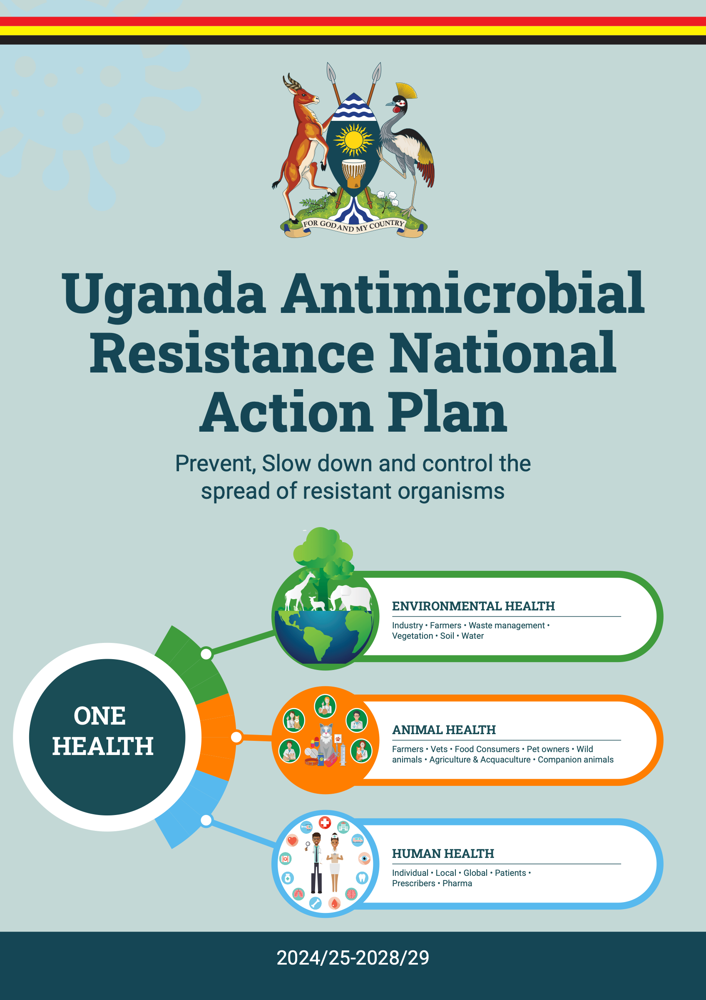
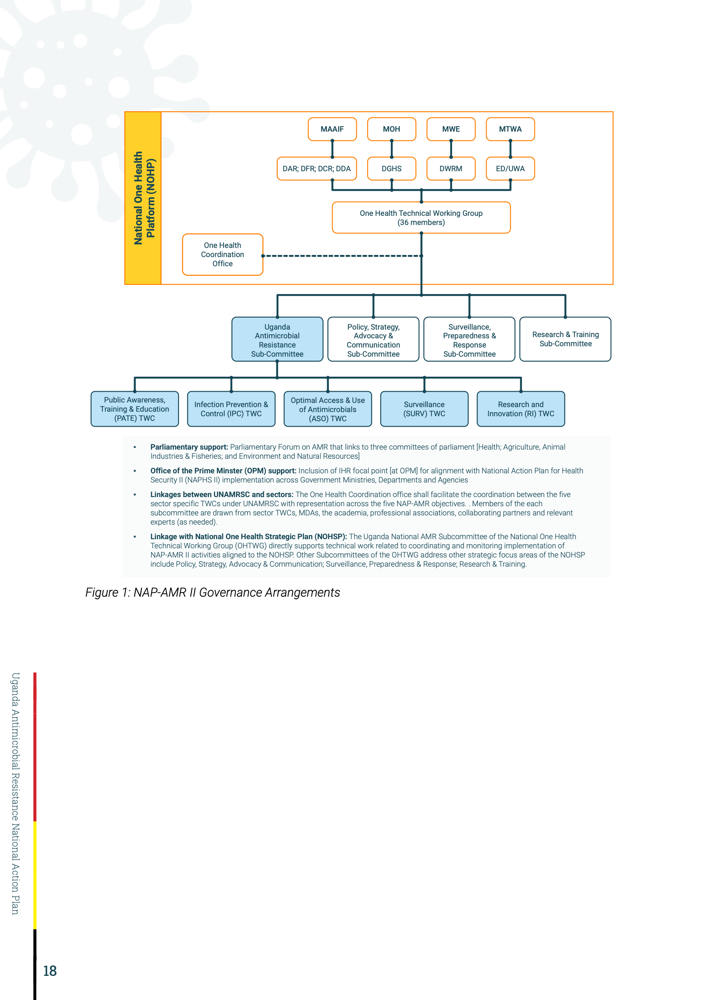
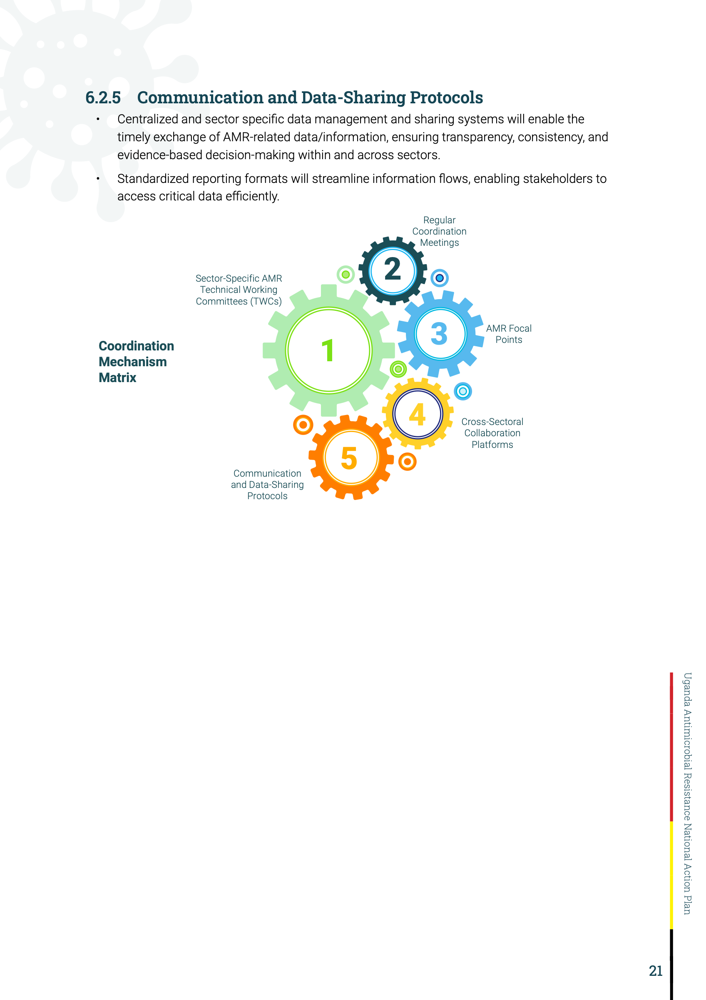
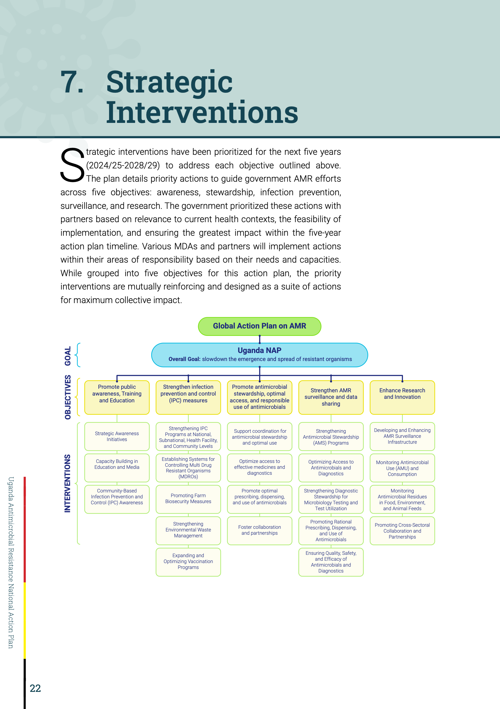
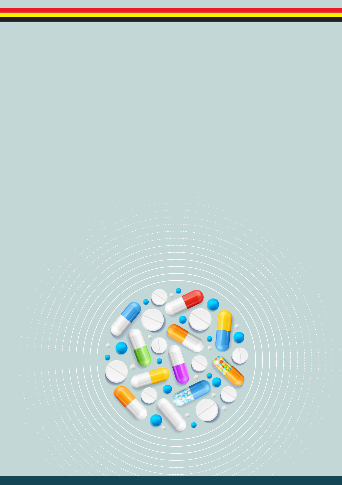

# Uganda Antimicrobial Resistance National Action Plan

**Plan period:** 2024/25–2028/29

**Theme:** Prevent, slow down and control the spread of resistant organisms

**Approach:** One Health

## Table of Contents

- [Acknowledgments](#acknowledgments)
- [Foreword](#foreword)
- [Acronyms](#acronyms)
- [Executive Summary](#executive-summary)
- [1. Introduction](#1-introduction)
  - [1.1 Background](#11-background)
  - [1.2 Drivers of AMR](#12-drivers-of-amr)
  - [1.3 AMR Diagnostics](#13-amr-diagnostics)
  - [1.4 AMR Burden in Uganda](#14-amr-burden-in-uganda)
  - [1.5 Progress towards AMR Containment (2018-2023)](#15-progress-towards-amr-containment-2018-2023)
  - [1.6 Review of NAP-AMR I (2018-2023)](#16-review-of-nap-amr-i-2018-2023)
- [2. Revision of the Plan](#2-revision-of-the-plan)
- [3. Principles of Approach of the NAP](#3-principles-of-approach-of-the-nap)
  - [3.1 Whole-of-Society Engagement and One Health Approach](#31-whole-of-society-engagement-and-one-health-approach)
  - [3.2 Prevention First](#32-prevention-first)
  - [3.3 Equitable Access to Effective Antimicrobials](#33-equitable-access-to-effective-antimicrobials)
  - [3.4 Sustainability](#34-sustainability)
  - [3.5 Incremental Targets and Measurable Progress](#35-incremental-targets-and-measurable-progress)
  - [3.6 Private Sector Involvement](#36-private-sector-involvement)
  - [3.7 Gender Equity](#37-gender-equity)
- [4. Goals and Strategic Objectives](#4-goals-and-strategic-objectives)
  - [4.1 Strategic Objectives](#41-strategic-objectives)
- [5. Governance](#5-governance)
  - [5.1 Core Functions](#51-core-functions)
  - [5.2 Governance Structure](#52-governance-structure)
  - [5.3 Inclusivity and Representation](#53-inclusivity-and-representation)
  - [5.4 Governance Arrangements](#54-governance-arrangements)
- [6. Coordination](#6-coordination)
  - [6.1 Objectives](#61-objectives)
  - [6.2 Core Coordination Mechanisms](#62-core-coordination-mechanisms)
  - [6.3 Coordination Mechanism Matrix](#63-coordination-mechanism-matrix)
- [7. Strategic Interventions](#7-strategic-interventions)
  - [Strategic Objective 1: Promote Public Awareness, Training, and Education](#strategic-objective-1-promote-public-awareness-training-and-education)
  - [Strategic Objective 2: Strengthen Infection Prevention and Control (IPC) Measures](#strategic-objective-2-strengthen-infection-prevention-and-control-ipc-measures)
  - [Strategic Objective 3: Promote Antimicrobial Stewardship, Optimal Access, and Responsible Use of Antimicrobials](#strategic-objective-3-promote-antimicrobial-stewardship-optimal-access-and-responsible-use-of-antimicrobials)
  - [Strategic Objective 4: Strengthen AMR Surveillance and Data Sharing](#strategic-objective-4-strengthen-amr-surveillance-and-data-sharing)
  - [Strategic Objective 5: Enhance Research and Innovation](#strategic-objective-5-enhance-research-and-innovation)
- [8. Implementation Framework](#8-implementation-framework)
  - [8.1 Phased Rollout Plan](#81-phased-rollout-plan)
  - [8.2 Stakeholder Roles in Implementation](#82-stakeholder-roles-in-implementation)
- [9. Cost and Financing of the Plan](#9-cost-and-financing-of-the-plan)
  - [9.1 Costed NAP-AMR II Strategic Objectives and Interventions](#91-costed-nap-amr-ii-strategic-objectives-and-interventions)
- [10. Monitoring, Evaluation, and Learning (MEL) Framework](#10-monitoring-evaluation-and-learning-mel-framework)
  - [10.1 Strategic Priorities of the MEL Function](#101-strategic-priorities-of-the-mel-function)
  - [10.2 Governance of the MEL Function](#102-governance-of-the-mel-function)
  - [10.3 MEL Indicators and Tracking Mechanisms](#103-mel-indicators-and-tracking-mechanisms)
  - [10.4 Embedding MEL in National Governance and Sustainability](#104-embedding-mel-in-national-governance-and-sustainability)
  - [10.5 Governance and Coordination Results Framework](#105-governance-and-coordination-results-framework)
  - [10.6 Results Framework: Strategic Objective 1: Promote Public Awareness, Training, and Education](#106-results-framework-strategic-objective-1-promote-public-awareness-training-and-education)
  - [10.7 Results Framework: Strategic Objective 2: Strengthen Infection Prevention and Control (IPC) Measures](#107-results-framework-strategic-objective-2-strengthen-infection-prevention-and-control-ipc-measures)
  - [10.8 Results Framework: Strategic Objective 3: Promote Antimicrobial Stewardship, Optimal Access, and Responsible Use of Antimicrobials](#108-results-framework-strategic-objective-3-promote-antimicrobial-stewardship-optimal-access-and-responsible-use-of-antimicrobials)
  - [10.9 Results Framework: Strategic Objective 4: Strengthen AMR Surveillance and Data Sharing](#109-results-framework-strategic-objective-4-strengthen-amr-surveillance-and-data-sharing)
  - [10.10 Results Framework: Strategic Objective 5: Enhance Research and Innovation](#1010-results-framework-strategic-objective-5-enhance-research-and-innovation)
- [11. References (2020–2024)](#11-references-20202024)
- [12. Annex 1: List of Contributors](#12-annex-1-list-of-contributors)

## Acknowledgments

The Government of Uganda (GoU) extends its sincere appreciation to the Fleming Fund through Baylor College of Medicine Children’s Foundation-Uganda and to the Food and Agriculture Organization (FAO) and World Health Organization (WHO) for their generous financial and technical support in revising Uganda’s National Action Plan on Antimicrobial Resistance (NAP-AMR 2024/25-2028/29). Their vital contributions enabled the update of the 2018-2023 plan and the development of the new NAP.

The GoU is especially grateful to Professor Denis K. Byarugaba of Makerere University, whose expertise was crucial in facilitating stakeholder consultations and overseeing the drafting, revision, and costing of the new NAP-AMR. The GoU also acknowledges the invaluable coordination provided by the One Health Coordination Office, led by Mr. Musa Sekamatte, the leadership of Dr. Henry Kajumbula, Chair of the Uganda National Antimicrobial Resistance Sub-Committee (UNAMSC) and the indispensable expertise from various technical teams and stakeholders who participated in the development and validation of the NAP-AMR II (Annex 1)

Special recognition is given to Ms. Carol Nyamor for her diligent efforts in compiling feedback from technical working committee members, stakeholders and NAP-AMR II development and validation workshops, ensuring that all elements were well-aligned, and to Mr. Isaac Musoke for his layout and design support, which contributed to the finalization of the NAP-AMR 2024/25-2028/29.

The GoU acknowledges all individuals and stakeholders who offered expertise and feedback during the document review (Annex 1). The dedication of UNAMSC members and the technical working groups, who meticulously examined each activity, was instrumental in shaping a comprehensive plan to address the threat of antimicrobial resistance. Their contributions were key to safeguarding public, animal, and environmental health and promoting sustainable development in Uganda and globally over the coming five years.

Lastly, the GoU recognizes the unwavering commitment of human, animal and environmental health professionals, researchers, and the general public to combating antimicrobial resistance. Together, we are building a healthier, more sustainable future for all.

**The Republic of Uganda**

- Ministry of Health
- Ministry of Agriculture, Animal Industry and Fisheries
- Ministry of Water and Environment

## Foreword

Antimicrobial resistance (AMR) is a critical global issue impacting human, animal, and environmental health, diminishing the effectiveness of treatments for infections caused by bacteria, parasites, viruses, and fungi. The effects of AMR extend beyond health to affect global security, healthcare systems, international trade, agriculture, and environmental integrity. Unchecked, AMR poses a significant threat to Uganda’s progress toward achieving the National Vision 2040 and United Nations Sustainable Development Goals (SDGs), particularly those related to health, food security, clean water, and sustainable ecosystems.

In 2018, the Government of Uganda launched the National Action Plan on Antimicrobial Resistance (NAP-AMR) for 2018–2023, aligning with international commitments and the One Health approach, which integrates human, animal, and environmental health responses. This collective effort brought together government ministries, departments, agencies (MDAs), and international organizations and partners to address AMR as a shared threat. Despite challenges, including the COVID-19 pandemic, Uganda made significant strides, such as establishing AMR awareness campaigns, initiating surveillance systems, and advancing antimicrobial stewardship and infection prevention across sectors.

While AMR cannot be fully eradicated, its spread can be effectively managed and slowed. In pursuit of Uganda Vision 2040, the Government of Uganda is committed to building on past achievements with the revised NAP-AMR 2024/25-2028/29 (NAP-AMR II), which aims to intensify our response to AMR threats. We call on all stakeholders to engage actively with this plan, coordinating their efforts to collectively prevent, detect, and respond to AMR risks. Through these unified actions, we safeguard the health and future of all Ugandans and enhance global health security.

**Hon. Dr. Jane Ruth Aceng Ocero**
Minister of Health

**Hon. Frank Tumwebaze**
Minister of Agriculture, Animal Industry, and Fisheries

**Hon. Cheptoris Sam Mangusho**
Minister of Water and Environment

## Acronyms

| Acronym | Full Form |
| --- | --- |
| AMR | Antimicrobial Resistance |
| AMS | Antimicrobial Stewardship |
| ASO | Antimicrobial Stewardship and Optimal Use |
| ASP | Antimicrobial Stewardship Programme |
| BS/S | Bio-safety/bio-security |
| CDC | The United States Centers for Disease Control and Prevention |
| CDDEP | Center for Disease Dynamics, Economics and Policy |
| CPHL | Central Public Health Laboratories |
| CQI | Continuous Quality Improvement |
| CSO | Civil Society Organization |
| DAR | Directorate of Animal Resources |
| DCR | Directorate of Crop Resources |
| DFR | Directorate of Fisheries Resources |
| DWRM | Directorate of Water Resources Management |
| ED | Executive Director |
| FAO | Food and Agriculture Organization |
| GAP | Global Action Plan |
| GARP | Global Antibiotic Resistance Partnership |
| GHSA | Global Health Security Agenda |
| GLASS | Global Antimicrobial Resistance Surveillance System |
| GoU | Government of Uganda |
| IDI | Infectious Diseases Institute |
| IEC | Information, Education, and Communication materials |
| IPC | Infection Prevention and Control |
| JEE | Joint External Evaluation |
| KPIs | Key Performance Indicators |
| LMICs | Low- and Middle-Income Countries |
| M&E | Monitoring and Evaluation |
| MAAIF | Ministry of Agriculture, Animal Industry and Fisheries |
| MDAs | Ministries, Departments and Agencies |
| MDR | Multi-drug resistant |
| MDR-TB | Multi-drug resistant Tuberculosis |
| MDROs | Multi Drug Resistant Organisms |
| MGLSD | Ministry of Gender Labour and Social Development |
| MoES | Ministry of Education and Sports |
| MOH | Ministry of Health |
| MoSTI | Ministry of Science, Technology, and Innovation |
| MTC | Medicines and Therapeutics Committee |
| MTWA | Ministry of Tourism, Wildlife and Antiquities |
| MWE | Ministry of Water and Environment |
| NAP | National Action Plan |
| NAPHS | National Action Plan for Health Security |
| NCL | Natural Chemotherapeutics Laboratories |
| NDPIV | National Development Plan 2025/26 – 2029/30 |
| NEMA | National Environment Management Authority |
| NGO | Non Governmental Organization |
| NWSC | National Water and Sewage Corporation |
| OHTWG | One Health Technical Working Group |
| OPM | Office of the Prime Minister |
| PATE | Public Awareness, Training, and Education |
| PSU | Pharmaceutical Society of Uganda |
| RI | Research and Innovations |
| SANAS | South African National Accreditation System |
| SDGs | Sustainable Development Goals |
| SMTs | Strategic Management Teams |
| SURV | Surveillance |
| TWC | Technical Working Group |
| UNAMRSC | Uganda National Antimicrobial Resistance Sub-Committee |
| UNAS | Uganda National Academy of Sciences |
| UNBS | Uganda National Bureau of Standards |
| UNCST | Uganda National Council for Science and Technology |
| UNGA | United Nations General Assembly |
| UPDF | Uganda People’s Defense Force |
| UPF | Uganda Police Force |
| URSB | Uganda Registration Services Bureau |
| UWA | Uganda Wildlife Authority |
| WASH | Water, Sanitation, and Hygiene |
| WHA | World Health Assembly |
| WHO | World Health Organization |
| WOAH | World Organization for Animal Health |
| XDR-TB | Extensively Drug-Resistant Tuberculosis |

## Executive Summary

Antimicrobial resistance (AMR) is a significant global threat to public health, economic stability, and sustainable development. It requires urgent and coordinated action to mitigate its impact. Resource limitations pose major challenges for low- and middle-income countries (LMICs), including Uganda, in addressing AMR. These limitations affect access to quality healthcare services, socioeconomic equity, awareness, surveillance systems, data collection, regulatory frameworks, quality control, healthcare infrastructure, and infection prevention practices. AMR is integral to human, animal, and environmental health, demanding a comprehensive and integrated response. Interventions such as promoting responsible antimicrobial use, enhancing surveillance, ensuring the quality of antimicrobial drugs, and fostering global collaboration are critical and needed more than ever.

The revised NAP-AMR 2024/25-2028/29 builds upon the significant progress made in the first NAP-AMR of 2018–2023 and seeks to strengthen those gains further and prioritize interventions for the next five years. The NAP-AMR II outlines the process of its development, discusses the implementation arrangements under which strategies will be implemented, and provides the interventions and a budget developed using the WHO AMR Costing and Budgeting Tool. AMR remains a One Health challenge, and the plan’s implementation will continue to be anchored under the One Health platform, bringing together relevant stakeholders to act in harmony. The NAP-AMR 2024–2028 will be aligned with global action plans, focusing on the following strategic objectives:

1.  Promote Public Awareness, Training, and Education

2.  Improve Infection Prevention and Control (IPC) measures

3.  Promote Antimicrobial Stewardship, Optimal Access, and responsible Use of Antimicrobials

4.  Strengthen AMR surveillance and data sharing

5.  Enhance Research and Innovation

The National One Health Platform (NoHP) through the Uganda National Antimicrobial Resistance Sub Committee (UNAMRSC) will continue to coordinate and oversee the implementation of this plan. The committee will also monitor the progress of the interventions and their impacts. While successful implementation relies heavily on the government’s commitment, the private sector, civil society organizations, and the public are expected to significantly support government efforts and implement some of the proposed interventions.

Uganda can effectively combat AMR, protect public health, promote sustainable development, and secure a healthier future for all by working

## 1. Introduction

### 1.1 Background

Antimicrobial resistance (AMR) is a growing global threat that hinders the effective management of infectious diseases. AMR occurs when bacteria, parasites, viruses and fungi change over time and no longer respond to medicines making infections harder to prevent and treat, increasing the risk of disease spread, severe illness and death. Many low- and middle-income countries (LMICs) face significant challenges in combating AMR, including a high burden of infectious diseases, poverty, weak health systems, and low awareness. The use of antimicrobials in humans, plants and animals all contribute to the environmental load of antimicrobial resistant bacteria, genes, residues and their metabolites

The impact of AMR is not evenly distributed across populations. Women, children, and marginalized groups are disproportionately affected. They face greater challenges due to a complex interplay of social and biological factors, including wealth, education, occupation, race, ethnicity, disability, and age. These intersecting disparities, rooted in gender and equity, limit their access to healthcare, increase their economic hardships, and exacerbate their vulnerability to the effects of AMR. Global efforts to address AMR must consider these unique challenges.

Furthermore, humans and animals share habitats and several infectious diseases. Some of these diseases may have originated in animals and later evolved to infect humans. AMR has increased with the growing global population and increased antimicrobial use. This has exerted selection pressure on microbes, resulting in larger populations of antimicrobial-resistant strains of pathogenic organisms.

### 1.2 Drivers of AMR

**Healthcare Practices:** Poor antimicrobial stewardship practices contribute significantly to the AMR crisis. This includes inappropriate prescribing, such as using antibiotics for viral infections or providing inadequate dosage or treatment duration. Additionally, limited access to appropriate antimicrobials can lead to the use of less effective or broader-spectrum options, further driving resistance.

**Patient Behavior:** Patient behavior also plays a role in the AMR crisis. Driven by the desire for quick and affordable treatment, patients often demand antibiotics even when unnecessary, avoiding essential investigations. This pressure on healthcare providers can lead to inappropriate prescribing and contribute to the development of resistance.

**Pharmaceutical Industry Practices:** The pharmaceutical industry’s practices considerably influence the AMR landscape. The decline in new antibiotic development has created a shortage and increased the cost of existing ones, limiting access, particularly in LMICs. Moreover, pharmaceutical companies often incentivize healthcare providers to prescribe specific antimicrobials, escalating both use and cost. This practice can lead to over-prescription and contribute to resistance. Additionally, many LMICs lack access to affordable vaccines that could help prevent infections and reduce the need for antibiotics, hindering efforts to curb AMR.

**Public Health Infrastructure:** Inadequate public health infrastructure, including limited access to clean water, sanitation, and hygiene (WASH) facilities, further contributes to the spread of infections. Lack of suitable diagnostics can hinder accurate and timely diagnosis, leading to inappropriate antimicrobial use. Additionally, poor infection prevention and control practices in healthcare settings and communities contribute to the spread of resistant organisms. Finally, the release of effluents containing antibiotic residues from hospitals and the pharmaceutical industry can contaminate the environment and promote the development of AMR.

**Non-human use of antimicrobials:** misuse and overuse of antimicrobial agents in animals, especially in food-producing animals has consequences for both human and animal health as it can result in the development of resistant bacteria. These resistant bacteria (with resistance genes) in animals can be transferred to humans through the consumption of food or through direct contact with food-producing animals or through environmental spread.

### 1.3 AMR Diagnostics

Accurate detection of antimicrobial resistance (AMR) depends on adequate laboratory capacity. However, the current state of diagnostic capability needs further enhancement. Investments in laboratory infrastructure improvements, equipment management, supply chain reliability for reagents and consumables, specimen/isolate transport and storage, data management, quality assurance and data management are critical in the detection of AMR.

Conventional methods for AMR diagnostics and Antimicrobial Susceptibility Testing (AST) are often tedious, expensive, and have long turnaround times and are not widely accessible. This leads to empirical antimicrobial therapies, contributing to AMR spread, higher mortality rates, and increased healthcare costs. While new time-saving technologies are available, classic methods like culture-based are the most commonly used. Several commercial automated methodologies, such as VITEK 2 compact system (bioMérieux, France) and BD Phoenix (Becton Dickinson), are on the market. More recently, microscopy-based and spectrometry-based approaches, including sequencing, Matrix Assisted Laser Desorption/ Ionization Time-of-Flight Mass Spectrometry (MALDI-TOF MS), and Fourier Transform Infrared (FTIR) spectroscopy, have been incorporated into AMR diagnostics.

Promising point-of-care (POC) tools for AMR diagnostics and phenotypic AST have been developed with faster turnaround times and the ability to detect and quantify bacterial concentrations. However, these tools are not yet readily accessible.

Reliable, sensitive, and affordable diagnostics are crucial to combat AMR. Rapid diagnostic technologies could significantly enhance targeted treatment, especially in primary care settings. Furthermore, advanced monitoring systems, like mobile applications and surveillance programs, are essential for tracking antimicrobial consumption. Emerging approaches, such as machine learning and data mining combined with automation, will play a key role in the next generation of diagnostics. These advancements and improved surveillance programs will be vital in minimizing the detrimental effects of AMR.

### 1.4 AMR Burden in Uganda

Antimicrobial resistance (AMR) places a significant and growing burden on Uganda’s health, economy, and society. Infections caused by drug-resistant bacteria lead to increased morbidity and mortality, limiting treatment options and forcing reliance on more expensive, less accessible drugs. The health system faces escalating challenges, with prolonged illnesses, higher risks of complications, and a growing prevalence of healthcare-associated infections.

Recent data (2020–2023) highlights high resistance levels among ESKAPE pathogens (Enterococcus faecium, Staphylococcus aureus, Klebsiella pneumoniae, Acinetobacter baumannii, Pseudomonas aeruginosa, and Enterobacter species), with resistance to commonly used antibiotics such as penicillins and cotrimoxazole exceeding 80% in some cases (Byarugaba et al., 2023). Methicillin-resistant Staphylococcus aureus (MRSA) prevalence ranges from 2% to 50%, while extended-spectrum beta-lactamase (ESBL)- producing gram-negative bacteria are present in 10% to 75% of analyzed isolates (Ackers-Johnson et al., 2021). Resistance to carbapenems, a last-line treatment, ranges from 4% to 30%, severely restricting treatment options (Tuhamize et al., 2023; Lubwama et al., 2024). These figures indicate the emergence of resistance and significant challenges in managing infections effectively.

The economic burden of AMR in Uganda is profound. Resistant infections lead to prolonged hospital stays, additional diagnostic procedures, and costly second-line treatments, straining already limited healthcare resources. The financial burden disproportionately affects low-income households, where accessing advanced treatment options is often impossible. Furthermore, productivity loss due to prolonged illness or premature death negatively impacts Uganda’s economic growth, particularly in the agricultural and informal sectors where daily productivity is critical (Muleme et al., 2023).

Socially, AMR exacerbates inequalities and disproportionately affects vulnerable populations, including children, women, and immunocompromised individuals. In rural and underserved areas, limited access to healthcare and sanitation increases exposure to resistant pathogens. Additionally, the potential for AMR-related outbreaks erodes public trust in healthcare systems, reducing the likelihood of timely healthcare-seeking behaviors and further compounding health inequities.

Health of humans, animals, plants and the environment is inextricably linked and actions against AMR requires a One Health approach to address drivers at the animal-human-environment interface. Uganda faces challenges with AMR in animals as well, although data remains limited. Studies report resistance rates of 30-60% in common pathogens (e.g., E. coli, Salmonella) isolated from livestock against tetracyclines, sulfonamides, and beta-lactams (Odoch, T. et al., 2021). Various reports document mastitis-causing multi-drug resistant (MDR) Staphylococci bacterial species in dairy, causing reduced milk yield, increased health management costs and making milk less suitable

Residues of beta-lactam and tetracycline residues have been detected in beef, while sulfonamide residues have been found in eggs. These residues not only threaten international trade but also contribute to the development of AMR, as well as potentially causing allergic reactions and even cancers in humans (Ahmad, I. et al., 2021). Additionally, antimicrobial resistance (AMR) is also significantly linked to water pollution, with the presence of antibiotic-resistant bacteria found in various water sources, primarily due to poor wastewater management, improper disposal of human and animal waste, and overuse of antibiotics, which contributes to the spread of resistant microbes within the environment and potential health risks for the population. Moreover, AMR can spread between wildlife and domestic animals through water, soil, and arthropod vectors. In essence wildlife can act as reservoirs and spreaders of AMR, which can pose risks to other animals and humans.

The burden of AMR in Uganda extends beyond its immediate health impacts to threaten the sustainability of its healthcare systems and broader economic and social stability. Addressing this crisis requires urgent multisectoral investments in strengthening surveillance, improving antimicrobial stewardship, and increasing public awareness. These interventions must be inclusive and context-specific, ensuring that Uganda’s most vulnerable populations are not left behind in the fight against AMR.

### 1.5 Progress towards AMR Containment (2018-2023)

Uganda has progressed in addressing AMR through guidelines and policies aligned with international strategies along the different strategic objectives in NAP-AMR-I (2018-2023). This was achieved through multisectoral coordination of AMR containment measure by the Uganda National AMR Sub-Committee (UNMRSC) under the National One Health Platform (NOHP). Regarding infection prevention and control, Uganda has National Infection Prevention and Control Guidelines (last updated in 2013) implemented across the country, with Infection Prevention and Control Committees established in most tertiary healthcare facilities. However, these committees need further strengthening, including infrastructure, supplies, and regular performance monitoring.

The National Drug Authority (NDA) is primarily responsible for ensuring optimal access to and use of antimicrobials in the public and private sectors. The NDA’s mandate, enshrined in the National Drug Policy and Act, is supported by several guidelines, including the National Treatment and Clinical Guidelines, which guide antimicrobial use for treating infectious diseases. To monitor AMR and the effectiveness of these documents, a Supervision Performance Assessment and Recognition Strategy (SPARS) is being implemented at the district level to assess adherence to these guidelines in human health facilities.

Surveillance of antimicrobial resistance is generally increasing in Uganda. According to the 2017 Joint External Evaluation (JEE), 25 human health facilities regularly perform Antimicrobial Susceptibility Testing (AST), and monthly reports on AMR are provided to the National Animal Disease Diagnostic and Epidemiology Center (NADDEC). Additionally, a Technical Working Group on AMR Surveillance developed a National Antimicrobial Resistance Surveillance Plan.

Research and innovation on AMR are growing priorities in Uganda, with opportunities for further improvement. Establishing the Ministry of Science, Technology, and Innovation (MoSTI) signals government interest in supporting research in areas including AMR. Several strong research institutions, such as the National Chemotherapeutics Laboratories, higher education institutions, and research organizations, continued to undertake AMR research, providing evidence to inform interventions.

### 1.6 Review of NAP-AMR I (2018-2023)

After five years of implementation, several reviews were conducted to assess the NAP-AMR’s performance, including the GoU review, the JEE review, and the FAO Performance of Veterinary Services (PVS) Pathway review. These reviews evaluated progress in funding and implementation, identified key barriers to implementation, and highlighted opportunities. Despite receiving less than optimal funding (<20%), the NAP-AMR I (2018-2023) achieved significant milestones, as reported by the 2023 JEE report including:

- A One Health governance framework with various technical working groups established.

- Development of guidelines and plans for infection prevention and control (IPC) implementation, antimicrobial use, and surveillance in human and animal health sectors.

- Designation of reference laboratories, including the National Microbiology Reference Laboratory at Butabika (accredited by the South African National Accreditation System [SANAS]) for the health sector and NADDEC for animal health.

- Participation and regular data sharing in the WHO Global Antimicrobial Resistance Surveillance System (GLASS).

- Establishment of subnational microbiology surveillance laboratories across the country in both human and animal health sectors.

- National awareness campaigns, including regular national AMR conferences and participation in World Antimicrobial Awareness Week. (WAAW)

Despite these achievements, limitations needing attention include:

- Funding constraints

- Weak coordination of NAP-AMR implementation and dissemination of findings across sectors.

- Unclear key performance indicators (KPIs) and lack of integration of KPIs at the national level, hindering effective monitoring.

- Unclear budget allocation for NAP-AMR I (2018-2023) operations in the sector policy statements.

- Limited data utilization and feedback to local users. Data for GLASS was collected, but not locally shared.

## 2. Revision of the Plan

Following the implementation and review of Uganda’s first NAP-AMR (2018-2023), a second NAP-AMR (2024/25-2028/29), also known as NAP-AMR II, was developed. The revision process emphasized integration of gender and equity as a guiding principle, ensuring that activities address the diverse needs of all populations, including marginalized and vulnerable groups. Stakeholder consultations, coordinated by the National Antimicrobial Resistance Sub-Committee with support from FAO Uganda and the UK Fleming Fund Phase II Country Grant II Project, were conducted in six phases:

1.  Stakeholder mapping and consultative workshops to review NAP-AMR I (2018-2023) implementation progress (situation analysis) and provide input for NAP-AMR II.

2.  Drafting of NAP-AMR II

3.  Training on the WHO Costing and Budgeting tool for rational budgeting and costing of activities.

4.  Costing of NAP-AMR activities using the WHO tool.

5.  Presentations and consultations with Directors from the Ministries of Health, Water and Environment, Agriculture, Animal Industry and Fisheries, and One Health Platform members.

6.  Review of the plan and input from the UNAMRSC.

7.  Validation workshop with all key stakeholders.

These workshops brought together stakeholders from various sectors, MDAs, and subject matter experts across human, animal, and environmental health, including UNAMRSC members, AMR Technical Working Group Committee members, and key stakeholders involved in AMR containment in Uganda. Participants discussed NAP-AMR I implementation progress, lessons learned, and generated strategies and activities for NAP-AMR II, costing them according to six strategic interventions. They also cost NAP-AMR II activities using the WHO AMR Costing and Budgeting Tool.

Through breakout and plenary sessions, stakeholders reviewed NAP-AMR I implementation and deliberated on prioritizing NAP-AMR II activities. Consensus was built on prioritizing activities across sectors (human, animal, and environmental health) for all NAP-AMR II objectives and strategic interventions. Prioritized timelines for NAP-AMR II activities, indicating completion timing, were based on sector-specific capacities and resources.

## 3. Principles of Approach of the NAP

The NAP-AMR II is guided by principles aligned with international standards and recommendations from the World Health Organization (WHO), the World Organization for Animal Health (WOAH), and the Food and Agriculture Organization (FAO). These principles establish a foundation for a robust, sustainable, and inclusive response to AMR in Uganda.

### 3.1 Whole-of-Society Engagement and One Health Approach

Containing AMR requires a One Health approach, emphasizing “the collaborative effort of multiple disciplines working locally, nationally, and globally to attain optimal health for people, animals, and our environment.” This principle recognizes the interconnectedness of human, animal, and environmental health. Implementing the NAP-AMR II involves mobilizing all sectors of society—government agencies, healthcare providers, veterinarians, environmental experts, academia, industry, and the public— fostering a shared responsibility that maximizes the impact of interventions across sectors.

### 3.2 Prevention First

Preventing infections is the most effective and economical approach to reducing the need for antimicrobials and curbing the spread of resistance. Emphasizing prevention requires robust infection prevention and control (IPC) measures and targeted health promotion and disease prevention efforts across human, animal, and environmental sectors. Effective IPC practices help preserve the efficacy of antimicrobials and contribute to the broader public health goal of minimizing infections, thereby decreasing the demand for antimicrobial treatments. Prevention strategies must be inclusive, benefiting men, women, individuals of all gender identities, marginalized communities, and people with disabilities.

### 3.3 Equitable Access to Effective Antimicrobials

Ensuring equitable access to effective antimicrobials is essential to prevent resistance from becoming entrenched in underserved communities. This principle extends beyond availability, promoting optimal antimicrobial use and rational prescribing practices. Achieving equity in access requires strengthening healthcare infrastructure, expanding access to trained professionals, providing diagnostic tools, and ensuring the availability of accurate health information— especially in rural and underserved areas where access barriers are often greatest.

### 3.4 Sustainability

Achieving long-term AMR containment requires sustained, inclusive efforts supported by strong national commitment and international collaboration. Embedding AMR interventions into routine practices across sectors ensures continuity and integrates these efforts into daily operations. Dedicated governance structures and a comprehensive sustainability plan—emphasizing national leadership and global partnerships—will strengthen sustainability and secure vital financial and technical resources. Political commitment and international collaboration are essential, focusing on sharing gender-responsive best practices, building capacity, and mobilizing resources to support these interventions effectively.

### 3.5 Incremental Targets and Measurable Progress

The NAP-AMR II adopts a phased approach with immediate, medium-term, and long-term targets to reach AMR containment goals effectively. Incremental targets allow Uganda to track measurable progress and adjust interventions according to resource availability. This approach facilitates ongoing monitoring and evaluation, identifying successes and areas for improvement while fostering accountability and commitment to sustainable AMR containment.

### 3.6 Private Sector Involvement

The private sector is a critical partner in AMR containment. Engaging private entities across interventions brings innovation, resources, and expertise to AMR efforts. The private sector contributes to surveillance data, policy development, resource mobilization, antimicrobial alternatives, and advancements in stewardship practices. This collaboration broadens the reach and enhances the effectiveness of AMR containment strategies.

### 3.7 Gender Equity

AMR containment efforts must consider the gender-related risks and vulnerabilities in implementing all interventions under each strategic objective. The NAP-AMR II integrates gender equality and equity principles to ensure that interventions are inclusive and meet the needs of marginalized and vulnerable populations. This approach promotes fair access to resources, recognizes the varied impacts of AMR across gender and social groups, and ensures that AMR initiatives do not unintentionally exacerbate existing inequalities.

## 4. Goals and Strategic Objectives

NAP-AMR II aims to slow the emergence and spread of resistant organisms while ensuring the availability of safe, effective, efficacious, and quality-assured antimicrobials and their optimal use. This will be achieved through collaborative action between partners in human health, agriculture, the food industry, the environment, teaching and research institutions, civil societies and associations, the pharmaceutical industry, and global stakeholders to synergize efforts and resources. This action plan is consistent with the guiding principles and strategic objectives of relevant global action plans and is part of the overall National Action Plan for Health Security (NAPHS) II. The NAP-AMR II is aligned to the long-term national development goals and objectives as spelt out in the Vision 2040, National Development Plan 2025/26 – 2029/30 (NDPIV) and Sustainable Development Goals (SDGs). A One Health approach will be adopted across all relevant sectors to implement actions and leverage synergies to combat AMR effectively.

**Vision:** A society where infectious diseases can be treated effectively with antimicrobial agents.

**Goal:** To slow down the emergence and spread of resistant organisms and maintain the efficacy of antimicrobials to treat infectious diseases effectively.

### 4.1 Strategic Objectives

The plan maintains strategic interventions with a multi-sectoral approach comprising effective communication, coordination, and collaboration between different sectors, Ministries, Departments, and Agencies, locally and globally. The plan leverages the strengths of the public, private, civil society, academia, and research partners. It also focuses on strengthening national systems by utilizing existing structures and avoiding the creation of new parallel institutions for implementation. The following strategic objectives are proposed to address the AMR challenge:

1.  To promote public awareness and understanding of antimicrobial use, resistance prevention, and containment through effective communication and training.

2.  To improve infection prevention and containment of resistant microorganisms in human healthcare, the community, and animal health through individual and environmental sanitation, hygiene, infection prevention, and biosecurity measures.

3.  To optimize the use of antimicrobial drugs in human and animal healthcare settings through effective stewardship practices.

4.  To strengthen the knowledge and evidence base of antimicrobial use and antimicrobial resistance through One Health surveillance to inform policy.

5.  To invest in research and innovations to inform policy and implementation science.

## 5. Governance

### 5.1 Core Functions

The governance framework performs five key functions:

**Strategic Oversight:** Defines AMR objectives aligned with national and international priorities.

**Policy Direction:** Develops and harmonizes legal frameworks, policies, and guidelines.

**Accountability:** Establishes monitoring, evaluation, and reporting systems for AMR interventions.

**Resource Mobilization:** Advocates for sustained financial, political, and technical support.

**Collaboration:** Facilitates multisectoral partnerships under the One Health framework.

### 5.2 Governance Structure

The governance structure (illustrated in Figure 1) consists of the following key entities:

- **National One Health Platform (NOHP):** Oversees high-level coordination among sectors, ensuring AMR strategies align with global standards and national priorities.

- **Uganda National Antimicrobial Resistance Subcommittee (UNAMRSC):** Operates under the One Health Technical Working Group (OHTWG), coordinating multisectoral efforts for NAP-AMR II implementation. Leadership rotates annually among the Ministry of Health (MOH), Ministry of Agriculture, Animal Industry and Fisheries (MAAIF), Ministry of Water and Environment (MWE), and Uganda Wildlife Authority (UWA).

- **Specialized Technical Working Committees (TWCs):** These committees provide expert guidance to ensure AMR interventions are evidence-based. Their focus areas include:

  - **Public Awareness, Training, and Education (PATEac) TWC:** Enhancing public understanding and promoting behavior change.

  - **Infection Prevention and Control (IPC) TWC:** Strengthening infection control measures in healthcare and community settings.

  - **Optimal Access and Use of Antimicrobials (ASO) TWC:** Promoting responsible antimicrobial use and ensuring equitable access.

  - **Surveillance (SURV) TWC:** Strengthening AMR data collection, analysis, and reporting systems.

  - **Research and Innovation (RI) TWC:** Identifying research gaps, setting priorities, and fostering innovation.

- **Parliamentary Oversight Committee:** Ensures AMR policies align with national goals, cultivate visibility of AMR issues at policy level, advocates for resource allocation, implementation and monitors governance performance.

- **Strategic Management Teams (SMTs):** Provide sector-specific insights, governance and strategic leadership, linking operational realities with high-level governance.

Consistent with the NOHP rotational Chair arrangement, the Chair of the UNAMRSC will alternate between the technical departmental heads/commissioners of respective line ministries (MAAIF, MOH, MWE and UWA under the Ministry of Wildlife, Tourism and Antiquities on a annual basis. The alternating Chairs/delegated technical leads of UNAMRSC will have overall oversight for the implementation of the NAP-AMR II. Technical work related to coordinating implementation and monitoring of NAP-AMR II activities will be conducted through the five Subcommittees of the UNAMRSC as depicted in Figure 1. Administrative and secretarial work relating to NAP-AMR II coordination and monitoring will be led by the One Health Coordination office. Sector specific AMR TWC will include experts and collaborating partners across the five NAP-AMR objectives

### 5.3 Inclusivity and Representation

The governance framework ensures diverse stakeholder engagement, including:

#### 5.3.1 Stakeholders and Roles in AMR Governance

| Stakeholder Category | Entities (Examples) | Role in AMR Governance |
| --- | --- | --- |
| Government Ministries, Departments & Agencies | MOH, MAAIF, MWE, UWA, Ministry of Gender, Labour & Social Development (MGLSD), NDA, and NEMA | Lead sectoral contributions, policy direction, and mainstream gender & equity in AMR response. Regulatory Agencies provide regulatory oversight & technical expertise in antimicrobial use and environmental impact. |
| Research & Academic Institutions | UNHRO, NARO, Universities, UNAS | Generate scientific evidence for AMR policy, integrate AMR topics in curricula, and train professionals. |
| Private Sector | Pharmaceutical companies, Healthcare providers, Agribusinesses | Promote responsible antimicrobial use, support AMR innovation, and contribute to surveillance. |
| Civil Society & Community-Based Organizations | National & local NGOs, VHCs, Community Leaders | Raise awareness, advocate for responsible AMR use, and mobilize communities. |
| Development & Implementing Partners | WHO, FAO, WOAH, USAID, US CDC, Fleming Fund and their respective implementing partners | Provide funding, technical assistance, and align Uganda’s AMR response with national and global priorities. |
| Professional Organizations | Uganda Medical & Dental Council, Veterinary Board, Pharmacy Council | Set professional standards and ethical guidelines for AMR containment. |

### 5.4 Governance Arrangements

*Figure 1: NAP-AMR II Governance Arrangements*

## 6. Coordination

The Coordination function complements governance by operationalizing the priorities and policies set under the NAP-AMR II. While governance focuses on leadership, oversight, and accountability, coordination ensures that these directives are implemented effectively through structured mechanisms that promote collaboration, integration, and real-time decision-making across all sectors.

Coordination is central to implementing the One Health approach to AMR containment. It fosters cross-sectoral collaboration, enables synchronized responses, and effectively implements national AMR strategies.

### 6.1 Objectives

The coordination mechanisms aim to:

- Facilitate cross-sector collaboration across human, animal, environmental, and wildlife health sectors under the One Health approach.

- Establish communication systems and shared data platforms for timely and evidence-based decision-making.

- Harmonize monitoring and evaluation processes to track progress and ensure accountability.

- Align national AMR strategies with global standards while fostering regional and international partnerships.

### 6.2 Core Coordination Mechanisms

#### 6.2.1 Sector-Specific AMR Technical Working Committees (TWCs)

- Each line ministry—MOH, MAAIF, MWE, MTWA (through UWA) and collaborating MDA’s —will establish TWCs to develop and implement sector-specific AMR operational plans, aligned to all the NAP-AMR II strategic objectives.

- The TWCs will align operational plans with NAP-AMR II objectives and collaborate with the Uganda National Antimicrobial Resistance Subcommittee (UNAMRSC), development and implementing partners to harmonize actions with national priorities and avoid duplication.

- They will focus on achieving outcomes in areas such as infection prevention, antimicrobial stewardship, surveillance, research, and public awareness.

#### 6.2.2 Regular Coordination Meetings

- Monthly Technical Review Meetings: Convened by sectoral teams to address operational challenges, review progress, and refine strategies.

- Quarterly AMR Multisectoral Meetings to review plans, progress, share lessons learned and address challenges:

  - At the national level, the National One Health Platform (NOHP) through the One Health Coordination office will convene quarterly UNAMRSC and its TWC meetings, bringing together stakeholders to review AMR and AMU/C trends, ensure alignment and monitor implementation across sectors, resolve cross-sectoral issues, and foster collaborative problem-solving.

  - At the subnational level, designated regional AMR focal persons will work closely with district and facility AMR focal persons to convene quarterly regional TWCs to review regional AMR and AMU/C trends, ensure alignment and monitor regional implementation, resolve regional issues, and foster collaborative problem-solving at regional level

  - At the facility level, designated facility AMR focal persons will work closely with facility leadership to convene quarterly facility AMR TWCs to review facility AMR and AMU/C trends, ensure alignment and monitor facility implementation, resolve facility issues, and foster collaborative problem-solving at facility level

  - At the community level, designated subcounty AMR focal persons will work closely with subcounty leadership to convene quarterly subcounty AMR TWCs to review community AMR and AMU/C trends, ensure alignment and monitor community implementation, resolve community issues, and foster collaborative problem-solving at community level

#### 6.2.3 AMR Focal Points

- Each line Ministry, department and agency will designate AMR Focal Points, who will:

  - Coordinate AMR activities within their sectors.
  - Report progress, challenges, and updates to the UNAMRSC.
  - Facilitate the collection and integration of surveillance data into national monitoring frameworks.

These Focal Points are the critical link between governance structures and sectoral implementation teams, ensuring consistency in achieving the plan’s objectives.

#### 6.2.4 Cross-Sectoral Collaboration Platforms

- Joint planning sessions, intersectoral workshops, integrated implementation of activities including training, mentorship and surveillance programs will foster harmonization and promote knowledge, data and resource-sharing within and across sectors.

- These platforms will support the integration of innovative approaches and strengthen stakeholder engagement to improve AMR responses.

### 6.3 Coordination Mechanism Matrix

## 7. Strategic Interventions

### Strategic Objective 1: Promote Public Awareness, Training, and Education

The goal of Strategic Objective 1 is to increase awareness and understanding of antimicrobial resistance (AMR) among the public, healthcare professionals, and policymakers, addressing the root cause of AMR’s persistence as a public health threat. To achieve this, the objective focuses on bridging the knowledge gap through comprehensive risk communication and community engagement initiatives grounded in behavioral science and social and behavior change (SBC) approaches. By fostering lasting behavior changes, this objective aims to reduce antimicrobial misuse and slow the spread of AMR. Emphasizing a community-centered approach, it seeks to empower individuals to actively prevent AMR across human, animal, and environmental health sectors. The following priority strategies and actions are proposed:

#### Strategic Intervention 1.1 Improve Public Awareness

| Activity | Action |
| ---: | --- |
|    1.1.1 | Update and improve functionality of the national coordination PATE TWC, ensuring inclusiveness and representation |
|    1.1.2 | Establish and implement a communication strategy to increase awareness, ensuring that messages are culturally appropriate and accessible to diverse groups, including those with disability, the marginalized and vulnerable |
|    1.1.3 | Promote the institutionalization of NAP-AMR II priorities and strategies in MDAs including integration in MDA plans, national risk register and any other related frameworks to ensure its visibility |
|    1.1.4 | Create AMR awareness among stakeholders (health professionals, decision makers, opinion leaders, NGOs, CSOs, the media, private sector players, and other stakeholders) |
|    1.1.5 | Establish multisectoral mechanisms to coordinate AMR communication and public awareness across all relevant sectors |
|    1.1.6 | Develop and disseminate tailored AMR information, education, and communication (IEC) materials and tools suitable for diverse |
|    1.1.7 | Develop and disseminate AMR IEC materials and tools suitable for diverse stakeholders |
|    1.1.8 | Conduct regular public awareness campaigns on AMR and antimicrobial use, targeting behavior change |
|    1.1.9 | Partner with NGOs, civil society organizations, and other stakeholders to enhance outreach and amplify AMR messaging. |
|   1.1.10 | Define and engage vulnerable groups on AMR issues to promote inclusive awareness. |
|   1.1.11 | Disseminate relevant AMR research findings promptly to the public for awareness, including aspects of differential impact of AMR in diverse populations. |
|   1.1.12 | Engage key decision-makers at different levels to discuss AMR data, promoting data-driven policy actions. |
|   1.1.13 | Engage vulnerable groups and establish advocacy networks to enhance awareness on AMR at the national, subnational and community level |

#### Strategic Intervention 1.2 Enhance Education and Training of Human, Animal and Environment Professionals

| Activity | Action |
| ---: | --- |
|    1.2.1 | Integrate AMR topics into curricula for primary, secondary, university, and in-service training for professionals in human, animal, plant, and environmental health sectors, ensuring the curriculum includes content on the differential impact of AMR across diverse population groups |
|    1.2.2 | Train media professionals on accurate and effective reporting of AMR and its impact on various/diverse groups to support informed discourse. |

#### Strategic Intervention 1.3 Promote Awareness on Infection Prevention and Control (IPC) Practices in Communities

| Activity | Action |
| ---: | --- |
|    1.3.1 | Develop/update/adopt and disseminate IPC IEC materials for AMR containment ensuring that messages are culturally appropriate and accessible to diverse groups, including those with disability, the marginalized and vulnerable |
|    1.3.2 | Adapt, disseminate and implement social and behavior change (SBC) tools specific to IPC practices to support awareness in various community settings, including schools and public places |
|    1.3.3 | Collaborate with local leaders and influencers to champion IPC practices and encourage community-led AMR prevention initiatives |
|    1.3.4 | Facilitate community dialogues and training to raise awareness of IPC practices, focusing on hygiene, sanitation, and responsible antimicrobial use in daily activities, ensuring inclusivity and representation of divers groups |

### Strategic Objective 2: Strengthen Infection Prevention and Control (IPC) Measures

Effectively combating antimicrobial resistance (AMR) in Uganda requires a comprehensive infection prevention and control (IPC) strategy across all sectors. This strategy prioritizes personal and environmental hygiene and implements robust biosecurity measures across the entire value chain, from farms to food production to plate. The following interventions are proposed:

#### Strategic Intervention 2.1 Strengthen IPC Programs at the national, subnational, health facility and community levels

| Activity | Action |
| ---: | --- |
|    2.1.1 | Update and improve functionality of the national coordination IPC TWC, ensuring inclusiveness and representation |
|    2.1.2 | Update and improve functionality of the health facility IPC committees |
|    2.1.3 | Strengthen, and monitor IPC programs across national and local healthcare facilities through standardization of procedures and practices, regular assessments CQI, performance recognition and recognition/reward, inclusive training and mentorship. |
|    2.1.4 | Ensure compliance with IPC, hand hygiene and water management protocols through regular monitoring, and inclusive training and mentorship. |
|    2.1.5 | Improve and expand infrastructure and resources in healthcare facilities to support safe practices across all geographical locations, ensuring accessibility to all. |
|    2.1.6 | Ensure consistent availability of essential IPC supplies, such as disinfectants and protective Gear across all geographical locations. |
|    2.1.7 | Promote food hygiene practices in all public places and communities. |
|    2.1.8 | Improve access to safe and clean water at the community levels |

#### Strategic Intervention 2.2 Establish systems for controlling multidrug resistant organism (MDRO)

| Activity | Action |
| ---: | --- |
|    2.2.1 | Establish and implement diagnostic, treatment, notification, tracking and response protocols for patients with Multi Drug Resistant infections, based on evidence-based practices, including colonization screening for priority MDRO pathogens |
|    2.2.2 | Train health care workers on infection prevention and control protocols for the containment and management of MDROs, ensuring inclusiveness |

#### Strategic Intervention 2.3 Promote Farm Biosecurity Measures

| Activity | Action |
| ---: | --- |
|    2.3.1 | Develop, disseminate and support implementation of biosecurity guidelines tailored for various agricultural settings, promoting hygiene, sanitation, and safe waste management practices. |
|    2.3.2 | Support food safety campaigns. |
|    2.3.3 | Implement minimum biosecurity infrastructure standards across agricultural and animal production facilities. |
|    2.3.4 | Distribute biosecurity materials and train agricultural workers on their proper use, safeguarding animal health and measure for minimizing cross-contamination risks, ensuring inclusiveness. |

#### Strategic Intervention 2.4 Strengthen environmental waste management

| Activity | Action |
| ---: | --- |
|    2.4.1 | Establish/update and promote compliance to safe discharge guidelines to limit microbial and antibiotic waste from health care facilities, farms, manufacturing units and the public |

#### Strategic Intervention 2.5 Expand and Optimize Vaccination Programs

| Activity | Action |
| ---: | --- |
|    2.5.1 | Strengthen vaccination initiatives to cover vaccine-preventable human, fish and livestock diseases, particularly in underserved regions. |
|    2.5.2 | Diversify the range of vaccines available nationwide, enhancing distribution to ensure timely access to vaccines across Uganda. |

### Strategic Objective 3: Promote Antimicrobial Stewardship, Optimal Access, and Responsible Use of Antimicrobials

Strategic Objective 3 seeks to promote responsible antimicrobial use to preserve the efficacy of these essential medicines, extend their lifespan, and limit resistance development. This objective focuses on establishing sustainable antimicrobial stewardship (AMS) practices across human, animal, and environmental health sectors. Targeted interventions will address stewardship frameworks, rational prescribing practices, and quality assurance. The ultimate goal is to maintain the effectiveness of antimicrobials for human, animal, and environmental health by promoting controlled access, effective stewardship, and appropriate usage.

#### Strategic Intervention 3.1 Strengthening Antimicrobial Stewardship Programs

| Activity | Action |
| ---: | --- |
|    3.1.1 | Update and enhance functionality of the Technical Working Committee (TWC) for Antimicrobial Stewardship and Optimal Use (ASO) to provide cohesive AMS leadership, ensuring inclusiveness and representation. |
|    3.1.2 | Update and improve functionality of the health facility Medicines and Therapeutics Committee (MTC) committees and their related subcommittees, ensuring inclusiveness and representation |
|    3.1.3 | Institutionalize Antimicrobial stewardship (AMS) practices at national and subnational levels, ensuring |
|    3.1.4 | Availability and adherence to up-to-date AMS guidelines and protocols across One Health sectors. |

#### Strategic Intervention 3.2 Optimizing Access to Antimicrobials and Diagnostics

| Activity | Action |
| ---: | --- |
|    3.2.1 | Monitor the availability and access to essential antimicrobials and diagnostics to prevent shortages and maintain ensure rational use. |
|    3.2.2 | Enhance financing systems to make antimicrobials and diagnostics affordable and accessible to all, across all one sectors health sectors. |
|    3.2.3 | Strengthen supply chain management to ensure continuous availability and quality of antimicrobials and diagnostics. |
|    3.2.4 | Support local production of antimicrobials to reduce dependence on imports and increase local accessibility. |
|    3.2.5 | Establish systems to restrict broad or generalized use of antimicrobials as growth promoters or as feed additives |

#### Strategic Intervention 3.3 Strengthen Diagnostic Stewardship for Microbiology Testing and Test Utilization in human, fish and livestock sectors

| Activity | Action |
| ---: | --- |
|    3.3.1 | Develop and implement standardized diagnostic protocols, guidelines, SOPs and Job aids |
|    3.3.2 | Train health care workers including laboratory personnel, clinicians, pharmacists, and nurses and veterinary practitioners on diagnostic stewardship principles, ensuring inclusiveness |
|    3.3.3 | Mentor healthcare providers on the use/implementation of standardized diagnostic protocols, guidelines, SOPs and Job aids, ensuring inclusiveness |
|    3.3.4 | Support facilities to conduct regular Continuing Medical Education (CME) sessions with health and veterinary practitioners focusing on the importance of microbiology diagnostics, correct test ordering practices, and interpretation of results |
|    3.3.5 | Establish regular interdisciplinary meetings and case discussions between laboratory staff and clinicians or veterinary partitioners to review test results, discuss diagnostic challenges, and optimize patient management strategies |
|    3.3.6 | Conduct periodic audits of microbiology testing practices and use the findings to provide feedback and drive quality improvement initiatives |
|    3.3.7 | Create and integrate clinical decision support tools within the hospital information system to assist clinicians in selecting appropriate microbiology tests based on clinical guidelines and patient symptoms |
|    3.3.8 | Develop and disseminate hospital-specific and veterinary antibiograms to guide empiric antimicrobial therapy and support stewardship efforts |

#### Strategic Intervention 3.4 Promote Rational Prescribing, Dispensing, and Usage Practices

| Activity | Action |
| ---: | --- |
|    3.4.1 | Enforce regulations on over-the-counter sales and self-medication to reduce unauthorized antimicrobial use. |
|    3.4.2 | Regularly update guidelines to support rational prescribing, dispensing, and use of antimicrobials in clinical and agricultural settings. |
|    3.4.3 | Implement systems to detect and manage errors in antimicrobial prescribing, dispensing, and use, including agrochemical applications. |
|    3.4.4 | Strengthen treatment protocols for Multi Drug Resistant organisms (MDROs), focusing on consistent and evidence-based practices. |
|    3.4.5 | Conduct mentorship and supervision to improve prescribing and dispensing practices in human and animal sectors, ensuring inclusiveness |
|    3.4.6 | Assess prescription practices, institute Continuous Quality Improvement (CQI) and reward systems to ensure compliance to established standards |

#### Strategic Intervention 3.5 Ensure Quality, Safety, and Efficacy of Antimicrobials and Diagnostics

| Activity | Action |
| ---: | --- |
|    3.5.1 | Strengthen national quality control laboratories to verify antimicrobial and diagnostic product quality. |
|    3.5.2 | Train pharmacy and retail outlet owners on AMS principles to promote informed dispensing practices, ensuring inclusiveness. |
|    3.5.3 | Monitor antimicrobial residues across sectors and geographical regions to prevent environmental contamination, particularly in water and food sources. |
|    3.5.4 | Improve pharmaceutical and antimicrobial waste management practices to reduce pollution and prevent environmental AMR risks across all geographical regions. |
|    3.5.5 | Strengthen detection mechanisms to identify and address substandard or counterfeit antimicrobials, agrochemicals, diagnostics, and other health technologies. |
|    3.5.6 | Collaborate with regional/regulatory agencies to ensure these products meet quality and safety standards before entering the market. |
|    3.5.7 | Update and disseminate guidelines for pharmaceutical and antimicrobial waste management |

### Strategic Objective 4: Strengthen AMR Surveillance and Data Sharing

Effective AMR surveillance is essential for tracking and addressing the growing threat of antimicrobial resistance in Uganda. Strategic Objective 4 focuses on creating a comprehensive monitoring system to produce reliable data on AMR trends, antimicrobial use, and residue levels across human, animal, and environmental sectors. By enhancing surveillance infrastructure, improving data management, and fostering cross-sector collaboration, Uganda can make data-driven decisions, respond proactively to AMR threats, and guide evidence-based policy adjustments. The following interventions are proposed:

#### Strategic Intervention 4.1 Developing and Enhancing AMR Surveillance Infrastructure

| Activity | Action |
| ---: | --- |
|    4.1.1 | Update and improve the functionality of the Technical Working Committee (TWC) for AMR surveillance, ensuring inclusiveness and representation |
|    4.1.2 | Establish and implement a national framework for AMR data management and sharing within and across sectors. |
|    4.1.3 | Update and standardize AMR surveillance plans, protocols and Standard Operating Procedures (SOPs). |
|    4.1.4 | Train Health care workers, environmentalists, conservation and veterinary teams on AMR surveillance plans, protocols and mitigation measures |
|    4.1.5 | Adopt and implement a framework for monitoring and improving microbiology laboratories within the AMR surveillance network |
|    4.1.6 | Assess and strengthen microbiology/AMR testing capacity and across sectors to improve testing and quality capacity focusing on priority pathogens. |
|    4.1.7 | Enroll and monitor labs in external quality assurance programs to ensure accuracy in AMR data. |
|    4.1.8 | Enhance laboratory infrastructure, human resources, equipment management and ensure supply chain reliability of essential reagents and commodities. |
|    4.1.9 | Conduct regular AMR surveillance data collection, analysis, interpretation and reporting (at the national and international level) |
|   4.1.10 | Regularly disseminate/share generated AMR surveillance data and information disaggregated to represent diverse population and geographical locations to promote utilization for policy making and evidence-based practices at all levels |
|   4.1.11 | Establish an early warning system to monitor trends of AMR and initiate public health actions |
|   4.1.12 | Establish and implement procedures and guidelines for the Early detection and response to multi-drug-resistant infections |

#### Strategic Intervention 4.2 Monitoring Antimicrobial Use and Consumption

| Activity | Action |
| ---: | --- |
|    4.2.1 | Revise/ update and implement AMU/C surveillance plans in human and animal health and environment |
|    4.2.2 | Develop and Implement procedures to monitor antimicrobials imported, used and disposed- off. |
|    4.2.3 | Strengthen and monitor antimicrobial stewardship interventions |
|    4.2.4 | Support AMU/C surveillance data collection, analysis, interpretation and reporting at the national and international levels |
|    4.2.5 | Regularly disseminate/share generated AMU/C surveillance data and information to promote utilization to promote utilization for policy making and evidence based practices at all levels |

#### Strategic Intervention 4.3 Monitoring Antimicrobial Residues in foods, Environment, animal feeds

| Activity | Action |
| ---: | --- |
|    4.3.1 | Design/update and implement surveillance plans, protocols and SOPs to monitor and report antimicrobial residues in food products, water sources, herbal products, and animal feeds |
|    4.3.2 | Facilitate regular antimicrobial residue data collection, analysis, interpretation and reporting (at national and international levels) |
|    4.3.3 | Regularly disseminate/share generated antimicrobial residue data and information to promote utilization for policy making and evidence-based practices at all levels |
|    4.3.4 | Adopt and apply national and international standards that align with international guidelines for monitoring and reporting antimicrobial residues |

#### Strategic Intervention 4.4 Promoting Cross-Sectoral Collaboration and Partnerships

| Activity | Action |
| ---: | --- |
|    4.4.1 | Establish regular communication channels between across sectors and stakeholders (including multilateral and bilateral organizations, CSOs, the private sectors) to harmonize AMR data collection, analysis, interpretation, dissemination and share surveillance data and best practices. Collaborate with regional and global partners to align surveillance systems to global and regional standards, conduct data sharing forums, share best practices, and optimize data sharing protocols. |
|    4.4.2 | Collaborate with regional and global partners to align surveillance systems to global and regional standards, conduct data sharing forums, share best practices, and optimize data sharing protocols. |
|    4.4.3 | Establish collaborations with WHO/FAO Codex Alimentarius and other regional/global partners to promote information exchanges and sharing of best practices |
|    4.4.4 | Establish and implement integrated AMR surveillance protocols |

### Strategic Objective 5: Enhance Research and Innovation

Uganda must invest in research and innovation to combat AMR effectively. This includes developing new diagnostics, preventive measures, therapeutics, and innovative strategies to reduce transmission and prevent infections. This strategic objective aims to foster innovation and advance research to discover technologies that can slow the emergence and spread of AMR. The following interventions are proposed:

#### Strategic Intervention 5.1 Set Priorities for AMR Research and Innovation

| Activity | Action |
| ---: | --- |
|    5.1.1 | Establish mechanisms for regular prioritization of research areas that address Uganda’s AMR challenges. |

#### Strategic Intervention 5.2 Enhance Operational and Systems Research

| Activity | Action |
| ---: | --- |
|    5.2.1 | Improve reporting and publication on AMR epidemiology and drug efficacy to inform policy and strengthen AMR management. |
|    5.2.2 | Enhanced antimicrobial product development by the Natural Chemotherapeutics Laboratories (NCL) and other partners |
|    5.2.3 | Establish linkages between indigenous technical knowledge (ITK) groups to improve product development system |
|    5.2.4 | Conduct studies to estimate |

#### Strategic Intervention 5.3 Strengthen Collaborations in AMR Research

| Activity | Action |
| ---: | --- |
|    5.3.1 | Update and support the functionality of Research TWC, ensuring inclusiveness and representation |
|    5.3.2 | Build and expand partnerships with national and international institutions to support basic and applied AMR research. |
|    5.3.3 | Facilitate research collaborations focused on developing alternative therapies, vaccines, and antimicrobial agents. |
|    5.3.4 | Support and expand biorepositories and enhance bioinformatics and next-generation sequencing capabilities within the country. |
|    5.3.5 | Evaluate AMR containment interventions to guide future interventions, practices and policy decisions. |
|    5.3.6 | Establish linkages between indigenous technical knowledge (ITK) groups to improve product development system |
|    5.3.7 | Enhance genomics and bio-informatics on AMR data management and analysis |

## 8. Implementation Framework

### 8.1 Phased Rollout Plan

Implementing the NAP-AMR II will follow a structured, phased approach to ensure systematic progress and sustainable impact. Each phase is defined by specific milestones to guide targeted actions across sectors, allowing for gradual scale-up and improvement in addressing AMR.

#### 8.1.1 Phase 1: Short-Term Actions (Years 1-2) – Foundational Setup

**Key Focus:** Establish governance, regulatory mechanisms, awareness, and surveillance infrastructure.

- Governance and Coordination: Strengthen the One Health Secretariate multisectoral AMR coordination function, Uganda National AMR Sub-Committee (UNAMRSC) and Technical Working Committees (TWCs) with clear mandates and performance indicators.

- Public Awareness and Education: Develop, disseminate and implement a national AMR communication strategy targeting human, animal, and environmental sectors. Establish a national multi-sectoral AMR awareness campaign platform.

- Regulatory Enforcement: Develop and enforce a private-sector regulatory framework for pharmacies, agro-vets, and healthcare providers to control antimicrobial misuse.

- Surveillance and Laboratory Capacity-Building: Prioritize national laboratory capacity-building for AMR surveillance with clear data-sharing mechanisms and quality assurance protocols.

- Biosecurity and Infection Prevention: Conduct nationwide training for food producers, veterinarians, and farmers on AMR-related biosecurity measures.

- Stakeholder Engagement: Establish collaborative networks with CSOs, NGOs, media, and industry players to disseminate AMR information.

- Financing and Resource Mobilization: Establish a financial sustainability roadmap for AMR initiatives, including donor mapping and engagement with the private sector.

#### 8.1.2 Phase 2: Medium-Term Actions (Years 3-4) – Scale-Up and Strengthening

**Key Focus:** Expand surveillance, enforce antimicrobial stewardship, and strengthen regulatory oversight.

- AMR Surveillance Expansion: Achieve full national AMR surveillance coverage with standardized regional reporting mechanisms and an early warning system for emerging resistance threats.

- Regulatory Compliance and Enforcement: Implement full restrictions on over-the-counter sales of antimicrobials, with strengthened regulatory oversight for prescribing and dispensing practices.

- Antimicrobial Stewardship: Roll out incentive-based antimicrobial stewardship programs for healthcare providers, veterinarians, and pharmacists to improve prescribing behaviors.

- Biosecurity Enforcement: Scale up enforcement of biosecurity standards in livestock, aquaculture, and food industries, with targeted inspections and compliance measures.

- Research and Development: Launch targeted funding mechanisms for local antimicrobial production and diagnostic innovation.

- Policy Integration: Institutionalize AMR interventions into national policies across health, agriculture, and environmental sectors.

#### 8.1.3 Phase 3: Long-Term Actions (Year 5 and Beyond) – Sustainability and Innovation

**Key Focus:** Evaluate interventions, ensure financial sustainability, and integrate AMR programs into national health, agriculture, and environmental systems.

- Evaluation and Policy Refinement: Conduct comprehensive impact assessments of AMR interventions and use findings to refine national policies and strategies.

- Financial Sustainability: Develop long-term financing models for AMR initiatives, including public-private partnerships and government budget allocations.

- Institutionalization of AMR Programs: Fully integrate AMR containment measures into routine national health, agricultural, and environmental programs.

- Innovation and Research Expansion: Scale up Uganda’s involvement in regional and global AMR research collaborations, particularly in antimicrobial alternatives, vaccine development, and transmission pathway studies.

### 8.2 Stakeholder Roles in Implementation

The successful implementation of the NAP-AMR relies on a coordinated effort from a diverse set of stakeholders, each with distinct responsibilities that leverage their strengths and areas of expertise:

#### 8.2.1 Government Ministries and Agencies

- Ministry of Health (MOH): Leads AMR initiatives in the human health sector.

- Ministry of Agriculture, Animal Industry, and Fisheries (MAAIF): Manages AMR-related efforts in agriculture, including biosecurity measures, antimicrobial use surveillance, and policy development for animal health.

- Ministry of Water and Environment (MWE): Oversees environmental aspects of AMR, particularly in waste management, water safety, and pollution control, to limit AMR spread in natural ecosystems.

- Uganda Wildlife Authority (UWA): Contributes to AMR monitoring within wildlife populations and addresses AMR-related biodiversity challenges.

- Ministry of Gender Labour and Social Development: to provide technical expertise to UNAMRSC and collaborating partners to support the streamlining of Gender and Equity in the containment of AMR.

- National Drug Authority (NDA): Regulates antimicrobial production, distribution, and usage across sectors, ensuring responsible access and safe use.

- National Environment Management Authority (NEMA): Ensures that environmental regulations related to AMR are enforced, particularly those concerning waste disposal and environmental contamination.

#### 8.2.2 Research and Academic Institutions

- Organizations like the Uganda National Health Research Organization (UNHRO), the National Agricultural Research Organization (NARO) and the Uganda National Academy of Sciences conduct operational and systems research, generating data and evidence to support evidence-based decision-making.

- Universities and academic institutions integrate AMR topics into educational curricula, train the next generation of AMR professionals, and support research initiatives.

#### 8.2.3 Private Sector

- Pharmaceutical companies: Participate in antimicrobial stewardship programs, promote responsible antimicrobial use, and support innovations in antimicrobial alternatives.

- Healthcare providers and agribusinesses: Implement AMR prevention measures, adhere to best practices in antimicrobial use, and contribute to data sharing for surveillance purposes.

#### 8.2.4 Civil Society and Community-Based Organizations

- These groups are key in raising public awareness, advocating for responsible antimicrobial use, and engaging local communities in AMR prevention efforts. They work with Village Health Committees (VHCs) and other local structures to promote AMR knowledge and adherence to guidelines.

#### 8.2.5 Development and Implementing Partners

- Multilateral Organizations like the World Health Organization (WHO), Food and Agriculture Organization (FAO), and World Organization for Animal Health (WOAH) provide technical support, funding, and access to international resources, aligning Uganda’s efforts with global standards and practices.

- Bilaterial Organizations like the USAID, US CDC, Africa CDC provide providing development assistance including funding and access to international resources

- Implementing organization provide technical assistance in implementation and monitoring of the NAP-AMR II

#### 8.2.6 Professional Organizations

- Professional organizations including associations, Councils and Boards such as the Uganda Medical and Dental Practitioners Council, Uganda Veterinary Board, Pharmacy Council, Allied Health Professionals Council, Uganda Medical Laboratory Technology Association provide support in advancing of the knowledge and practice of professions through developing, supporting, regulating and promoting professional standards for technical and ethical competence in relation to AMR containment.

## 9. Cost and Financing of the Plan

The implement national action plan was costed using the WHO pragmatic and modular costing tool for antimicrobial resistance (AMR) NAPs (WHO Costing tool, https://openwho.org/courses/AMR-NAP-costing-tool ). Stakeholders involved in the costing were trained by WHO after which they were able to undertake the costing exercise. This tool provides a clear approach to planning, costing and budgeting NAPs on AMR and provides the foundation to identify funding gaps and mobilize additional resources to fill those gaps to allow for successful implementation of the activities and support from partners. The costs of each of the activities are provided in the detailed operational/implementation plan. Below is a summary of each objective and the strategic interventions identified achieve the objectives.

The plan will be financed through government financing mechanisms including contributions from development partners and systems and in line with the Uganda national Development Plan (NDP-II). It is anticipated that the proposed activities will be streamlined into government mainstream planning, financing and implementation mechanisms. The UNAMSC will coordinate, support and advocate for sufficient financing of the plan. Below is a summary estimate of the plan that was generated in accordance with the WHO costing tools for AMR NAPS.

*Table 1: Estimated Costs for the implementation of the Plan.*

### 9.1 Costed NAP-AMR II Strategic Objectives and Interventions

| Description of the Strategic Objective and Intervention |        2024 |           2025 |          2026 |          2027 |          2028 |      Total UGX |
| --- | ---: | ---: | ---: | ---: | ---: | ---: |
| Governance and Coordination | 105,028,096 |    146,829,116 |   115,793,476 |   115,793,501 |   100,245,427 |    583,689,616 |
| Strategy 1: Public Awareness, Training and Education | 312,842,305 |  1,090,308,398 |   517,099,368 |   393,912,747 |   300,514,425 |  2,614,677,243 |
| Intervention 1.1: Improve Public Awareness and capacity | 161,822,574 |    665,368,601 |   367,669,355 |   333,896,958 |   296,526,516 |  1,825,284,003 |
| Intervention 1.2: Support Education and Training of Human, Animal and Environment Professionals |  69,898,389 |    299,601,822 |     3,617,152 |             0 |     3,987,909 |    377,105,272 |
| Intervention 1.3: Promote awareness on Infection Prevention and control practices in communities |  81,121,342 |    125,337,975 |   145,812,862 |    60,015,789 |             0 |    412,287,968 |
| Strategy 2: Infection Prevention and Control (IPC) measures | 197,566,978 |  1,309,363,729 | 1,383,062,019 |   754,779,753 |   663,413,186 |  4,308,185,665 |
| Intervention 2.1: Strengthen IPC Programs at the national, subnational, health facility and community levels |  90,036,687 |    139,797,029 |   318,214,504 |    71,470,312 |    72,043,777 |    691,562,310 |
| Intervention 2.2 Establish systems for the detection and Control of multidrug resistant organism (MDRO) |  38,587,152 |     59,913,012 |   136,377,645 |    30,630,134 |    30,875,905 |    296,383,847 |
| Intervention 2.3: Promote on Farm Biosecurity Measures |  41,050,800 |    415,485,110 |   293,606,845 |   280,705,302 |   219,942,946 |  1,250,791,002 |
| Intervention 2.4: Strengthen environmental waste management procedures and practices |  10,262,700 |    103,871,277 |    73,401,711 |    70,176,326 |    54,985,736 |    312,697,750 |
| Intervention 2.5: Expand and Optimize Vaccination Programs |  17,629,638 |    590,297,301 |   561,461,314 |   301,797,679 |   285,564,823 |  1,756,750,755 |
| Strategy 3: Promote Antimicrobial Stewardship, Optimal Access, and Responsible Use of Antimicrobials | 132,044,739 |    838,670,645 |   595,635,655 |   476,447,752 |   214,556,835 |  2,257,355,627 |
| Intervention 3.1: Strengthening Antimicrobial Stewardship |  30,357,987 |     84,715,288 |    36,292,823 |    50,960,484 |    40,012,838 |    242,339,420 |
| Intervention 3.2: Optimizing Access to Antimicrobials and Diagnostics |           0 |    170,701,410 |    84,539,891 |    98,261,909 |     6,565,461 |    360,068,671 |
| Intervention 3.3: To promote Optimal Prescribing, Dispensing and Use of antimicrobials and chemicals |  30,850,117 |    234,166,456 |   168,833,861 |    68,783,337 |   102,095,351 |    604,729,121 |
| Intervention 3.4: Strengthen Diagnostic Stewardship for Microbiology Testing and Test Utilization in human, fish and livestock sectors |  13,221,479 |    100,357,053 |    72,357,369 |    29,478,573 |    43,755,150 |    259,169,623 |
| Intervention 3.5: Ensure Quality, Safety, and Efficacy of Antimicrobials and Diagnostics |  57,615,158 |    248,730,438 |   233,611,711 |   228,963,450 |    22,128,036 |    791,048,792 |
| Strategy 4: Strengthen AMR Surveillance and Data Sharing | 154,440,632 |  4,439,633,517 | 1,896,115,296 | 1,500,051,529 | 1,481,386,860 |  9,471,627,834 |
| Intervention 4.1: Developing and Enhancing AMR Surveillance Infrastructure |  97,025,526 |  4,130,789,264 | 1,056,936,118 |   699,922,149 |   750,675,362 |  6,735,348,419 |
| Intervention 4.2: Enhance Monitoring of Antimicrobial Use and Consumption |           0 |    229,548,392 |    65,064,618 |    11,579,296 |             0 |    306,192,306 |
| Intervention 4.3: Monitoring Antimicrobial Residues in foods, Environment, animal feeds |  40,810,737 |     54,089,230 |   774,114,561 |   788,550,084 |   730,711,498 |  2,388,276,109 |
| Intervention 4.4: Promoting Cross-Sectoral Collaboration and Partnerships |  16,604,368 |     25,206,632 |             0 |             0 |             0 |     41,811,000 |
| Strategy 5: Enhance Research and Innovation |   5,361,411 |  4,764,525,993 | 2,209,991,424 | 2,516,644,276 | 1,483,307,867 | 10,979,830,970 |
| Intervention 5.1: Set Priorities for AMR Research and Innovation |   5,361,411 |     29,617,792 |             0 |     6,252,820 |             0 |     41,232,023 |
| Intervention 5.2: Enhance Operational and Systems Research |           0 |  4,673,729,605 | 1,206,452,404 |   140,109,486 |             0 |  6,020,291,495 |
| Intervention 5.3: Strengthen Collaborations in AMR Research and evaluate interventions |           0 |     61,178,595 | 1,003,539,020 | 2,370,281,969 |             0 |  4,918,307,451 |
| Total | 907,284,160 | 12,589,331,397 | 6,717,697,238 | 5,757,629,557 | 4,243,424,602 | 30,215,366,954 |

## 10. Monitoring, Evaluation, and Learning (MEL) Framework

The Monitoring, Evaluation, and Learning (MEL) Framework provides the strategic foundation for tracking, assessing, and continuously improving the implementation of Uganda’s National Action Plan on Antimicrobial Resistance (NAP-AMR II).

This framework defines how evidence will be collected, analyzed, and used to support accountability, adaptation, and effectiveness in reducing AMR risks across human, animal, environmental, and policy sectors.

The NAP-AMR II MEL Plan operationalizes this framework by outlining specific indicators, data sources, and reporting mechanisms. It is directly linked to the NAP-AMR II Results Matrix, ensuring monitoring and evaluation activities align with expected outputs and outcomes across all strategic objectives.

### 10.1 Strategic Priorities of the MEL Function

The MEL Framework for NAP-AMR II is structured around five core strategic priorities that ensure AMR containment efforts are evidence-based, data-driven, and continuously improving.

#### 10.1.1 Surveillance and Early Warning Systems

- Establishes a national AMR surveillance system across One Health sectors.

- Uses real-time alerts and automated dashboards to detect AMR trends.

- Ensures timely risk assessment and response coordination.

- Lead Entities: UNAMRSC, Line Ministries, AMR Surveillance TWC.

#### 10.1.2 Tracking Implementation and Program Performance

- Conducts quarterly reviews to assess program progress and identify bottlenecks.

- Integrates routine site-level mentorship to enhance implementation quality.

- Strengthens cross-sectoral collaboration to improve AMR response delivery.

- Lead Entities: One Health Secretariat, UNAMRSC, Line Ministries.

#### 10.1.3 Evaluating Effectiveness and Scaling Best Practices

- Conducts periodic impact assessments to measure effectiveness and cost-efficiency.

- Identifies best practices for AMR containment and facilitates national scale-up.

- Strengthens evidence-based policy recommendations.

- Lead Entities: UNAMRSC, Independent Evaluators, Research TWC.

#### 10.1.4 Continuous Learning and Adaptive Program Management

- Uses M&E insights to inform real-time policy and program adjustments.

- Conducts quarterly scenario planning exercises to improve AMR preparedness.

- Ensures continuous program learning and refinement.

- Lead Entities: UNAMRSC, One Health Secretariat, Line Ministries.

#### 10.1.5 Aligning MEL with Policy and Resource Planning

- Uses M&E findings to guide AMR policy development and national decision-making.

- Aligns AMR priorities with Ministry of Finance & Parliament for sustained funding.

- Ensures resource allocation is evidence-driven and transparent.

- Lead Entities: UNAMRSC, One Health Secretariat, Line Ministries.

### 10.2 Governance of the MEL Function

The National AMR Sub-Committee (UNAMRSC) is the lead technical structure responsible for: Coordinating MEL activities across human, animal, and environmental health sectors.

- Ensuring AMR surveillance data informs national decision-making.

- Aligning MEL processes with global AMR monitoring frameworks (WHO, FAO, OIE).

- Engaging Parliament and MFPED to secure long-term AMR financing.

Cross-sectoral MEL integration is operationalized through:

- The One Health Secretariat, which provides technical oversight and ensures data-sharing across ministries.

- Technical Working Committees (TWCs) on AMR surveillance, stewardship, and policy, which generate M&E insights for program improvement.

- Independent evaluators who assess the effectiveness, scalability, and cost-efficiency of interventions.

### 10.3 MEL Indicators and Tracking Mechanisms

The NAP-AMR II MEL Plan defines performance indicators and reporting mechanisms, ensuring that tracking occurs at the national and sectoral levels. These indicators are aligned with the Results Matrix, ensuring that MEL activities reinforce the achievement of intended outcomes across all sectors.

At a high level, the following priority MEL indicators will be tracked:

| Strategic Area | Key Indicator | Responsible Entity | Data Source | Tracking Mechanism |
| --- | --- | --- | --- | --- |
| Governance & Coordination | Functional AMR coordination mechanisms operational across One Health sectors. | One Health TWG, UNAMRSC, One Health Secretariat | Policy reviews, One Health TWG reports | Document review, key informant interviews |
| Public Awareness & Competencies | % of population demonstrating accurate knowledge of AMR. | UNAMRSC, PATE TWC, One Health Secretariat | National surveys, media monitoring | Household surveys, focus group discussions |
| Infection Prevention & Control (IPC) | Reduction in healthcare-associated resistant infections. | UNAMRSC, IPC TWC, One Health Secretariat | DHIS2, surveillance data | Routine surveillance, patient record reviews |
| Antimicrobial Stewardship (AMS) | % of health facilities implementing stewardship programs. | UNAMRSC, ASO TWC, One Health Secretariat | Facility self-assessments, AMU/AMC surveillance | Checklist-based assessments |
| Research & Innovation | Number of new AMR solutions developed & tested (vaccines, diagnostics, antimicrobials). | UNAMRSC, Research TWC, One Health Secretariat | Research publications, patent filings | Literature reviews, patent databases |

### 10.4 Embedding MEL in National Governance and Sustainability

To ensure Uganda’s sustained progress in AMR containment, the NAP-AMR II MEL framework is fully institutionalized within national governance structures through:

- A dedicated AMR MEL budget, aligned with annual government planning cycles.

- Integration of MEL into Uganda’s national development frameworks, ensuring policy and financial sustainability.

- Operationalization of a national One Health data-sharing platform to enhance multi-sectoral coordination.

- Engagement with Parliament and Ministry of Finance, Planning and Economic Development (MFPED), reinforcing government commitment to MEL-driven AMR governance.

**Ultimate Outcome / Impact:** The emergence and spread of drug-resistant infections is slowed, and antimicrobials remain effective for treating infectious diseases in the human and animal health sectors

### 10.5 Governance and Coordination Results Framework

| Planning | Input | Outputs | Immediate Outcomes | Intermediate Outcomes |
| --- | --- | --- | --- | --- |
| Governance, coordination and Strategic Oversight | Personnel time; Office space and operational resources; Budget allocation for governance and coordination structures | Functional National One Health Platform (NOHP), ensuring cross-sector AMR governance and coordination; Uganda National Antimicrobial Resistance Subcommittee (UNAMRSC) structure established, ensuring inclusiveness and representation; Operational One Health Secretariat to support UNAMRSC and its five TWCs | Enhanced governance and coordination within and across Ministries, Departments, and Agencies (MDAs) in AMR response; Enhanced multisectoral collaboration in AMR response | Well-governed, coordinated and unified national AMR response across One Health sectors; Increased multisectoral collaboration for AMR activities; Improved stakeholder engagement on AMR containment |
| Technical Working Committees (TWCs) and Implementation Support | Personnel time; Meeting resources; Technical expertise for TWC support | Sector-Specific TWCs (Human, Animal, Environmental, Wildlife) established and functional, ensuring equitable representation and inclusivity; TWC membership updated with designation letters and Terms of Reference (TORs) | Improved technical oversight and implementation of AMR activities; Strengthened capacity of TWCs to align AMR plans with national priorities | Enhanced implementation of AMR action plans within sectors; Reduced duplication of AMR-related interventions across MDAs |
| Regular Coordination Meetings and Data-Sharing Platforms | Personnel time; Digital infrastructure for data management and reporting; Budget for national and regional meetings; M&E system | Quarterly UNAMRSC and TWC Meetings at National, Sectoral, and Subnational levels to review NAP-AMR II implementation; Established AMR focal points at the national, regional, district, and facility levels; NAP-AMR II MEL plan developed and operationalized; Multisectoral AMR data management and sharing platform developed and operationalized | Timely and evidence-based decision-making on AMR containment; Improved AMR surveillance, reporting, and response mechanisms | Strengthened cross-sectoral collaboration for AMR containment; Increased use of real-time AMR data for decision-making and policy development |

### 10.6 Results Framework: Strategic Objective 1: Promote Public Awareness, Training, and Education

| Planning | Input | Outputs | Immediate Outcomes | Intermediate Outcomes |
| --- | --- | --- | --- | --- |
| Legislative, Policy and Financial Support for AMR Response | Personnel time; Engagement with policymakers and budget committees; Funding for AMR implementation | AMR economic studies conducted to generate an investment case for increased funding; Budget allocations for AMR response strengthened; Advocacy for greater resource mobilization from development partners strengthened; Parliamentary Forum on AMR established and linked to oversight sectoral health committees | Strengthened AMR financing mechanisms; Strengthened AMR policy direction and legislative oversight; Increased legislative support for AMR policies and enforcement | Sustained national investments in AMR response; Increased political commitment and funding for AMR activities; Improved regulatory frameworks for AMR containment |
| Strategic Awareness Initiatives | Personnel time; Stationery; Funds for media and campaign outreach | Functional National Coordination PATE TWC in place, ensuring equitable representation and inclusiveness; National AMR Communication Strategy developed and operationalized, ensuring that messages are culturally appropriate and accessible to diverse groups including persons with disability; AMR priorities integrated into MDAs, national risk register, and other frameworks; Culturally appropriate AMR IEC materials developed and disseminated; Regular public awareness campaigns on AMR and responsible antimicrobial use conducted; Partnerships with NGOs, civil society, and other stakeholders strengthened to support awareness on AMR; Relevant AMR research findings disseminated to the public, including the differential impact of AMR in diverse populations; Key decision-makers engaged on AMR data for policy action; Advocacy networks established for AMR awareness at all levels | Enhanced coordination of public awareness, training and education interventions; Strengthened national AMR messaging and advocacy; Increased awareness and understanding of AMR among stakeholders (the public, policymakers, health professionals, farmers, and the food industry) | Enhanced coordination of public awareness, training and education interventions; Strengthened national AMR messaging and advocacy; Increased awareness and understanding of AMR among stakeholders (the public, policymakers, health professionals, farmers, and the food industry) |

### 10.7 Results Framework: Strategic Objective 2: Strengthen Infection Prevention and Control (IPC) Measures

| Planning | Input | Outputs | Immediate Outcomes | Intermediate Outcomes |
| --- | --- | --- | --- | --- |
| Capacity Building in Education and Media | Training resources; Curriculum experts; Training funds | AMR topics integrated into primary, secondary, university, and in-service training curricula; Media professionals trained in accurate and responsible AMR reporting, ensuring inclusiveness | Improved capacity of media to disseminate accurate AMR information; Strengthened skills for AMR prevention among professionals | Increased professional knowledge on AMR awareness and containment measures; Strengthened role of media in educating the public on AMR risks |
| Community-Based Infection Prevention and Control (IPC) Awareness | Personnel time IEC materials and SBC tools; Partnership engagement resources | IPC IEC materials updated, developed, and disseminated; Culturally appropriate SBC tools for IPC and WASH developed and implemented in schools and public places, taking into considerations persons with disability; Collaboration established with local leaders and influencers for IPC awareness; Community dialogues and training sessions facilitated on hygiene, sanitation, and antimicrobial use, ensuring inclusiveness; Partnerships with NGOs, civil society, and community leaders established for enhanced IPC community engagement | Increased awareness of IPC practices among communities; Enhanced community engagement in IPC activities | Strengthened community adoption of IPC and biosecurity measures; Reduced spread of infections due to improved hygiene and sanitation |
| Strengthening IPC Programs at National, Subnational, Health Facility, and Community Levels | Personnel time; Training materials; Funding for IPC infrastructure and supplies | Functional IPC Technical Working Committee (TWC) in place, ensuring equitable representation and inclusivity; Functional Health facility IPC committees in place; Standardized IPC procedures implemented and monitored in healthcare and community settings; Routine monitoring and supportive supervision for IPC programs, ensuring inclusiveness; Infrastructure and resources in healthcare facilities enhanced and expanded to support safe practices across all geographic locations, ensuring access to all; Consistent availability of IPC supplies (disinfectants, PPE, water, soap, etc.) | Improved compliance with IPC standards across health facilities; Increased adherence to hand hygiene and waste management protocols; Strengthened institutional capacity for IPC implementation | Reduced incidence of infections in health care facilities and communities; Improved infection control across healthcare and community settings |
| Establishing Systems for Controlling Multi Drug Resistant Organisms (MDROs) | Surveillance tools; Diagnostic laboratory equipment; Training resources for healthcare staff | National diagnostic, treatment, and reporting protocols for patients with MDR infections developed; Routine screening for y MDR infections in healthcare facilities established; Healthcare workers trained in the management and containment of MDR infections, ensuring inclusiveness | Improved early detection and response to MDR infections; Strengthened laboratory capacity for MDRO surveillance | Reduced spread of MDROs in hospitals and communities; Increased capacity for MDRO outbreak preparedness and response |
| Promoting Farm Biosecurity Measures | Agricultural extension services; Biosecurity materials and training; Engagement with farmers and veterinary professionals | Biosecurity guidelines developed and disseminated for various agricultural settings; Agricultural workers trained on farm biosecurity guidelines, ensuring inclusiveness; Minimum farm biosecurity infrastructure standards enforced in livestock and aquaculture; Food safety campaigns conducted targeting farmers and agribusinesses | Increased adoption of farm biosecurity measures among farmers and veterinarians; Strengthened compliance with safe waste disposal and hygiene in animal farming | Reduced incidence of zoonotic infections and antimicrobial use in livestock; Increased consumer access to safer food products |
| Strengthening Environmental Waste Management | Regulatory enforcement; Investment in wastewater treatment; Stakeholder engagement | National guidelines for safe disposal of antimicrobial waste established; Routine environmental monitoring for antimicrobial contamination; Enforcement mechanisms to reduce pharmaceutical and hospital waste pollution | Reduced release of antimicrobial residues into water bodies and soil ecosystems; Increased compliance with waste management policies | Lower environmental contamination with microbial and antimicrobial residues; Decreased AMR transmission through water and soil ecosystems |
| Expanding and Optimizing Vaccination Programs | Vaccine procurement and distribution; Cold chain infrastructure; Community outreach for immunization awareness | Expanded immunization coverage for vaccine- preventable diseases in humans and livestock; Diversified range of vaccines available and accessible nationwide; Routine community vaccination drives implemented | Increased vaccination uptake in rural and urban populations; Improved herd immunity against key infectious diseases | Reduced incidence of infections requiring antimicrobial treatment; Strengthened population resilience against infectious diseases |

### 10.8 Results Framework: Strategic Objective 3: Promote Antimicrobial Stewardship, Optimal Access, and Responsible Use of Antimicrobials

| Planning | Input | Outputs | Immediate Outcomes | Intermediate Outcomes |
| --- | --- | --- | --- | --- |
| Strengthening Antimicrobial Stewardship (AMS) Programs | Personnel time; Training materials for healthcare professionals; Funds for AMS committees and supervision | Functional AMS Technical Working Committee (TWC) in place, ensuring equitable representation and inclusivity; Functional Health facility Medicine and Therapeutics Committees (MTCs) in place, ensuring equitable representation and inclusivity; AMS guidelines updated and disseminated; AMS mentorship and supervision programs implemented, ensuring inclusiveness | Improved compliance with AMS guidelines in human, veterinary, and agricultural sectors; Increased awareness and knowledge of AMS among prescribers | Reduced inappropriate antimicrobial prescribing and dispensing; Increased adoption of AMS best practices across One Health sectors |
| Optimizing Access to Antimicrobials and Diagnostics | Supply chain resources; Funding for procurement and regulation; Distribution infrastructure | Essential antimicrobial and diagnostic available to all , monitored and used rationally; Procurement and supply chain management systems for antimicrobials and diagnostic supplies strengthened; Local production capacity of antimicrobials and diagnostic supplies enhanced to reduce dependence on imports and increase local accessibility; Policies for antimicrobial importation, production, and use enforced | Reduced stockouts and shortages of essential antimicrobials and microbiology diagnostics; Strengthened national capacity to regulate antimicrobial and microbiology diagnostics supply | Improved equitable access to high-quality, affordable antimicrobials and microbiology diagnostics across healthcare and veterinary sectors |
| Strengthening Diagnostic Stewardship for Microbiology Testing and Test Utilization | Laboratory reagents and equipment; Diagnostic stewardship training for health workers; Laboratory Quality assurance systems | Standardized diagnostic protocols, guidelines, and; SOPs developed and disseminated; Healthcare and veterinary professionals trained and mentored on diagnostic stewardship, ensuring inclusiveness; Regular hospital and veterinary antibiograms developed to guide empiric therapy; Regular multidisciplinary diagnostic stewardship/ clinician-laboratory meetings conducted to review practices and cases; Periodic audits of microbiology testing cascade conducted to drive quality improvement initiatives; Clinical decision support tools created and integrated within the hospital information system to assist clinicians in selecting appropriate microbiology tests based on clinical guidelines and patient symptoms | Improved microbiology test utilization to support; Appropriate ct antimicrobial prescribing practices; Increased adoption of evidence-based antimicrobial therapy | Reduced empirical and inappropriate use of antimicrobials; Strengthened capacity for evidence based antimicrobial therapy; Optimized use of microbiology tests in human and animal health |
| Promoting Rational Prescribing, Dispensing, and Use of Antimicrobials | Funds for supervision and monitoring; Training materials for prescribers and dispensers; Regulatory frameworks | Regulations enforced on over-the-counter antimicrobial sales; Prescribing and dispensing guidelines updated and implemented; Monitoring systems for antimicrobial use established in the human and animal health sectors; Training, Mentorship and supervision programs for prescribers and dispensers implemented, ensuring inclusiveness | Improved rational prescribing and dispensing practices; Reduced unauthorized antimicrobial sales and self-medication | Increased adherence to antimicrobial use guidelines in human and animal health; Strengthened compliance with prescription regulations; Optimized use of antimicrobials in human and animal health |
| Ensuring Quality, Safety, and Efficacy of Antimicrobials and Diagnostics | Regulatory enforcement; Surveillance tools for antimicrobial quality control; Funding for laboratory testing | National quality control laboratories strengthened for antimicrobial and diagnostic product testing; Regulatory framework for counterfeit and substandard antimicrobials enforced; Pharmaceutical waste management guidelines updated and disseminated; Environmental monitoring for antimicrobial residues strengthened | Increased detection and removal of substandard or counterfeit antimicrobials; Improved waste disposal practices in healthcare, veterinary, and pharmaceutical sectors | Reduced environmental contamination with antimicrobial residues; Increased consumer and public safety from counterfeit drugs |

### 10.9 Results Framework: Strategic Objective 4: Strengthen AMR Surveillance and Data Sharing

| Planning | Input | Outputs | Immediate Outcomes | Intermediate Outcomes |
| --- | --- | --- | --- | --- |
| Developing and Enhancing AMR Surveillance Infrastructure | Personnel time; Laboratory equipment and reagents; Digital infrastructure for data management; Funding for training, mentorship and supervision; Laboratory Quality management Systems; Funding for External Quality Assessment program; Laboratory infrastructure | Functional AMR Surveillance Technical Working Committee (TWC) in place, ensuring equitable representation and inclusivity; National framework for AMR data management and sharing developed and implemented; AMR surveillance plans, protocols, and SOPs updated and implemented, including mapping and monitoring of AMR spillover risks between wildlife, livestock, and humans; ; Health care workers, environmentalists, conservation and veterinary teams trained on AMR surveillance plans, protocols and mitigation measures; Microbiology/AMR testing capacity in health and veterinary laboratories, monitored and strengthened; Microbiology External Quality Assessment program implemented, monitored and strengthened; Procurement and supply chain management systems for microbiology laboratory reagents enhanced across all sectors; Microbiology equipment management systems enhanced, across all geographical locations; Regular AMR data collected and trends desegregated to represent diverse populations reported at facility, subnational, national and international levels; Early warning system for AMR trends and MDROs; Established | Increased standardization and harmonization of AMR surveillance across sectors; Improved capacity for laboratory-based AMR detection and reporting | Strengthened monitoring of AMR trends across human, animal, and environmental sectors; Increased capacity for timely AMR response; Strengthened knowledge and evidence base on AMR trends used for policy and practical decisions |
| Monitoring Antimicrobial Use (AMU) and Consumption | Personnel training; Funding for AMU/C surveillance implementation | AMU/C surveillance plans in human, animal, and environmental sectors updated; Systems developed for tracking imported, locally manufactured antimicrobials, used, and disposed; Sector-specific monitoring of antimicrobial consumption conducted; Regular AMU/C data collected and trends reported at facility, sunnational, national and international levels | Improved tracking of antimicrobial use and potential misuse; Strengthened sectoral and cross-sectoral antimicrobial use reporting | Increased accountability and regulation of antimicrobial consumption; Reduced indiscriminate use of antimicrobials across all sectors; Strengthened knowledge and evidence base on AMU/C trends used for policy and practical decisions |
| Monitoring Antimicrobial Residues in Food, Environment, and Animal Feeds | Laboratory infrastructure; Field surveillance tools; Regulatory enforcement resources | Antimicrobial Residues Surveillance plans, protocols, and SOPs developed and implemented; Regular monitoring of antimicrobial residues in food, water, and animal feeds conducted; Data shared with policymakers and regulators to inform actions; International standards (e.g., Codex; Alimentarius) applied for residue monitoring | Increased awareness of antimicrobial residue risks in food and water; Strengthened regulatory enforcement to reduce contamination | Reduced antimicrobial contamination in food systems and water sources; Increased consumer and public health protection; Strengthened knowledge and evidence base on antimicrobial residuals used for policy and practical decisions |
| Promoting Cross-Sectoral Collaboration and Partnerships | Stakeholder engagement funds; Policy development resources; Data-sharing platforms | Regular AMR data-sharing platforms established across sectors; Cross-sectoral meetings conducted with regulatory agencies, private sector, and development partners; Regional and global collaborations strengthened (WHO, FAO, WOAH, etc.); Integrated AMR surveillance protocols established and implemented | Increased harmonization of AMR data collection and reporting; Strengthened collaboration between public and private sectors | Improved global alignment with AMR surveillance and response mechanisms; Enhanced data-driven policymaking for AMR control |

### 10.10 Results Framework: Strategic Objective 5: Enhance Research and Innovation

| Planning | Input | Outputs | Immediate Outcomes | Intermediate Outcomes |
| --- | --- | --- | --- | --- |
| Setting Priorities for AMR Research and Innovation | Research personnel; Funding for research grants; Policy engagement resources | Functional AMR Research and Innovation Technical Working Committee (TWC) in place, ensuring equitable representation and inclusivity; National AMR research priorities defined and disseminated; Funding mechanisms developed for priority AMR research areas; Annual research dissemination meetings held | Increased alignment of AMR research with national needs; Strengthened stakeholder engagement in AMR research agenda-setting | Enhanced evidence-based decision-making for AMR policies; Strengthened national capacity for AMR-related research |
| Enhancing Operational and Systems Research | Data collection tools; Research funding; Institutional partnerships | Epidemiological studies on AMR burden; Conducted, including the differential impact of AMR in diverse populations; Research on antimicrobial drug efficacy and stewardship implemented; Collaborative studies with regional and global research institutions established; Integration of research findings into AMR policies and guidelines | Increased understanding of AMR trends and drivers; Strengthened capacity to evaluate AMR interventions | Improved effectiveness of AMR response strategies; Strengthened monitoring of antimicrobial effectiveness in human and veterinary medicine |
| Strengthening Coordination and Collaboration in AMR Research | Institutional research networks; Knowledge-sharing platforms; Capacity-building programs | National AMR Research TWC fully operational; Collaborations established with universities, research institutes, and international partners; Capacity-building programs for early-career AMR researchers implemented; Bioinformatics and genomic surveillance capabilities enhanced | Increased collaboration between researchers, policymakers, and practitioners; Strengthened AMR research infrastructure and human resource capacity | Improved capacity for rapid response to emerging AMR threats; Increased uptake of research findings into AMR programs and policies |
| Developing and Scaling Up Alternative Therapies and Innovations | Research facilities; Laboratory resources; Private sector partnerships | Studies on alternative antimicrobials (e.g., probiotics, bacteriophages) conducted; Indigenous technical knowledge (ITK) research on traditional antimicrobials integrated; New AMR diagnostic tools and technologies developed and piloted; Local production of antimicrobial alternatives supported | Increased availability of alternative treatment options for infections; Strengthened collaboration between researchers and industry in antimicrobial innovation | Diversified treatment options to reduce reliance on conventional antimicrobials; Increased adoption of locally developed AMR solutions |

## 11. References (2020–2024)

1.  Abongomera, et al., . (2021). Spectrum of antibiotic resistance in UTI caused by Escherichia coli among HIV-infected patients in Uganda: a cross-sectional study. BMC Infect Dis, 21(1), 1179.

2.  Ackers-Johnson, et al (2021). Antibiotic resistance profiles and population structure of disease-associated Staphylococcus aureus infecting patients in Fort Portal Regional Referral Hospital, Western Uganda. Microbiology (Reading), 167(5).

3.  Ahmad, I., Malak, H. A., and Abulreesh, H. H. (2021). Environmental antimicrobial resistance and its drivers: a potential threat to public health. Journal of Global Antimicrobial Resistance, 27, 101-111.

4.  Antimicrobial Resistance, C. (2022). Global burden of bacterial antimicrobial resistance in 2019: a systematic analysis. Lancet, 399(10325), 629-655. https://doi.org/10.1016/S0140- 6736(21)02724-0

5.  Antimicrobial Resistance, C. (2024). The burden of bacterial antimicrobial resistance in the WHO African region in 2019: a cross-country systematic analysis. Lancet Glob Health, 12(2), e201-e216.

6.  Appiah, G. D., et al . (2021). Salmonella Bloodstream Infections in Hospitalized Children with Acute Febrile Illness-Uganda, 2016-2019. Am J Trop Med Hyg, 105(1), 37-46. https://doi.org/10.4269/ajtmh.20-1453

7.  Bager, S. L., Kakaala, I., Kudirkiene, E., Byarugaba, D. K et al.(2022). Genomic characterization of Multi Drug Resistant extended-spectrum beta-lactamase-producing Escherichia coli and Klebsiella pneumoniae from chimpanzees (pan troglodytes) from wild and sanctuary locations in uganda. J Wildl Dis, 58(2), 269-278.

8.  Ball, T.,et al., . (2020). International lineages of Salmonella enterica serovars isolated from chicken farms, Wakiso District, Uganda. PLoS One, 15(1), e0220484. https://doi.org/10.1371/journal.pone.0220484

9.  Byarugaba, et al., (2023). Genome Analysis of Klebsiella pneumoniae Reveals International High-Risk Pandemic MDR Clones Emerging in Tertiary Healthcare Settings in Uganda. Pathogens, 12(11).

10. Byarugaba, et al., (2023). Resistome and virulome of high-risk pandemic clones of Multi Drug Resistant extra-intestinal pathogenic Escherichia coli (ExPEC) isolated from tertiary healthcare settings in Uganda. PLoS One, 18(11), e0294424. https://doi.org/10.1371/journal.pone.0294424

11. Byarugaba, et al., (2023). Whole Genome Sequencing Reveals High Genetic Diversity, Diverse Repertoire of Virulence-Associated Genes and Limited Antibiotic Resistance Genes among Commensal Escherichia coli from Food Animals in Uganda. Microorganisms, 11(8). https://doi.org/10.3390/microorganisms11081868

12. Carrasco Calzada, et al., (2023). Differences in Virulence Factors and Antimicrobial Susceptibility of Uropathogenic Enterococcus spp. Strains in a Rural Area of Uganda and a Spanish Secondary Hospital. Trop Med Infect Dis, 8(5). https://doi.org/10.3390/ tropicalmed8050282

13. Decano, et al (2021). Pan-Resistome Characterization of Uropathogenic Escherichia coli and Klebsiella pneumoniae Strains Circulating in Uganda and Kenya, Isolated from 2017-2018. Antibiotics (Basel), 10(12). https://doi.org/10.3390/antibiotics10121547

14. Ducrot, et al (2021). Antimicrobial Resistance in Africa-How to Relieve the Burden on Family Farmers. Emerg Infect Dis, 27(10), 2515-2520. https://doi.org/10.3201/eid2710.210076

15. Gahongayire, et al (2020). Prevalence and Detection of qac Genes from Disinfectant- Resistant Staphylococcus aureus Isolated from Salon Tools in Ishaka Town, Bushenyi District of Uganda. Can J Infect Dis Med Microbiol, 2020, 1470915. https://doi.org/10.1155/2020/1470915

16. Gomi, R et al (2024). Genomic surveillance of antimicrobial-resistant Escherichia coli in fecal sludge and sewage in Uganda. Water Res, 248, 120830. https://doi.org/10.1016/j.watres.2023.120830

17. Ikwap, et al . (2021). The presence of antibiotic-resistant Staphylococcus spp. and Escherichia coli in smallholder pig farms in Uganda. BMC Vet Res, 17(1), 31. https://doi.org/10.1186/s12917-020-02727-3

18. Iramiot, et al . (2020). Whole genome sequences of multi-drug resistant Escherichia coli isolated in a Pastoralist Community of Western Uganda: Phylogenomic changes, virulence and resistant genes. PLoS One, 15(5), e0231852. https://doi.org/10.1371/journal.pone.0231852

19. Kakooza, et al . (2021). Epidemiological Dynamics of Extended-Spectrum beta-Lactamase- or AmpC beta-Lactamase-Producing Escherichia coli Screened in Apparently Healthy Chickens in Uganda. Scientifica (Cairo), 2021, 3258059. https://doi.org/10.1155/2021/3258059

20. Kakooza, et al (2023). Mastitis on selected farms in Wakiso district, Uganda: Burden, pathogens and predictors of infectivity of antimicrobial resistant bacteria in dairy herds. Vet Med Sci, 9(5), 2376-2385.

21. Kakooza, et al (2021). A retrospective analysis of antimicrobial resistance in pathogenic Escherichia coli and Salmonella spp. isolates from poultry in Uganda. Int J Vet Sci Med, 9(1), 11-21.

22. Katongole, et al (2020). Biofilm formation, antimicrobial susceptibility and virulence genes of Uropathogenic Escherichia coli isolated from clinical isolates in Uganda. BMC Infect Dis, 20(1), 453. https://doi.org/10.1186/s12879-020-05186-1

23. Khairullah, A. R., Sudjarwo, S. A., Effendi, M. H., Ramandinianto, S. C., Gelolodo, M. A., Widodo, A., ... and Rehman, S. (2022). Profile of multidrug resistance and methicillin-resistant Staphylococcus aureus (MRSA) on dairy cows and risk factors from farmer. Biodiversitas Journal of Biological Diversity, 23(6).

24. Kisame, et al (2021). Blood Culture Testing Outcomes among Non-Malarial Febrile Children at Antimicrobial Resistance Surveillance Sites in Uganda, 2017-2018. Trop Med Infect Dis, 6(2).

25. Kungu, et al . (2024). Antimicrobial susceptibility profiles of Staphylococcus aureus in cattle and humans in farming communities of Isingiro and Kamuli districts, Uganda. Sci Rep, 14(1), 1900.

26. Lewnard, J. A., Charani, E., Gleason, A., Hsu, L. Y., Khan, W. A., Karkey, A., Chandler, C. I. R., Mashe, T., Khan, E. A., Bulabula, A. N. H., Donado-Godoy, P., and Laxminarayan, R. (2024). Burden of bacterial antimicrobial resistance in low-income and middle-income countries avertible by existing interventions: an evidence review and modelling analysis. Lancet, 403(10442), 2439-2454.

27. Lubwama, et al (2024). CTX-M, TEM, and SHV Genes in Escherichia coli, Klebsiella pneumoniae, and Enterobacter spp Isolated from Hematologic Cancer Patients with Bacteremia in Uganda. Infect Drug Resist, 17, 641-653. https://doi.org/10.2147/IDR.S442646

28. Maghembe, et al (2024). Chromosomal and plasmid-encoded virulence and multidrug resistance of Escherichia coli ST58/24 infecting a 2-year-old sickle cell patient with sepsis in Kampala Uganda, East Africa. Heliyon, 10(9), e30187. https://doi.org/10.1016/j.heliyon.2024. e30187

29. Mayito, et al . (2024). Characterization of Antibiotic Resistance in Select Tertiary Hospitals in **Uganda:** An Evaluation of 2020 to 2023 Routine Surveillance Data. Trop Med Infect Dis, 9(4).

30. Mestrovic, et al (2023). The burden of bacterial antimicrobial resistance in Croatia in 2019: a country-level systematic analysis. Croat Med J, 64(4), 272-283. https://doi.org/10.3325/cmj.2023.64.272

31. Mostafa, et al (2022). Febrile illness of bacterial etiology in a public fever hospital in Egypt: High burden of multidrug resistance and WHO priority Gram negative pathogens. Germs, 12(1), 75-85.

32. Mugerwa, et al . (2021). Antimicrobial Resistance Situational Analysis 2019-2020: Design and Performance for Human Health Surveillance in Uganda. Trop Med Infect Dis, 6(4).

33. Muleme, et al (2023). Epidemiology of extended-spectrum beta-lactamase-producing Escherichia coli at the human-animal-environment interface in a farming community of central Uganda. PLOS Glob Public Health, 3(6), e0001344. https://doi.org/10.1371/journal.pgph.0001344

34. Nabadda, et al (2021). Implementation of the World Health Organization Global Antimicrobial Resistance Surveillance System in Uganda, 2015-2020: Mixed-Methods Study Using National Surveillance Data. JMIR Public Health Surveill, 7(10), e29954. https://doi.org/10.2196/29954

35. Nale, et al (2023). Novel Escherichia coli-Infecting Bacteriophages Isolated from Uganda That Target Human Clinical Isolates. Phage (New Rochelle), 4(3), 141-149. https://doi.org/10.1089/phage.2023.0012

36. O’Neil (2015). AMR Review UK Report. Available at : https://amr-review.org/

37. Odoch, T. et al. (2021) ‘Antimicrobial resistance patterns in livestock in Uganda’, BMC Veterinary Research, 17(1), p. 145.

38. Odongo et al (2020). Prevalence of Escherichia Coli and Its Antimicrobial Susceptibility Profiles among Patients with UTI at Mulago Hospital, Kampala, Uganda. Interdiscip Perspect Infect Dis, 2020, 8042540.

39. Okidi, et al (2022). Agroecology influences Salmonella food contamination with high exposure risk among children in Karamoja sub-region: A high diarrhoea prevalent locality in Uganda. Heliyon, 8(11), e11703. https://doi.org/10.1016/j.heliyon.2022.e11703

40. Okubo, et al . (2020). Isolation and Characterization of Antimicrobial-Resistant Escherichia coli from Retail Meats from Roadside Butcheries in Uganda. Foodborne Pathog Dis, 17(11), 666-671.

41. Onohuean, H., and Igere, B. E. (2022). Occurrence, Antibiotic Susceptibility and Genes Encoding Antibacterial Resistance of Salmonella spp. and Escherichia coli From Milk and Meat Sold in Markets of Bushenyi District, Uganda. Microbiol Insights, 15, 11786361221088992. https://doi.org/10.1177/11786361221088992

42. Onohuean, H., and Igere, B. E. (2022). Occurrence, Antibiotic Susceptibility and Genes Encoding Antibacterial Resistance of Salmonella spp. and Escherichia coli From Milk and Meat Sold in Markets of Bushenyi District, Uganda. Microbiol Insights, 15, 11786361221088992. https://doi.org/10.1177/11786361221088992

43. Pezzani, et al (2021). Methodological quality of studies evaluating the burden of drug- resistant infections in humans due to the WHO Global Antimicrobial Resistance Surveillance System target bacteria. Clin Microbiol Infect, 27(5), 687-696. https://doi.org/10.1016/j.cmi.2021.01.004

44. Ranjbar, R., and Alam, M. (2023). Antimicrobial Resistance Collaborators (2022). Global burden of bacterial antimicrobial resistance in 2019: a systematic analysis. Evid Based Nurs. https://doi.org/10.1136/ebnurs-2022-103540

45. Samuel, et al (2023). Antimicrobial Usage by Small-Scale Commercial Poultry Farmers in Mid-Western District of Masindi Uganda: Patterns, Public Health Implications, and Antimicrobial Resistance of E. coli. Vet Med Int, 2023, 6644271. https://doi.org/10.1155/2023/6644271

46. Ssekatawa, et al (2021). Prevalence of pathogenic Klebsiella pneumoniae based on PCR capsular typing harbouring carbapenemases encoding genes in Uganda tertiary hospitals. Antimicrob Resist Infect Control, 10(1), 57. https://doi.org/10.1186/s13756-021-00923-w

47. The FAO Action Plan on Antimicrobial Resistance 2016-2020. Available at: www.fao.org/3/a- i5996e.pdf

48. The OIE Strategy on Antimicrobial Resistance and the Prudent Use of Antimicrobials. Available at: http://www.oie.int/fileadmin/Home/eng/Media_Center/docs/pdf/PortailAMR/ EN_OIE-AMRstrategy.pdf

49. Tuhamize, B., Asiimwe, B. B., Kasaza, K., Sabiiti, W., Holden, M., and Bazira, J. (2023). Klebsiella pneumoniae carbapenamases in Escherichia coli isolated from humans and livestock in rural south-western Uganda. PLoS One, 18(7), e0288243. https://doi.org/10.1371/journal.pone.0288243

50. Tusiime, et al (2024). Molecular characterization of Escherichia coli virulence markers in neonatal and postweaning piglets from major pig-producing districts of Uganda. BMC Vet Res, 20(1), 230.

51. UNAS (2015). Antibiotic Resistance in Uganda: Situational Analysis and Recommendations. Prepared by Mpairwe Yusuf, Wamala Samuel and GARP-Uganda Working Group.

52. UNGA Political declaration of the high-level meeting of the General Assembly on antimicrobial resistance 2016. Available at: http://www.un.org/pga/71/wp- content/uploads/ sites/40/2016/09/DGACM_GAEAD_ESCAB-AMR-Draft-Political- Declaration-1616108E.pdf

53. Wekesa, et al (2020). Ceftriaxone- and ceftazidime-resistant Klebsiella species, Escherichia coli, and methicillin-resistant Staphylococcus aureus dominate caesarean surgical site infections at Mulago Hospital, Kampala, Uganda. SAGE Open Med, 8, 2050312120970719. https://doi.org/10.1177/2050312120970719

54. Wekesa, et al Y. N., Namusoke, F., Sekikubo, M., Mango, D. W., and Bwanga, F. (2020). Ceftriaxone- and ceftazidime-resistant Klebsiella species, Escherichia coli, and methicillin- resistant Staphylococcus aureus dominate caesarean surgical site infections at Mulago Hospital, Kampala, Uganda. SAGE Open Med, 8, 2050312120970719. https://doi.org/10.1177/2050312120970719

55. WHO Costing Tool. Available at https://openwho.org/courses/AMR-NAP-costing-tool

56. WHO Global Action Plan on Antimicrobial Resistance, 2015. Available at: www.wpro.who.int/ entity/drug_resistance/.../global_action_plan_eng.pdf

57. WHO global strategy for containment of antimicrobial resistance, 2001. Available at: www.who.int/drugresistance/WHO_Global_Strategy_English.pdf

58. Zhang, et al . (2024). Burden of infectious diseases and bacterial antimicrobial resistance in China: a systematic analysis for the global burden of disease study 2019. Lancet Reg Health West Pac, 43, 100972. https://doi.org/10.1016/j.lanwpc.2023.100972

## 12. Annex 1: List of Contributors

| No. | Name | Institution |
| ---: | --- | --- |
|   1 | Hon. Dr. Jane Ruth Aceng Ocero | Ministry Of Health |
|   2 | Hon. Frank Tumwebaze | Ministry of Agriculture, Animal Industry, and Fisheries |
|   3 | Hon. Cheptoris Sam Mangusho | Ministry of Water and Environment |
|   4 | Hon. Col. Tom R. Butime | Ministry of Tourism Wildlife and Antiquities |
|   5 | Dr. Henry Mwebesa | Ministry of Health |
|   6 | Dr. Charles Olaro | Ministry of Health |
|   7 | Dr. Allan Muruta | Ministry of Health |
|   8 | Dr. Anna Rose Ademun | Ministry of Agriculture, Animal Industry, and Fisheries |
|   9 | Mr Sam Mwandha | Ministry of Tourism Wildlife and Antiquities, UWA |
|  10 | Dr. Susan Nabadda | Ministry of Health, NHLDS |
|  11 | Dr. Akello Harriet | Ministry of Health |
|  12 | Mr. Simon Etimu | Ministry of Water and Environment |
|  13 | Dr. Patrick Atimnedi | Ministry of Tourism Wildlife and Antiquities, UWA |
|  14 | Dr. Kajumbula Henry | Makerere University |
|  15 | Prof. Denis Byarugaba | Makerere University |
|  16 | Mr. Musa Sekamatte | National One Health Platform |
|  17 | Ms. Carolyne Nyamor | National One Health Platform |
|  18 | Mr. Ibrahim Mugerwa | National Health Laboratory and Diagnostic Services |
|  19 | Dr. Saudah Namubiru | Ministry of Health, NHLDS |
|  20 | Mr. Rogers Kisame | Baylor College of Medicine Children’s Foundation-Uganda |
|  21 | Dr. Ceaser Adibaku Nyomliti | Baylor College of Medicine Children’s Foundation-Uganda |
|  22 | Dr. Moses Mukiibi | Baylor College of Medicine Children’s Foundation-Uganda |
|  23 | Dr. Joseph Mpagi | Busitema University |
|  24 | Dr. Willington Bessong Ojong | Food and Agriculture Organization of the United Nations |
|  25 | Dr. Alice Namatovu | Food and Agriculture Organization of the United Nations |
|  26 | Ms. Prima kazoora | HEPS-Uganda |
|  27 | Mr. Richard walemwa | Infectious Diseases Institute |
|  28 | Dr. Peter Wanyama | Ministry of Agriculture, Animal Industry, and Fisheries |
|  29 | Rodgers Kalanda | Ministry of Agriculture, Animal Industry, and Fisheries |
|  30 | Emmanuel isingoma | Ministry of Agriculture, Animal Industry, and Fisheries |
|  31 | Ezra tumukunde | Ministry of Agriculture, Animal Industry, and Fisheries |
|  32 | Michael kimanga | Ministry of Agriculture, Animal Industry, and Fisheries |
|  33 | Dr. Fred Monje | Ministry of Agriculture, Animal Industry, and Fisheries |
|  34 | Prof. Clovice Kankya | Makerere University |
|  35 | Mr. Pius Mukisa | Makerere University |
|  36 | Dr. Kajumbula Henry | Makerere University |
|  37 | Dr. Henry Mwebesa | Ministry of Health |
|  38 | Dr. Opolot John | Ministry of Health |
|  39 | Dr. Vivian Bazanye Twemanye | Infectious Diseases Institute |
|  40 | Prof. Esther Buregyeya | Makerere University |
|  41 | Dr. David Muwanguzi | Ministry of Health |
|  42 | Dr. Elizabeth Katwesige | Ministry of Health |
|  43 | Mr. Tabley Basajatebadiba | Ministry of Health |
|  44 | Mr. Godfrey Katumba | Ministry of Water and Environment |
|  45 | Mr. Stephen Mugabi | Ministry of Water and Environment |
|  46 | Mr. Abraham Otai | Ministry of Water and Environment |
|  47 | Ms. Phiona Kebirungi | Ministry of Water and Environment |
|  48 | Ms. Betty Mbolanyi | Ministry of Water and Environment |
|  49 | Mr. Dadino Ndibarema | Ministry of Water and Environment |
|  50 | Dr. Sheila Ampaire | National Drug Authority |
|  51 | Dr. Brian Sekayombya | National Drug Authority |
|  52 | Dr. Abubakar Moki | Office of the President |
|  53 | Mr. Kabaliisa Peace | National One Health Platform |
|  54 | Mr. Abdulrazak Sekamatte | National One Health Platform |
|  55 | Mr. Steven Aupal | Lira Regional Referral Hospital |
|  56 | Dr. Laura Lydia Adong | Mbale District Local Government |
|  57 | Mr. Timothy Lubanga | Office of the Prime Minister |
|  58 | Ms. Bibaze Assumpta | U.S. Agency for International Development (USAID)-Uganda |
|  59 | Dr. Joseph Ojwang | U.S. Centers for Disease Control and Prevention -Uganda |
|  60 | Ms. Gloria Akurut | Ministry of Tourism Wildlife and Antiquities, UWA |
|  61 | Ms. Lorna Nabukwasi | Ministry of Tourism Wildlife and Antiquities, UWA |
|  62 | Dr. Annet Alenyo | World Health Organization-Uganda |
|  63 | Ms. Winnie Agwang | World Health Organization-Uganda |
|  64 | Dr. Grace Asiimwe | Ministry of Agriculture, Animal Industry, and Fisheries |
|  65 | Dr. James Muleme | Makerere University |
|  66 | Dr. Philip Katabarwa | National Medical Stores |
|  67 | Dr. Moses Wwanja | Ministry of Agriculture, Animal Industry, and Fisheries |
|  68 | Dr. Alfred Wejuli | Ministry of Health |
|  69 | Mr. Julius Mafumbo | Ministry of Water and Environment |
|  70 | Ms. Anita Kisakye | Baylor College of Medicine Children’s Foundation-Uganda |
|  71 | Ms. Pamela Kjumba | i-Train and Evaluate Center |
|  72 | Mr. Ekuka Godfrey | Ministry of Health |
|  73 | Ms. Glory Mkandawire | Johns Hopkins Center for Communication Programs |

