# Event-Based Surveillance Guidelines for Uganda

**The Republic of Uganda — Ministry of Health**

*An All-Hazards, One Health Approach to Early Warning for Public Health Events in Uganda*

**May 2026**

## Executive Summary

The Event-Based Surveillance (EBS) Guidelines for Uganda provide the national framework for the systematic detection, reporting, verification, risk assessment, and response to unusual public health events using an all-hazards, One Health approach. The Guidelines are intended to standardize implementation of EBS across all levels of Uganda’s health system and across relevant sectors, including human health, animal health, wildlife, and environmental health. They are aligned to Uganda’s obligations under the International Health Regulations (2005), the National Action Plan for Health Security II, the WHO IDSR framework, the Sendai Framework, and related regional and global guidance on epidemic intelligence and health security.

The Guidelines respond to the need to strengthen early detection of public health emergencies, particularly those that may not be captured promptly through routine indicator-based surveillance systems. They recognize that outbreaks and other hazards are often preceded by signals from communities, and relevant facilities within the One Health sector, reported through various channels, including phone calls, short messaging services (SMS), media platforms, hotlines, border points, animal health systems, and environmental monitoring structures. By providing a structured mechanism for capturing and acting on such signals, the Guidelines strengthen Uganda’s capacity to detect, assess, and respond rapidly to infectious disease outbreaks, zoonotic events, chemical and environmental hazards, and other emergencies of public health significance.

The document sets out the core components of Uganda’s EBS system and clarifies how EBS complements indicator-based surveillance as part of a broader epidemic intelligence architecture. It outlines the major EBS modalities in Uganda, namely Community and Facility EBS; major reporting platforms, including phone calls, SMS, hotlines, media and other channels. It also describes the standard steps of the EBS cycle: detection, triage, verification, risk assessment, alert generation, response, and feedback. The Guidelines also define signal sources, reporting pathways, decision-making timelines, and the minimum standards required for timely action at each stage of the process.

A major strength of the Guidelines is the clear articulation of governance and implementation arrangements across all levels. At national level, the Ministry of Health, through the Department of Integrated Epidemiology, Surveillance and Public Health Emergencies and the National Public Health Emergency Operations Centre, provides overall leadership, coordination, quality assurance, and management of national alert and information systems. At regional and district levels, Regional Public Health Emergency Operations Centres, District Health Officers, District Surveillance Focal Persons, and Rapid Response Teams are assigned responsibilities for signal management, event verification, risk assessment, escalation, and support supervision. At facility and community levels, Surveillance Focal Persons, Village Health Teams, and Community Health Extension Workers are identified as the front-line actors for early signal detection and reporting. The Guidelines further institutionalize a One Health approach by assigning roles to the Ministry of Agriculture, Animal Industry and Fisheries, the Ministry of Water and Environment, the Uganda Wildlife Authority, and security agencies, among others.

The Guidelines also establish standards for data management, information sharing, and cross-border collaboration. Uganda’s EBS system is designed as a hybrid model that combines paper-based tools with electronic platforms such as eIDSR, hotline and alert systems, and event management platforms to support timely documentation, analysis, and action. Recognizing Uganda’s porous borders and shared epidemic risks, the Guidelines provide for cross-border surveillance coordination with neighbouring countries, surveillance at points of entry, and mechanisms for joint information exchange and risk assessment. In addition, the document includes a monitoring and evaluation framework with standardized indicators to assess timeliness, completeness, functionality, and overall performance of the EBS system, while promoting routine review, supportive supervision, simulation exercises, and after-action learning.

Overall, the Guidelines are intended to strengthen Uganda’s early warning capacity, improve the timeliness and quality of public health intelligence, and support faster, better-coordinated responses to emerging threats. Their implementation is expected to improve sensitivity for detecting unusual events at source, enhance coordination across sectors and administrative levels, strengthen community participation and feedback, and contribute to reduced morbidity, mortality, and wider social and economic disruption from public health emergencies. As such, the Guidelines provide an important operational foundation for building a resilient, responsive, and nationally owned surveillance system for Uganda.

**FOR GOD AND MY COUNTRY**

Prof. Charless Olaro **DIRECTOR GENERAL HEALTH SERVICES**

## Foreword

The Ministry of Health of the Republic of Uganda remains steadfast in its commitment to protecting the health and well-being of all Ugandans through the strengthening of robust, integrated, and responsive public health systems. Central to this commitment is the sustained investment in surveillance, our first and most critical line of defence against public health threats.

Uganda's experience with epidemic-prone and emerging infectious diseases, including Ebola Virus Disease, Marburg Virus Disease, cholera, Yellow Fever, Rift Valley Fever, and the COVID-19 pandemic, has repeatedly demonstrated that early detection is the single most powerful determinant of effective outbreak control. The faster we detect, the faster we respond and the fewer lives we lose.

Event-Based Surveillance (EBS) is a cornerstone of Uganda's early warning architecture. Operating alongside indicator-based surveillance, EBS captures unstructured signals of unusual health events from communities, health facilities, hotlines, media platforms, and cross-border sources before they are identified through routine reporting. It extends the reach of our surveillance system beyond the walls of health facilities and into the very spaces where threats first emerge.

I am pleased to present these Event-Based Surveillance Guidelines for Uganda, which represent a landmark milestone in the country's health security journey. These guidelines have been developed through an inclusive, multi-stakeholder process, bringing together technical experts from the Ministry of Health, the Ministry of Agriculture, Animal Industry and Fisheries, the Ministry of Water and Environment, the Uganda Wildlife Authority, the Uganda Peoples' Defence Forces, Uganda Police Forces, and our esteemed national and international partners.

The guidelines are grounded in Uganda's National Action Plan for Health Security II (NAPHS II, 2024/25– 2028/29) and aligned with the WHO International Health Regulations (2005), the 3rd Edition of the National Technical Guidelines for Integrated Disease Surveillance and Response (IDSR), the Africa CDC Event-Based Surveillance Framework, the One Health Joint Plan of Action (2022–2026), and the Sendai Framework for Disaster Risk Reduction (2015–2030). They operationalize Uganda's obligations under these international instruments and translate global standards into nationally applicable, operationally ready guidance.

These guidelines adopt an all-hazards, One Health approach extending the scope of surveillance beyond infectious diseases to encompass zoonotic events, chemical and environmental threats, food safety incidents, and radiological or explosive hazards. This holistic approach reflects Uganda's recognition that public health threats do not respect sectoral boundaries, and that effective surveillance must bridge human, animal, wildlife, and environmental health systems.

I wish to express my sincere appreciation to all individuals and institutions whose expertise, time, and commitment made these guidelines possible. I particularly commend the Department of Integrated Epidemiology, Surveillance and Public Health Emergencies (IES&PHE), which led this process with professionalism and technical rigour, and our development partners, whose financial and technical support was invaluable.

I call upon District Health Officers, Regional Public Health Emergency Operations Centres, health facility Surveillance Focal Persons, Village Health Teams, Community Health Extension Workers and all One Health partners to embrace these guidelines and implement them with the dedication and urgency that Uganda's public health security demands. Together, we can build a surveillance system that detects threats early, responds rapidly, and keeps our communities safe.

**FOR GOD AND MY COUNTRY**

Dr. Diana Atwine, **PERMANENT SECRETARY**

## Preface

These Event-Based Surveillance (EBS) Guidelines for Uganda have been developed by the Ministry of Health, through the Department of Integrated Epidemiology, Surveillance and Public Health Emergencies (IES&PHE), to provide a comprehensive, standardized, and operationally ready framework for implementing EBS across all levels of Uganda's health system and across all One Health sectors.

### Purpose of These Guidelines

These guidelines serve as the primary national reference for EBS in Uganda. They are intended to translate Uganda's international and national policy commitments into clear, actionable operational guidance. Specifically, they:

1.  Define what EBS is, how it relates to indicator-based surveillance, and how the two systems together constitute Uganda's epidemic intelligence architecture;

2.  Describe the roles and responsibilities of all EBS actors from the community level to the national level, and across all One Health sectors;

3.  Provide step-by-step guidance on each stage of the EBS cycle: detection, triage, verification, risk assessment, and alert generation, as well as incorporating aspects of emergency response, and feedback;

4.  Establish standards for the two major types of EBS operating in Uganda—Community and Facility EBS, and the main reporting channels; SMS, direct phone call to authorities, hotlines, and media scanning;

5.  Set out requirements for Cross-border EBS coordination with Uganda's neighbouring countries;

6.  Define standards for EBS data management, quality assurance, and information sharing; and

7.  Establish a monitoring and evaluation framework with standardized key performance indicators for ongoing EBS system assessment.

### Development Process

These guidelines were developed through a rigorous, participatory, multi-stakeholder process spanning 2025 and early 2026. The process comprised the following phases:

1.  Situation Analysis: A comprehensive review of Uganda's existing EBS documentation, surveillance system performance data, Joint External Evaluation findings, NAPHS II commitments, and lessons learned from outbreak responses, including Ebola Virus Disease, Marburg Virus Disease, and COVID-19;

2.  Technical Drafting: Development of initial guidelines content by a core technical team within IES&PHE, informed by global standards including the WHO IDSR Third Edition, the Africa CDC EBS Framework, the IHR (2005), and the One Health Joint Plan of Action;

3.  Stakeholder Consultations: Multi-sectoral consultation workshops conducted in December 2025, bringing together representatives from the Ministry of Health, MAAIF, MWE, the Uganda Wildlife Authority, UPDF, UPF, National and Regional PHEOCs, academic institutions, and international technical partners; and

4.  National Validation Workshop: A national validation workshop conducted in March 2026, at which the draft guidelines were reviewed, refined, and formally validated by a broad multi-stakeholder forum.

5.  Technical Review and Approval: Following the national validation workshop, the revised draft guidelines were submitted to the relevant Ministry of Health Technical Working Group for technical review and recommendation, and thereafter to the Senior Management Committee of the Ministry of Health Uganda for approval and adoption.

These guidelines supersede all previous EBS standard operating procedures, guidelines, and job aids issued by the Ministry of Health or its implementing partners that are inconsistent with the provisions herein. All EBS activities at community, facility, district, regional, and national levels, and across all One Health sectors, shall be conducted in accordance with these guidelines from the date of their adoption.

### How to Use These Guidelines

These guidelines are organized into eleven chapters supported by ten operational annexes. Users are encouraged to navigate the document as follows:

1.  All EBS actors should read Chapter 1 (Introduction) and Chapter 2 (Overview of Public Health Surveillance) to understand the policy context and the place of EBS within Uganda's surveillance architecture;

2.  All EBS actors should read Chapter 3 (Governance, Roles and Responsibilities) in full to understand their specific roles within the EBS system;

3.  Chapter 4 (Steps of Event-Based Surveillance) provides the core technical guidance on the EBS cycle and should be read by all EBS actors;

4.  Community-level actors including VHTs and CHEWs should refer primarily to Chapter 5 (Community EBS) and Annex III (Community Signal List) and Annex VII (Quick Reference Cards);

5.  Facility-level Surveillance Focal Persons should refer to Chapter 6 (Facility EBS), Annex I (Facility Signal List), and Annex IV (Paper-Based EBS Signal Register);

6.  District and PHEOC staff responsible for hotline management and media monitoring should consult Chapters 7 and 8 respectively;

7.  District Health Officers and RPHEOC staff with cross-border responsibilities should consult Chapter 9 and Annex IX; and

8.  Data managers, M&E officers, and PHEOC analysts should consult Chapters 10 and 11 in detail.

Signal Reporting Forms (Annex IV) are available for use by VHTs, community members, leaders, facility Surveillance Focal Persons, and District Surveillance Focal Persons. Local language versions of the Community Signal List (Annex III) and Quick Reference Cards are available from the Regional PHEOCs.

### Review and Updating

These guidelines shall be reviewed every five years or earlier in the event of significant changes to Uganda's surveillance landscape, following major outbreak responses that reveal systemic gaps, or following revisions to the international standards on which they are based. The Department of IES&PHE shall coordinate the review process, with inputs from districts, Regional PHEOCs, One Health partners, and international technical partners.

Feedback on the content, usability, and operational relevance of these guidelines is welcomed and should be directed to the Department of Integrated Epidemiology, Surveillance and Public Health Emergencies, Ministry of Health, through the contact details provided on the last page of this document.

**FOR GOD AND MY COUNTRY**

Dr. Muruta Niyonzima Allan Edward

**COMMISSIONER HEALTH SERVICES, INTEGRATED EPIDEMIOLOGY, SURVEILLANCE AND PUBLIC HEALTH EMERGENCIES (IES&PHE)**

## Acknowledgements

The Ministry of Health acknowledges the contributions of the many individuals and institutions who participated in the development, review, and validation of these guidelines.

These guidelines were developed under the leadership of the Department of Integrated Epidemiology, Surveillance and Public Health Emergencies (IES&PHE), with the Principal Medical Officer, Dr. Kithula Haggai Sunday, providing overall technical oversight.

The Ministry further recognizes the invaluable technical guidance provided by experts from the World Health Organization (WHO), the Food and Agriculture Organization (FAO), the United States Department of State (US DoS) and Centers for Disease Control and Prevention (US CDC), Korean Foundation for International Healthcare (KOFIH) and the Africa Centers for Disease Control and Prevention (Africa CDC), whose contributions shaped the international alignment of these guidelines.

Special recognition is extended to representatives of the Ministry of Agriculture, Animal Industry and Fisheries (MAAIF), the Ministry of Water and Environment (MWE), the Uganda Wildlife Authority (UWA), the Uganda Peoples' Defense Forces (UPDF), Uganda Police Forces (UPF), the National Public Health Emergency Operations Centre (NPHEOC), Regional Public Health Emergency Operations Centres (PHEOCs), Baylor Uganda, Makerere University School of Public Health (MakSPH), and African Field Epidemiology Network (AFENET), whose participation in the stakeholder consultations and the national validation workshop was invaluable.

The Ministry also acknowledges the dedicated role of Denis Okethwangu, who served as the TDAPP2 Consultant for the development of these guidelines, ensuring technical coherence and stakeholder engagement throughout the process.

Financial support was provided by Africa CDC, WHO, US CDC, and Palladium Uganda under TDDAP2, funded by the UK Foreign, Commonwealth and Development Office.

## Combined List of Contributors

| No. | Name | Affiliation |
| ---: | --- | --- |
|   1 | Emily Abigaba | Hoima RPHEOC |
|   2 | Alinde Agnes | Baylor Foundation Uganda |
|   3 | Dativa Aliddeki | Africa Centers for Disease Control and Prevention |
|   4 | Dr. Muruta Niyonzima Allan | Ministry of Health |
|   5 | Ministry of Health | Ministry of Health |
|   6 | Raymond Asiimwe | Entebbe RPHEOC |
|   7 | Dr. Patrick Atimnedi | Uganda Wildlife Authority |
|   8 | Dr. Peter Babigumira | Infectious Diseases Institute |
|   9 | Namara Barbra | Ministry of Health |
|  10 | Owori Benard | Ministry of Health |
|  11 | Dr. Kintu Bonny | Ministry of Health |
|  12 | Aggrey Byaruhanga | Ministry of Health |
|  13 | Dr. Atim Dansan | Ministry of Health |
|  14 | Dr. Muwanguzi David | Ministry of Health |
|  15 | Dr. Mabumba Elly Donald | Ministry of Health |
|  16 | Dr. Makanga Douglas | Ministry of Health |
|  17 | Joy Ebonwu | Africa Centers for Disease Control and Prevention |
|  18 | Adaora Ejikeme | Africa Centers for Disease Control and Prevention |
|  19 | Daniel Eurien | Baylor Foundation Uganda |
|  20 | Dr. Bwire Godfrey | Ministry of Health |
|  21 | Teddy Gwoyazika | Ministry of Water and Environment |
|  22 | Mayinja Harriet | Ministry of Health |
|  23 | Dr. Bakiika Herbert | Infectious Diseases Institute |
|  24 | Dr. Opolot John | Ministry of Health |
|  25 | Dr. Ojwang Joseph | Centers for Disease Control |
|  26 | Prof. Henry Kajumbura | Makerere College of Health Sciences |
|  27 | Ankunda Kariisa | US Department of State |
|  28 | Juliet N. Kasule | Centers for Disease Control |
|  29 | Joshua Kayiwa | Ministry of Health |
|  30 | Maureen Kesende | Infectious Diseases Institute |
|  31 | Christine Kihembo | AFENET |
|  32 | Herbert Isabirye Kiirya | MOH / Infectious Diseases Institute |
|  33 | Dr. Kithula Haggai Sunday | Ministry of Health – EBS Coordinator |
|  34 | Leocardia Kwagonza | Ministry of Health |
|  35 | Job Kyakakasibwa | Ministry of Health |
|  36 | Simon Kyazze | Palladium |
|  37 | Dr. Robert Majwala | Baylor Foundation Uganda |
|  38 | Dr. Kizito Douglas Makanga | Ministry of Health |
|  39 | Silver Maniraguha | Ministry of Defense and Veteran Affairs |
|  40 | Dr. Lunkuse Stella Maris | Ministry of Health |
|  41 | Nangobi Immaculate Mary | Ministry of Health |
|  42 | Betty Mbolanyi | Ministry of Water and Environment |
|  43 | Dr. Fred Monje | Ministry of Agriculture, Animal, Industry, and Fisheries |
|  44 | Dr. Ebong Moses | Ministry of Health |
|  45 | Asimire Moureen | Ministry of Health |
|  46 | Sadam Mukalazi | Ministry of Agriculture, Animal, Industry, and Fisheries |
|  47 | Dr. Laban Byabojo Munakenya | Ministry of Defense and Veteran Affairs |
|  48 | Dr. Wilbrod Mwanje | Ministry of Health |
|  49 | Lornah Nabukwasi | Uganda Wildlife Authority |
|  50 | Sarah Nakimuli | Ministry of Health |
|  51 | Dr. Anne Nakinsige | Ministry of Health |
|  52 | Dr. Mary Naturinda | Ministry of Health |
|  53 | Emmanuel Ochien | World Health Organization |
|  54 | Dr. Felix Ocom | NPHEOC |
|  55 | Dr. Solome Okware | World Health Organization |
|  56 | Dr. Lumu Paul | Ministry of Agriculture, Animal, Industry, and Fisheries |
|  57 | Asiimwe Raymond | Entebbe Regional Referral Hospital |
|  58 | Bukenya Kizza Roland | Ministry of Health |
|  59 | Stephanie Salyer | Africa Centers for Disease Control and Prevention HQ |
|  60 | Musa Sekamate | Ministry of Health |
|  61 | Charles Wagooli | Ministry of Health |
|  62 | Bessong Willington | Food and Agriculture Organization |
|  63 | Dr. Katushabe Edson | World Health Organization |
|  64 | Denis Okethwangu | TDDAP2 Consultant |

## Table of Contents

- [Executive Summary](#executive-summary)
- [Foreword](#foreword)
- [Preface](#preface)
  - [Purpose of These Guidelines](#purpose-of-these-guidelines)
  - [Development Process](#development-process)
  - [How to Use These Guidelines](#how-to-use-these-guidelines)
  - [Review and Updating](#review-and-updating)
- [Acknowledgements](#acknowledgements)
- [Combined List of Contributors](#combined-list-of-contributors)
- [List of Figures](#list-of-figures)
- [List of Tables](#list-of-tables)
- [List of Abbreviations](#list-of-abbreviations)
- [Glossary of Terms](#glossary-of-terms)
- [Chapter 1: Introduction](#chapter-1-introduction)
  - [1.1 Background and Rationale](#11-background-and-rationale)
  - [1.2 Policy and Legal Framework](#12-policy-and-legal-framework)
  - [1.3 Objectives of the National EBS Guidelines](#13-objectives-of-the-national-ebs-guidelines)
  - [1.4 Scope and target audience](#14-scope-and-target-audience)
  - [1.5 Structure of the guidelines](#15-structure-of-the-guidelines)
- [Chapter 2: Public Health Surveillance Systems and Epidemic Intelligence in Uganda](#chapter-2-public-health-surveillance-systems-and-epidemic-intelligence-in-uganda)
  - [2.1 Uganda's Surveillance Architecture](#21-ugandas-surveillance-architecture)
  - [2.2 Types of Event-Based Surveillance](#22-types-of-event-based-surveillance)
  - [2.3 Channels of Event Based Surveillance](#23-channels-of-event-based-surveillance)
- [Chapter 3: Governance, Roles and Responsibilities](#chapter-3-governance-roles-and-responsibilities)
  - [3.1 Overview](#31-overview)
  - [3.2 National Level](#32-national-level)
  - [3.3 Regional Level](#33-regional-level)
  - [3.4 District Level](#34-district-level)
  - [3.5 Facility Level](#35-facility-level)
  - [3.6 Community Level](#36-community-level)
  - [3.7 Multi-Sectoral Stakeholders](#37-multi-sectoral-stakeholders)
- [Chapter 4: Steps of Event-Based Surveillance](#chapter-4-steps-of-event-based-surveillance)
  - [4.1 Overview of the EBS cycle](#41-overview-of-the-ebs-cycle)
  - [4.2 Step 1: Detection](#42-step-1-detection)
  - [4.3 Step 2: Triage](#43-step-2-triage)
  - [4.4 Step 3: Verification](#44-step-3-verification)
  - [4.5 Step 4: Risk Assessment](#45-step-4-risk-assessment)
  - [4.6 Step 5: Alerts](#46-step-5-alerts)
- [Chapter 5: Community Event-Based Surveillance](#chapter-5-community-event-based-surveillance)
  - [5.1 Introduction](#51-introduction)
  - [5.2 Community EBS actors and roles](#52-community-ebs-actors-and-roles)
  - [5.3 Community Signal List](#53-community-signal-list)
  - [5.4 Sources of Information in CEBS](#54-sources-of-information-in-cebs)
  - [5.5 Steps of Community Event-Based Surveillance](#55-steps-of-community-event-based-surveillance)
  - [5.6 Flow of Information in Community EBS](#56-flow-of-information-in-community-ebs)
- [Chapter 6: Facility Event-Based Surveillance](#chapter-6-facility-event-based-surveillance)
  - [6.1 Introduction](#61-introduction)
  - [6.2 Facility Signal List](#62-facility-signal-list)
  - [6.3 Steps of Facility EBS](#63-steps-of-facility-ebs)
  - [6.4 Reporting Tool](#64-reporting-tool)
  - [6.5 Flow of information in FEBS](#65-flow-of-information-in-febs)
- [Chapter 7: Reporting Channels Used in Event-Based Surveillance](#chapter-7-reporting-channels-used-in-event-based-surveillance)
  - [7.1 Introduction](#71-introduction)
  - [7.2 Reporting channels in EBS](#72-reporting-channels-in-ebs)
  - [7.3 Integrating Data, Emergency Medical Services, Alert Management, and Laboratory (IDEAL)](#73-integrating-data-emergency-medical-services-alert-management-and-laboratory-ideal)
  - [7.4 Flow of information during public health emergencies](#74-flow-of-information-during-public-health-emergencies)
- [Chapter 8: Cross-Border Event-Based Surveillance](#chapter-8-cross-border-event-based-surveillance)
  - [8.1 Rationale](#81-rationale)
  - [8.2 Key elements of Cross-Border EBS](#82-key-elements-of-cross-border-ebs)
- [Chapter 9: Data Management in Event-Based Surveillance](#chapter-9-data-management-in-event-based-surveillance)
  - [9.1 Introduction](#91-introduction)
  - [9.2 Data collection](#92-data-collection)
  - [9.3 Data Storage and Security](#93-data-storage-and-security)
  - [9.4 Data Processing and Analysis](#94-data-processing-and-analysis)
  - [9.5 Data flow and reporting](#95-data-flow-and-reporting)
  - [9.6 Data Quality Assurance](#96-data-quality-assurance)
  - [9.7 Analysis and Visualization](#97-analysis-and-visualization)
  - [9.8 Data Storage and Security](#98-data-storage-and-security)
  - [9.9 Reporting and Feedback](#99-reporting-and-feedback)
  - [9.10 Ethical considerations for data management in Uganda](#910-ethical-considerations-for-data-management-in-uganda)
- [Chapter 10: Monitoring and Evaluation](#chapter-10-monitoring-and-evaluation)
  - [10.1 Introduction](#101-introduction)
  - [10.2 Objectives of the EBS M&E](#102-objectives-of-the-ebs-me)
  - [10.3 Key Performance Indicators](#103-key-performance-indicators)
  - [10.4 Evaluation Approaches](#104-evaluation-approaches)
  - [10.5 After-Action Reviews](#105-after-action-reviews)
  - [10.6 Simulation Exercises](#106-simulation-exercises)
  - [10.7 Supportive Supervision](#107-supportive-supervision)
  - [10.8 Feedback and Learning](#108-feedback-and-learning)
- [References](#references)
- [Annexes](#annexes)
  - [For Technical Enquiries](#for-technical-enquiries)
  - [Annex I: Facility EBS Signal List](#annex-i-facility-ebs-signal-list)
  - [Annex II: Community EBS Signal List](#annex-ii-community-ebs-signal-list)
  - [Annex III: Monitoring and Evaluation Plan](#annex-iii-monitoring-and-evaluation-plan)
  - [Annex IV: Signal Reporting Tool](#annex-iv-signal-reporting-tool)

## List of Figures

- Figure 1: Indicator- and Event-Based Surveillance supporting Epidemic Intelligence
- Figure 2: The steps of Event-Based Surveillance
- Figure 3: EBS Triage Decision Algorithm
- Figure 4: The EBS risk categorization matrix
- Figure 5: The EBS risk categorization algorithm
- Figure 6: Recommended actions to be taken by risk category
- Figure 7: Community EBS — Signal Flow and Reporting Chain
- Figure 8: Data flowchart in Community EBS
- Figure 9: The data flow of Facility EBS
- Figure 10: A schema of the IDEAL model
- Figure 11: Data flow using a hotline

## List of Tables

- Table 1: Comparison between Facility- and Community-based EBS
- Table 2: Other key EBS stakeholders and their roles and responsibilities in EBS implementation.
- Table 3: Priority categorization, criteria, and required action
- Table 4: EBS indicators, description, target, and frequency

## List of Abbreviations

| Acronym | Full Form |
| --- | --- |
| AFENET | African Field Epidemiology Network |
| Africa CDC | Africa Centres for Disease Control and Prevention |
| CEBS | Community Event-Based Surveillance |
| CHEW | Community Health Extension Worker |
| DHO | District Health Officer |
| EBS | Event-Based Surveillance |
| eCHIS | Electronic Community Health Information System |
| eIDSR | Electronic Integrated Disease Surveillance and Response |
| EMA-i | Event Mobile Application (animal health) |
| ePHEM | Electronic Public Health Emergency Management System |
| EWARS | Early Warning and Response System |
| FAO | Food and Agriculture Organization |
| IBS | Indicator-Based Surveillance |
| IDEAL | Integrated Data, Emergency Medical Services, Alert Management, and Laboratory |
| IHR | International Health Regulations (2005) |
| IES&PHE | Integrated Epidemiology, Surveillance and Public Health Emergencies |
| JEE | Joint External Evaluation |
| MAAIF | Ministry of Agriculture, Animal Industry and Fisheries |
| MakSPH | Makerere University School of Public Health |
| MoH | Ministry of Health |
| MWE | Ministry of Water and Environment |
| NAPHS II | National Action Plan for Health Security II (2024/25–2028/29) |
| NIFAMIS | National Integrated Food and Agricultural Management Information System |
| NPHEOC | National Public Health Emergency Operations Centre |
| OH JPA | One Health Joint Plan of Action |
| PHEIC | Public Health Emergency of International Concern |
| PHEOC | Public Health Emergency Operations Centre |
| POE | Points of Entry |
| RRT | Rapid Response Team |
| RPHEOC | Regional Public Health Emergency Operations Centre |
| SPAR | State Party Annual Report |
| SFP | Surveillance Focal Person |
| TDDAP2 | Tackling Deadly Diseases in Africa Programme Phase II |
| UPF | Uganda Police Forces |
| UPDF | Uganda Peoples' Defence Forces |
| US CDC | United States Centers for Disease Control and Prevention |
| VHT | Village Health Team |
| WDSMS | Wildlife Disease Surveillance and Monitoring System |
| WEIS | Water and Environment Information System |
| WHO | World Health Organization |

## Glossary of Terms

The following definitions apply to terms as used in these Event-Based Surveillance Guidelines for Uganda. Where terms are defined in referenced international instruments, such definitions have been adapted for the national context while remaining consistent with their source frameworks.

| TERM | DEFINITION |
| --- | --- |
| After-Action Review (AAR) | A structured post-event review conducted within 72 hours of the conclusion of a public health event response, involving all stakeholders who participated in detection and response, to identify lessons learned and improve future performance. |
| Alert | The formal output of the EBS process, issued after an event has been detected, triaged, verified, and risk-assessed, communicating confirmed or probable public health events to relevant authorities and stakeholders to enable timely mobilization of a response. |
| All-Hazards Approach | A surveillance and preparedness strategy that addresses all types of public health threats;- infectious diseases, zoonotic events, chemical and biological incidents, radiological and nuclear hazards, explosive events, food safety threats, and climate-related emergencies under a single, integrated framework. |
| CBRNe | Chemical, Biological, Radiological, Nuclear, and explosive hazards. Agents or events in these categories with potential to cause mass casualties or significant public health impact. |
| Community Event-Based Surveillance (CEBS) | A systematic approach to detecting and reporting unusual health events at the community level through the active engagement of Village Health Teams, Community Health Extension Workers, community leaders, and community members. |
| Community Health Extension Worker (CHEW) | A trained community-level health worker who supports Village Health Teams in signal identification, verification, and reporting, and serves as a liaison between the community and health facility levels. |
| Detection | The first step of the EBS cycle, involving the identification of signals of unusual events that may pose a public health risk from community reports, health facilities, media, hotlines, digital platforms, animal health, and environmental systems. |
| District Health Officer (DHO) | The senior government health official at the district level, responsible for overall accountability for public health surveillance and EBS implementation within the district. |
| District Surveillance Focal Person (DSFP) | The operational lead for day-to-day EBS activities at the district level, appointed by the District Health Officer, responsible for receiving, triaging, verifying, and escalating EBS signals. |
| Electronic Integrated Disease Surveillance and Response (eIDSR) | Uganda's electronic platform for routine disease surveillance and response, through which EBS signals may be reported via the 6767 SMS platform and the DHIS2 interface. |
| Electronic Public Health Emergency Management System (ePHEM) | Uganda's electronic system for the management of public health events, used for signal documentation, triage, risk assessment, and alert tracking within the EBS cycle. |
| Epidemic Intelligence | The systematic process of collecting, analyzing, and interpreting information regarding potential public health threats to facilitate prompt interventions, integrating both structured data from formal reporting systems and unstructured signals from communities, media, and other informal sources. |
| Event | A signal that has been triaged and verified as representing a real or probable public health occurrence requiring further assessment or response. An event has greater certainty than a signal and triggers formal risk assessment. |
| Event-Based Surveillance (EBS) | A flexible, signal-driven approach to public health surveillance that captures unstructured information about unusual health events from diverse sources, including community reports, media, hotlines, and digital platforms, enabling early detection before formal case definitions are met. |
| Event Mobile Application (EMA-i) | A mobile-based reporting tool used in Uganda's animal health sector for detecting and reporting unusual animal health events from the sub-county level upward through the veterinary reporting hierarchy. |
| Facility Event-Based Surveillance (Facility EBS) | The systematic detection, documentation, and escalation of unusual health events observed within health and other facilities, including human health facilities, veterinary clinics, abattoirs, laboratories, and environmental monitoring stations. |
| Feedback | The timely communication of outcomes and actions taken in response to reported signals, provided by health authorities to signal reporters, community members, facility staff, and other EBS actors to reinforce participation and maintain trust in the surveillance system. |
| Hazard | Any agent, condition, or event with the potential to cause harm to human, animal, or environmental health, including infectious agents, chemical substances, radiological materials, natural disasters, or other threats. |
| Hotline EBS | An accessible, centralized EBS reporting and signal-reception mechanism operationalized through the Ministry of Health toll-free hotline (0800100066), SMS platform (6767), and digital communication channels, enabling community members and health workers to report signals directly to health authorities. |
| IDEAL Model | An integrated framework for hotline-based EBS that combines Integrated Data management, Emergency Medical Services (EMS), Alert management, and Laboratory services into a coordinated system for signal receipt, triage, response, and feedback during public health emergencies. |
| Indicator-Based Surveillance (IBS) | A structured, routine surveillance approach relying on standardized reporting of priority diseases and conditions from health facilities and laboratories, using case definitions and electronic reporting platforms such as DHIS2. IBS generates quantitative trend data and epidemic thresholds. |
| International Health Regulations (IHR, 2005) | A binding international legal instrument adopted by the World Health Assembly that obligates State Parties, including Uganda, to build and maintain core capacities for the detection, assessment, notification, and response to public health events of international concern. |
| Joint External Evaluation (JEE) | A voluntary, collaborative external assessment process under the IHR (2005) that measures a country's capacity to prevent, detect, and rapidly respond to public health risks, whether naturally occurring, deliberate, or accidental. |
| Media Scanning EBS | A systematic surveillance modality that monitors traditional media (newspapers, radio, television) and digital platforms (social media, online news, international surveillance platforms such as ProMED and HealthMap) to capture signals of unusual health events not yet in formal reporting channels. |
| National Action Plan for Health Security II (NAPHS II) | Uganda's overarching strategic framework for building IHR (2005) core capacities across the Prevent, Detect, and Respond pillars, covering the period 2024/25 to 2028/29. Implementation of these EBS Guidelines is a direct NAPHS II deliverable under Technical Area D2 (Surveillance). |
| National Public Health Emergency Operations Centre (NPHEOC) | The national operational hub for EBS and public health emergency management in Uganda, responsible for receiving signals from all sources, conducting national-level triage and risk assessment, issuing national alerts, and coordinating public health emergency responses. |
| One Health | An integrated, unifying approach that recognizes that the health of people, animals, plants, and the environment are closely linked and interdependent. Uganda's EBS system adopts a One Health approach by integrating signals from human, animal, wildlife, and environmental health sectors. |
| Points of Entry (POE) | Official border crossings, airports, and ports where health surveillance is conducted as an IHR core requirement, including surveillance for unusual health events in travellers. |
| Public Health Emergency of International Concern (PHEIC) | An extraordinary event determined by the Director-General of the World Health Organization to constitute a public health risk to other States through the international spread of disease and to potentially require a coordinated international response. |
| Public Health Emergency Operations Centre (PHEOC) | A functional location whether at national or regional level, from which coordination of information and resources for strategic management of public health events and emergencies is conducted. |
| Rapid Response Team (RRT) | A multidisciplinary team constituted at district or national level to conduct field verification, risk assessment, and initial response for detected public health events. |
| Regional Public Health Emergency Operations Centre (RPHEOC) | A PHEOC situated at a Regional Referral Hospital, responsible for receiving EBS signals from district health offices, conducting regional-level triage, verification and risk assessment, publishing regional epi-bulletins, and providing technical support to districts. |
| Risk Assessment | A systematic, iterative process of gathering, evaluating, and recording information about a detected public health event to characterize its risk level (low, moderate, high, or very high) across three dimensions; hazard, exposure, and context to support decision-making on response actions. |
| Risk Characterization | The integrative phase of risk assessment in which findings from hazard, exposure, and contextual evaluations are combined to assign an overall risk level to a public health event, converting technical analysis into actionable decisions for resource allocation and response. |
| Sendai Framework for Disaster Risk Reduction (2015–2030) | A global strategy adopted at the Third UN World Conference on Disaster Risk Reduction, emphasizing four priorities: understanding risk, improving governance, investing in resilience, and boosting preparedness for response and recovery. Uganda's EBS system supports implementation of the Sendai Framework through all-hazards early warning. |
| Signal | Any unverified piece of information about a reported health event or potential public health risk, regardless of its source whether from a community member, health worker, hotline, media, or digital platform that may indicate a need for further investigation. |
| Simulation Exercise (SimEx) | A planned exercise that tests the EBS system's responsiveness from signal detection through to response activation at community, district, regional, and national levels, identifying gaps in procedures, communication systems, and staff capacity. |
| Spot Report (SpotRep) | A concise, standardized report issued for high and very high-risk public health events, providing initial situational information to relevant authorities and stakeholders immediately upon event identification. |
| State Party Annual Report (SPAR) | An annual self-assessment report submitted by IHR State Parties to the World Health Organization, documenting progress in building and maintaining IHR core capacities, including surveillance. |
| Surveillance Focal Person (SFP) | A designated individual at each health facility for human, veterinary, or environmental responsible for EBS operations at that facility, including signal detection, initial triage, reporting to the District Surveillance Focal Person, and maintaining the facility EBS signal register. |
| Triage | The filtering step in the EBS cycle in which received signals are assessed for their relevance and potential public health importance to determine whether they represent genuine or potential public health threats, and to assign priority levels for verification. |
| Verification | The process of confirming whether a triaged signal represents a real public health event by gathering information from reliable sources, including the signal originator, facility records, and laboratory data, through desk-based or field-based methods. |
| Village Health Team (VHT) | A group of community volunteers trained and supported by the Ministry of Health to promote health and conduct community-based surveillance activities, including household visits, signal identification and triage, and reporting of unusual health events via SMS 6767 or the MoH toll-free hotline (0800100066). |
| Zoonosis / Zoonotic Disease | An infectious disease caused by a pathogen (bacterium, virus, parasite, or prion) that has crossed the species barrier from animals to humans, or has the potential to do so. Examples include Ebola Virus Disease, Marburg Virus Disease, Rift Valley Fever, brucellosis, and anthrax. |

## Chapter 1: Introduction

### 1.1 Background and Rationale

Uganda faces a broad spectrum of public health challenges, including outbreaks of infectious and zoonotic diseases and issues related to climate change events. Although the likelihood of events caused by chemical, biological, radioactive, nuclear, and explosive (CBRNe) agents is rare, the threat they pose is recognized. These risks are exacerbated by factors such as rapid urbanization, population movements attributable to trade, conflict, and other causes, as well as porous borders. Early detection and response to these risks are therefore essential to protect communities and strengthen national resilience. Event-based surveillance (EBS) is a complementary system to indicator-based systems, which captures signals of unusual events from diverse sources, including communities, media, hotlines, and digital platforms. The EBS Guidelines for Uganda has been developed to standardize EBS implementation and ensure coherence across all levels of the health system and across all potential hazards. They are anchored on global and regional frameworks, including the International Health Regulations (2005), the Integrated Disease Surveillance and Response (IDSR) strategy, Africa CDC’s EBS framework, the One Health Joint Action Plan, the Sendai Framework for Disaster Risk Reduction, and Uganda’s National Action Plan for Health Security. The guidelines adopt an all-hazards approach, extending surveillance beyond infectious diseases to encompass any unusual event with potential public health consequences. This positions EBS as a central tool for preparedness, resilience, and health security in Uganda.

#### 1.1.1 Background

Event-based surveillance (EBS) is a critical component of global health security, designed to capture and analyze signals of unusual health events beyond traditional case-reporting systems. Unlike indicator-based surveillance, which relies on structured data from health facilities, EBS draws on unstructured information such as community reports, media stories, hotline alerts, and informal observations. This approach enables rapid detection of potential outbreaks, allowing health authorities to respond before events escalate into full-blown emergencies. The World Health Organization (WHO) and Africa Centers for Disease Control and Prevention (Africa CDC) recognize EBS as a vital early warning system under the International Health Regulations (2005) [1].

Uganda has progressively strengthened its surveillance capacity through the Integrated Disease Surveillance and Response (IDSR) framework [2]. The Ministry of Health, working through the Department of Integrated Epidemiology Surveillance and Public Health Emergencies, including the Public Health Emergency Operation Centers (PHEOCs), coordinates EBS activities at the national, regional, district, and community levels. The National and Regional Public Health Emergency Operating Centers (EOCs) receive all community-level reports from Village Health Teams (VHTs) and other community members through platforms such as mTrac and the alerts health platforms such as Uganda Health Alert System. The PHEOCs also monitor international platforms such as ProMED, HealthMap, and WHO bulletins. Toll-free hotlines, WhatsApp groups, email alerts, traditional media (such as radio, television, and print outlets), and informal health worker reports constitute additional Early Warning and Response System (EWARS) channels coordinated by PHEOCs. These channels have contributed to the early detection of priority diseases. Community-based alerts have triggered formal investigations in districts where formal case reporting was delayed, underscoring the value of EBS in bridging surveillance gaps.

Despite the achievements made in strengthening national surveillance systems in Uganda, several challenges persist. Reporting channels remain fragmented, with limited integration across platforms [3].

Verification of signals is often delayed by the lack of proper structures within the districts to facilitate the process [4]. District Health Teams (DHTs) and Village Health Teams (VHTs) require continuous training, supervision, and feedback to sustain engagement. Resource constraints, particularly in digital infrastructure and logistics, further hinder the effective implementation of EBS.

Public health emergencies have the capacity to cause widespread morbidity and mortality, therefore, institutionalizing EBS within district health systems offers strategic benefits. Early outbreak detection mitigates the impact of such threats on the population and fosters community trust through participatory surveillance. It also enhances cross-border collaboration and supports evidence-based decision-making for disaster risk reduction and health security. By strengthening the operationalization of EBS within Uganda's surveillance architecture, the country can build a more resilient, responsive, and integrated system capable of addressing both traditional and emerging threats. Strengthening EBS in Uganda is not only a technical necessity but also a strategic investment in resilience. By institutionalizing EBS within district health systems, Uganda can detect outbreaks earlier and reduce morbidity and mortality associated with them.

While Uganda has progressively strengthened its IDSR infrastructure, EBS implementation has historically been fragmented, inconsistent across districts, and insufficiently institutionalized at the community and district levels. These National EBS Guidelines address these gaps by providing a comprehensive, standardized framework for EBS implementation across all levels of Uganda's health system.

### 1.2 Policy and Legal Framework

These guidelines are anchored in the following international, regional, and national frameworks:

#### 1.2.1 International Health Regulations (2005)

The International Health Regulations (IHR, 2005) provide the global legal framework for preventing, detecting, and responding to public health risks that can cross borders [5]. The IHR (2005) obligate Uganda as a State Party to build and maintain core surveillance capacities for the rapid detection, notification, and response to public health events of international concern. EBS directly fulfils IHR core capacity C2 (Surveillance) by providing an additional, complementary detection layer beyond routine IBS. Uganda's IHR compliance is monitored through the Joint External Evaluation (JEE) and State Party Annual Reports (SPAR).

#### 1.2.2 IDSR Third Edition (WHO AFRO, 2019)

The Integrated Disease Surveillance and Response (IDSR) strategy, developed by the World Health Organization Regional Office for Africa (AFRO), and adopted by countries in the region, provides a comprehensive approach to strengthening national surveillance systems [6]. Uganda has implemented IDSR since the early 2000s, focusing on priority diseases, conditions, and events. The Third Edition of the Integrated Disease Surveillance and Response (IDSR) Technical Guidelines explicitly establishes EBS as a core component of national surveillance systems in the African Region, requiring countries to develop national EBS standard operating procedures and integrate EBS across community, facility, district, and national levels.

#### 1.2.3 Africa CDC Event-Based Surveillance Framework (2018)

The Africa CDC prioritizes EBS in its epidemic intelligence strategy, focusing on systematically collecting, verifying, and analyzing signals from communities, media, and digital sources [7]. The Africa CDC EBS Framework provides the continental standard for national EBS systems, establishing benchmarks for signal detection, triage, verification, risk assessment, and alert generation. Uganda's EBS system is designed to meet these benchmarks, supporting Africa CDC's vision of integrated, interoperable surveillance across the continent.

#### 1.2.4 One Health Joint Plan of Action (2022–2026)

The One Health Joint Plan of Action (OH JPA) 2022–2026 is a collaborative strategy by the Quadripartite organizations (Food and Agricultural Organization (FAO), World Health Organization (WHO), World Organization for Animal Health (WOAH), and United Nations Environment Program (UNEP)) to enhance global health security across human, animal, and environmental sectors [8]. The OH JPA, developed by the Quadripartite (WHO, FAO, WOAH, UNEP), mandates integrated surveillance across human, animal, and environmental health sectors. These guidelines embed a One Health approach across all EBS types, ensuring that signals from veterinary, wildlife, and environmental sources are captured alongside human health signals.

#### 1.2.5 Sendai Framework for Disaster Risk Reduction (2015–2030)

The Sendai Framework (2015–2030) offers a global strategy to reduce disaster risks and build resilience. It emphasizes four priorities: understanding risk, improving governance, investing in resilience, and boosting preparedness for response and recovery [9]. The Sendai Framework requires all-hazards early warning systems that extend beyond infectious disease surveillance. These guidelines adopt an all-hazards approach, extending EBS coverage to CBRNe incidents, food safety threats, and climate-related hazards.

#### 1.2.6 National Action Plan for Health Security II (NAPHS II, 2024/25–2028/29)

The Second National Action Plan for Health Security (NAPHS 2024/5 – 2028/9) is Uganda’s overarching framework for building IHR (2005) core capacities across the Prevent, Detect, and Respond pillars [10]. NAPHS II is Uganda's overarching national framework for IHR capacity strengthening. Technical Area D2 (Surveillance) of NAPHS II directly mandates the development and implementation of these National EBS Guidelines, the strengthening of community-based EBS across all 16 health regions, procurement of ICT infrastructure for EBS, and operationalization of multisectoral EWARS through an interoperable One Health data platform. Implementation of these guidelines is a direct NAPHS II deliverable.

### 1.3 Objectives of the National EBS Guidelines

The overall aim of these guidelines is to provide a standardized, operationally ready framework for EBS implementation at the national, regional, district, and community levels across Uganda. The specific objectives are to:

1.  Strengthen early warning capacity by providing clear guidance, role descriptions, and operational tools for EBS implementation at community, district, regional, and national levels.

2.  Harmonize reporting mechanisms by integrating community, media, hotline, digital, and facility signals into a unified EBS pipeline.

3.  Embed an all-hazards, One Health approach that captures signals across infectious diseases, zoonotic events, CBRNe incidents, food safety threats, and climate-related hazards.

4.  Establish monitoring and evaluation mechanisms to continuously assess and improve EBS system performance against national and international benchmarks.

### 1.4 Scope and target audience

These guidelines apply to all levels of Uganda's health system: the National level (MoH), Regional level (RPHEOCs and Regional Health Teams), District level (District Health Officers, District Surveillance Focal Persons, District Rapid Response Teams), Facility-level (Surveillance Focal Persons, clinicians, laboratory staff, Veterinary Officers, Wildlife Officers, Environmental Officers), and community level (Village Health Teams, Community Health Extension Workers) under the multi-hazard approach.

The guidelines extend beyond the human health sector to encompass the Ministry of Agriculture, Animal Industry and Fisheries (MAAIF), the Ministry of Water and Environment (MWE), the Uganda Wildlife Authority (UWA), Uganda Police Forces (UPF), Uganda Peoples' Defense Forces (UPDF), and other multi-sectoral stakeholders operating under the One Health platform.

### 1.5 Structure of the guidelines

These guidelines are organized into eleven chapters as follows:

1.  **Chapter 1: Introduction** — Background, policy framework, objectives, and scope.

2.  **Chapter 2: Overview of Public Health Surveillance** — Surveillance approaches, Uganda's architecture, and EBS types.

3.  **Chapter 3: Governance, Roles and Responsibilities** — Stakeholder roles across all levels.

4.  **Chapter 4: Steps of Event-Based Surveillance** — Detection, triage, verification, risk assessment, alerting, response, and feedback.

5.  **Chapter 5: Community Event-Based Surveillance (CEBS)** — Community-level EBS operations.

6.  **Chapter 6: Facility Event-Based Surveillance** — Human, animal, and environmental facility EBS.

7.  **Chapter 7: Other Channels of Event-Based Surveillance Signals** — Hotline operations and the IDEAL model.

8.  **Chapter 8: Media Scanning EBS** — Guideline-based and automated media surveillance.

9.  **Chapter 9: Cross-Border EBS** — Coordination with neighboring countries.

10. **Chapter 10: Data Management** — Collection, storage, analysis, and reporting.

11. **Chapter 11: Monitoring and Evaluation** — KPIs, evaluation approaches, and the results chain.

## Chapter 2: Public Health Surveillance Systems and Epidemic Intelligence in Uganda

### 2.1 Uganda's Surveillance Architecture

Uganda implements public health surveillance through the Integrated Disease Surveillance and Response (IDSR) framework, which has been in place since 2000 and was most recently updated in alignment with the WHO IDSR Third Edition (2019). Uganda's surveillance architecture is organized across four levels: national, regional, district, and community, with data flowing upward through established reporting channels to the National Public Health Emergency Operations Centre (NPHEOC) and Ministry of Health, Department of IES&PHE.

IDSR integrates two complementary surveillance approaches: Indicator-Based Surveillance (IBS) and Event-Based Surveillance (EBS). Together, these approaches constitute Uganda's epidemic intelligence architecture, with IBS providing trend data and quantitative baselines, and EBS contributing the early warning sensitivity and rapid signal detection capability that structured systems alone cannot deliver.

#### 2.1.1 Indicator-Based Surveillance

IBS relies on structured, routine reporting of priority diseases and conditions from health facilities and laboratories through standardized case definitions and electronic reporting platforms, including DHIS2 and HMIS. IBS captures data on a defined list of priority conditions at facility, district, and national levels, generating quantitative trend data and enabling the calculation of incidence, prevalence, and epidemic thresholds. IBS forms the backbone of Uganda's routine disease monitoring, but is inherently limited by its reliance on structured case definitions and formal reporting pathways, which may miss novel or atypical events.

#### 2.1.2 Event-Based Surveillance

EBS is a flexible, signal-driven approach that captures unstructured information about unusual health events from diverse sources lying beyond the reach of routine IBS, including community reports, media stories, hotline calls, social media, and informal health worker observations. EBS has demonstrated its operational value in Uganda through the early detection of high-consequence events including Ebola Virus Disease, Marburg Virus Disease, and COVID-19, enabling rapid mobilization of response before formal case confirmation.

#### 2.1.3 Relationship between IBS and EBS

IBS and EBS are complementary and mutually reinforcing surveillance approaches. IBS provides quantitative trend baselines against which EBS signals can be contextualized, while EBS provides the early warning sensitivity that enables detection before IBS thresholds are crossed. At the facility level, analysis of routine IBS data may reveal unusual patterns that trigger EBS signal reporting. District and national analysts are expected to integrate IBS trend analysis with EBS signal review in their routine surveillance work.

#### 2.1.4 Epidemic Intelligence

Epidemic intelligence is the systematic process of collecting, analyzing, and interpreting information regarding potential health threats to facilitate prompt public health interventions. It integrates both structured data obtained from formal reporting systems and unstructured signals derived from communities, media, and other informal sources. Its objective is to convert raw information into actionable insights that support early detection, verification, and response to outbreaks or other public health events. Consequently, epidemic intelligence is integral to preparedness and response efforts, ensuring that signals of unusual events are not only identified but also validated and acted upon before they escalate to emergencies. Event-based surveillance (EBS) and indicator-based surveillance (IBS) complement each other in epidemic intelligence. IBS provides routine data like case counts, lab results, and death rates, essential for tracking disease trends and burden. EBS detects unstructured signals such as rumors, community reports, media alerts, or environmental hazards, indicating emerging threats not yet in official data. Together, they make epidemic intelligence comprehensive and flexible: IBS offers reliability and trend analysis, while EBS provides rapid, early warnings. Combining these systems helps Uganda identify outbreaks faster, validate signals accurately, and address various hazards, strengthening public health resilience.

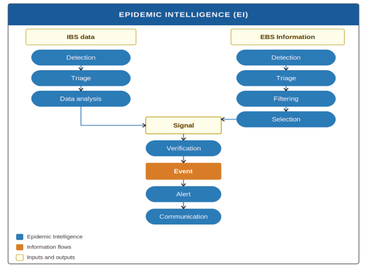

*Figure 1: Indicator- and Event-Based Surveillance supporting Epidemic Intelligence*

### 2.2 Types of Event-Based Surveillance

Uganda's EBS system encompasses two main types, each targeting distinct signal sources:

#### 2.2.1 Community Event-Based Surveillance

Relies on reports from Village Health Teams (VHTs), Community Health Extension Workers (CHEWs), local and religious leaders, and community members. CEBS is the most sensitive modality for detecting threats at the grassroots level and is particularly valuable in areas with limited formal healthcare access.

#### 2.2.2 Facility Event-Based Surveillance

Captures signals of unusual events detected within human health facilities (hospitals, clinics, laboratories), animal health facilities (veterinary clinics, abattoirs), and environmental monitoring stations. Facility EBS extends EBS to the clinical and laboratory interface, enabling detection of clusters, atypical presentations, and unusual laboratory findings.

The table below compares the two types of EBS, focusing on their definition, sources of information, strengths and weaknesses, and roles in the Uganda surveillance landscape.

_Table 1: Comparison between Facility- and Community-based EBS_

| Area | Facility EBS | Community EBS |
| --- | --- | --- |
| Definition | EBS conducted within facilities (human health clinics, small animal clinics, wildlife clinics, abattoirs, water purification plants etc). | Event-Based Surveillance conducted at the community level through informal and local reporting |
| Sources of information | 1. Health workers in human health clinics and hospitals Laboratory reports 2. Veterinary staff in small animal clinics 3. Abattoirs 4. Structured reporting systems (eIDSR, MoH PHEOC). 5. Ministry of Water and Environment staff | 1. Community health workers (VHTs) 2. Community Health Extension Workers 3. Subcounty Veterinary Officers 4. U-report 5. mTrac 6. SMS reports 7. Media (Radio or TV) monitoring 8. Social media (WhatsApp groups, Twitter, Facebook etc) 9. Phone calls 10. Walk-ins. |
| Strengths | 1. More clinically accurate data 2. Better diagnostic confirmation 3. Integration with national health systems. | 1. Faster detection of unusual events 2. Wider coverage, especially in rural areas 3. Captures rumors and early signals. |
| Limitations | 1. May miss events outside formal facilities 2. Reporting delays due to bureaucracy | 1. Data may be unstructured or less reliable 2. Requires validation by facility or MoH. |
| Role in Uganda’s surveillance landscape | Provides structured, verified reports that feed into the Ministry of Health’s Public Health Emergency Operations Centre (PHEOC). | Provides early warning signals from the grassroots, often triggering facility- and district-level investigations. |

### 2.3 Channels of Event Based Surveillance

Event-based surveillance signals detected either from the community or facility may be transmitted through two broad channels, including:

#### 2.3.1 Hotlines

Provides an accessible, centralized reporting channel through the Ministry of Health toll-free hotline (0800100066), SMS platform (6767), and digital communication channels. Hotline EBS is particularly effective during outbreaks and emergencies, and is operationalized through the IDEAL model.

#### 2.3.2 Media Scanning

Systematically monitors traditional media (newspapers, radio, television) and digital platforms (social media, online news, international surveillance platforms) to capture signals that have not yet entered formal reporting channels. (See Chapter 8.)

## Chapter 3: Governance, Roles and Responsibilities

### 3.1 Overview

Effective EBS requires clearly defined roles and responsibilities at each level of the health system and across all One Health sectors. This chapter defines the roles and responsibilities of all key stakeholders involved in Uganda's EBS system, from the national policy level to the community detection level.

### 3.2 National Level

#### 3.2.1 Ministry of Health / IES&PHE

The Department of Integrated Epidemiology, Surveillance and Public Health Emergencies (IES&PHE) within the Ministry of Health holds primary responsibility for the national coordination, oversight, and quality assurance of Uganda's EBS system. Key responsibilities include:

1.  Developing, updating, and disseminating national EBS guidelines, standard operating procedures, and training materials.

2.  Overseeing the operation of the National Public Health Emergency Operations Centre (NPHEOC) as the national hub for EBS signal receipt, triage, verification, and risk assessment.

3.  Managing national EBS data systems (ePHEM, eIDSR, Uganda Health Alert System) and ensuring interoperability with partner sector systems.

4.  Coordinating multi-sectoral EBS activities across the One Health platform.

5.  Leading national risk assessment and alert generation for high and very high-risk events.

6.  Producing national EBS performance reports, epi-bulletins, and IHR compliance reports (SPAR, JEE).

7.  Coordinating cross-border EBS activities with neighbouring countries and regional bodies.

#### 3.2.2 National Public Health Emergency Operations Centre (NPHEOC)

The NPHEOC serves as the operational hub for national EBS, receiving signals from all sources, conducting national-level triage and risk assessment, issuing national alerts, and coordinating national public health emergency responses. The NPHEOC operates 24 hours a day, 7 days a week during declared emergencies.

### 3.3 Regional Level

Regional Public Health Emergency Operations Centres (RPHEOCs) currently operate in 16 health regions planned under NAPHS II. These RPHEOCs are situated at Regional Referral Hospitals, where they are managed. Key RPHEOC responsibilities include:

1.  Receiving EBS signals from district health offices and community sources within their region.

2.  Conducting regional triage, verification, and risk assessment for signals that cannot be managed at the district level.

3.  Publishing weekly Regional Epi-Bulletins consolidating EBS signal activity across the region.

4.  Providing technical support and supervision to district surveillance teams.

5.  Escalating high and very high-risk events to the NPHEOC.

### 3.4 District Level

The District Health Officer (DHO) holds overall accountability for EBS implementation within the district. The District Surveillance Focal Person (DSFP), appointed by the DHO, is the operational lead for day-to-day EBS activities of the Alert Desk. Key district-level responsibilities include:

1.  Receiving, triaging, and verifying EBS signals from facility surveillance focal persons and community-level reporters.

2.  Coordinating district Rapid Response Team (RRT) deployment for field verification and risk assessment.

3.  Reporting verified signals and completed risk assessments to the Regional PHEOC.

4.  Maintaining up-to-date contact lists of trained EBS focal persons at all facilities and VHT focal persons across all sub-counties.

5.  Conducting quarterly supervisory visits to facility EBS focal persons.

6.  Providing feedback to health facilities and community reporters on the outcome of their signals.

### 3.5 Facility Level

Each facility including human health facilities (hospitals, Health Centers II - IV), veterinary clinics, abattoirs, and environmental monitoring stations shall designate a Surveillance Focal Person (SFP) responsible for EBS at the facility. Key SFP responsibilities include:

1.  Maintaining the facility signal list (Annex I) and training all clinical and support staff to recognize and report signals.

2.  Receiving signals from clinical staff and community members attending the facility, conducting initial triage, and reporting to the DSFP.

3.  Maintaining the facility EBS signal register.

4.  Participating in district-level EBS training and supervision activities.

5.  Ensuring feedback is provided to clinical staff and community members who reported signals.

### 3.6 Community Level

Village Health Teams (VHTs) and Community Health Extension Workers (CHEWs) are the primary EBS actors at the community level, supported by religious leaders, political leaders, teachers, and community members.

1.  VHTs: Conduct household visits to identify unusual occurrences; receive reports from community members; perform initial signal triage; and report via SMS 6767 or the MoH toll-free hotline (0800100066) or eCHIS within 24 hours of detection.

2.  CHEWs: Support VHTs in signal identification and reporting; liaise between community and facility levels.

3.  Religious and Political Leaders: Mobilize communities for EBS participation; channel signals from community gatherings and social networks to VHTs and health authorities.

### 3.7 Multi-Sectoral Stakeholders

Below is the list of key EBS stakeholders and their roles and responsibilities in EBS implementation.

_Table 2: Other key EBS stakeholders and their roles and responsibilities in EBS implementation._

| Stakeholder | EBS Role and Responsibilities |
| --- | --- |
| MAAIF | Animal health signal detection through EMA-i and NIFAMIS; joint One Health risk assessment for zoonotic events; participation in cross-sectoral EBS reviews. |
| MWE / UWA | Environmental and wildlife signal detection through WEIS and WDSMS; reporting of unusual animal mortalities, chemical incidents, or water quality events with public health implications. |
| UPDF | EBS signal detection within military installations and border areas; support to RRT deployments in security-sensitive environments; cross-border signal sharing through military intelligence channels. |
| UPF | Signal detection and reporting from police posts, prisons, and border points of entry; support to verification and response activities in the field. |
| WHO Uganda | Technical advisory support for IHR compliance; review of national risk assessments; liaison with WHO HQ for PHEIC notification. |
| FAO | Technical support for animal health EBS components; cross-sectoral risk assessment for zoonotic and food safety events. |
| US CDC, AFCDC, KOFIH, TDDAP, State Department, UHA, FHI 360, IDI, Baylor Uganda and other Global Health Security (GHS) partners | Technical support for EBS system strengthening; alignment with Africa CDC EBS Framework benchmarks; JEE and SPAR review support. |

## Chapter 4: Steps of Event-Based Surveillance

### 4.1 Overview of the EBS cycle

Event-Based Surveillance converts unstructured signals from diverse sources into actionable public health intelligence through a defined sequence of steps. Each step has a clear purpose, defined responsible actors, and mandatory timeframes. The EBS cycle comprises five main steps: detection, triage, verification, risk assessment, and alert. Throughout these processes, there is an active feedback loop that ensures a continuous communication between the health system at all levels and the community and health facilities.

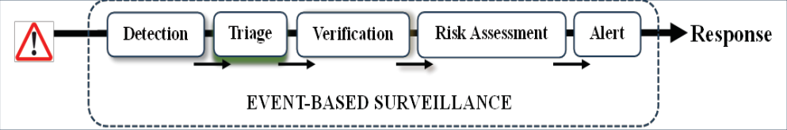

*Figure 2: The steps of Event-Based Surveillance*

### 4.2 Step 1: Detection

Detection is the first crucial step in Event-Based Surveillance (EBS), involving identifying signals of unusual events that could pose public health risks, sourced from community reports, facilities, media, hotlines, and digital platforms, as well as animal health, environmental systems, and CBRNe sources. The Africa CDC defines a signal as data indicating a potential health risk, such as an outbreak. Effective detection requires vigilance at all levels, especially at the community and district levels, where patterns often emerge first. Village Health Teams (VHTs), local leaders, and frontline workers are key to noticing and reporting anomalies such as unexplained illnesses or animal die-offs. They are encouraged to report signals beyond human health, including those in the animal, environmental, or CBRNe sectors. Detection is bolstered by awareness campaigns, training, and clear reporting channels, ensuring timely capture of signals from diverse sources. Prompt reporting of signals is essential to maintain sensitive surveillance for both common and rare threats.

#### 4.2.1 The process of detection

Identification of unusual health-related events or rumors:

##### 4.2.1.1 In the community

- VHTs during home visits may identify unusual occurrences in their community

- Community members report unusual occurrences to the VHT, facility staff, or community leaders.

##### 4.2.1.2 At the facility

- Facility staff analyze routine data and notice an unexpected cluster

- A clinician, while managing patients, notices unusual symptoms in a patient with a familiar illness

- The Veterinary Officer in a small animal clinic identifies an unusual occurrence at their facility.

- Laboratory staff at the water treatment plants detects a strange occurrence.

At the District or Regional or National Public Health Emergency Operations Center

- The EBS focal person at the PHEOC or District Health Office hears a news item on the radio or television, or reads in the daily newspaper about a cluster of unusual events in a community, school, or prison.

- Unusual occurrences may also be identified through social media feeds, which are captured by the PHEOC or District Health Office.

Note: Ensure frontline staff are trained to recognize signals.

#### 4.2.2 Sources of signals

Signals may be identified from the following sources:

- Community sources: VHTs during household visits; community members reporting unusual illnesses, deaths, or events; religious and community gatherings.

- Facility sources: Clinicians noticing unusual clinical presentations or unexplained case clusters; routine data analysis revealing unusual trends; laboratory staff identifying atypical results.

- Hotline sources: Phone calls and SMS messages to the MoH toll-free hotline (0800100066) or SMS platform (8500, 6767).

- Media sources: Radio, television, print, and online media reporting unusual events; social media posts; international surveillance platforms (ProMED, HealthMap, WHO Bulletin).

- Animal and environmental sources: Unusual livestock or wildlife mortalities reported to MAAIF, UWA, or MWE; environmental incidents with potential public health implications.

- Cross-border sources: Reports from neighbouring country counterparts or international health authorities.

#### 4.2.3 Minimum information for signal reporting

When reporting a signal, the following minimum information must be provided:

1.  Date and time of detection.

2.  Location of the event (district, sub-county, village or facility name).

3.  Brief description of the unusual occurrence.

4.  Estimated number of persons / animals affected (if known).

5.  Source of the signal (community, facility, media, hotline).

6.  Actions already taken (if any).

7.  Name and contact information of the person reporting.

**Note: All signals must be reported within 24 hours of detection.**

#### 4.2.4 Reporting Channels

**Some of the available EBS reporting channels in Uganda include:**

- SMS: 6767 (eIDSR platform) and 8500 (U-Report)

- Toll-free hotline: 0800100066 (Ministry of Health)

- Online platform: alerts.health.go.ug | QR code scan

- eCHIS application (VHT reporting platform)

- Direct phone call to facility in-charge, DSFP, or PHEOC

- WhatsApp / social media to designated PHEOC accounts

### 4.3 Step 2: Triage

Triage is the filtering step in which received signals are assessed for their relevance and potential public health importance. Triage ensures that resources are directed towards genuine threats and prevents false alarms from overwhelming the system.

Triage is guided by two fundamental questions:

1.  Has this signal been reported before? (If yes and already being investigated, discard and record)

2.  Does this signal represent a genuine or potential threat to public health? (If no, monitor and log for further management)

Repeated reports about an unusual event may be dismissed. If this information hasn't been reported before and poses a threat to health, it becomes a signal and is escalated. For example, unreported cholera deaths in a fishing village may be escalated. District officers and PHEOC staff use checklists to guide triage, ensuring consistency and avoiding false alarms. This process helps identify real threats and guides information for verification.

#### 4.3.1 Signal Prioritization

Signals that pass triage should be assigned a priority level to guide the urgency of verification:

_Table 3: Priority categorization, criteria and required action_

| Priority | Criteria | Required Action |
| --- | --- | --- |
| High | Potential for rapid spread; high mortality; novel pathogen; population panic; cross-border implications. | Verify immediately; complete verification within 12 hours. |
| Medium | Localized event; moderate severity; known pathogen but unusual context. | Assign verifier; complete verification within 24 hours. |
| Low | Limited scope; low severity; unlikely to spread. | Log and assign for routine verification within 48 hours. |

**Note: All triage must be completed within 24 hours of signal receipt.** All triage outcomes must be documented in ePHEM and the district EBS signal register.

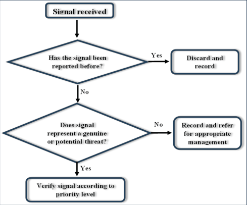

*Figure 3: EBS Triage Decision Algorithm*

### 4.4 Step 3: Verification

Verification is the process of confirming whether a triaged signal represents a real public health event by gathering information from reliable sources, including the signal originator. Verification converts unstructured information into validated intelligence, reducing false alerts and guiding resources to genuine threats.

#### 4.4.1 Process of Verification

1.  Following triage, the EBS focal person at the PHEOC or District Health Office should identify a trained facility staff member at the nearest facility and assign them to verify the signal.

2.  Full signal information should be shared with the verifying personnel, including reporter contact details.

3.  The verifying personnel should contact the signal source to confirm accuracy (desk verification).

4.  Once the occurrence is confirmed, cross-check with facility records or laboratory data.

5.  If necessary, conduct a physical visit to the site (field verification) in consultation with community leaders and local authorities.

6.  Document and report verification outcomes to the PHEOC or DHO.

If the source of the signal is media, corroborate with other relevant sources, including online sources or publications.

**Note:**

1.  Verification of community and facility signals should be conducted physically to establish the authenticity of the information.

2.  It is recommended that PHEOCs and District Health Offices maintain a list of trained staff at all levels who may be contacted in the event of a need for verification. Every facility in the district should have at least one trained person who serves as an EBS focal point for both facility and community signals.

3.  The verification process should be conducted within 12 hours of triage.

### 4.5 Step 4: Risk Assessment

Risk assessment serves as a crucial link between signal verification and the implementation of an actionable public health response. It is a systematic, continuous process of gathering, evaluating, and recording information to support decisions on how to manage and mitigate the impacts of major health events. This process concludes with classifying the risk level of an event as very high, high, medium, or low. The assigned risk level guides the necessary actions to lessen its harmful effects on communities, healthcare systems, and national security. Risk assessment involves examining the nature of the event, its likelihood of spreading, the potential severity of outcomes, and the health system's ability to respond. The process is guided by structured criteria, often using standardized tools or checklists to maintain consistency across districts and at the national level. The purpose of the risk assessment process is to:

1.  Rapidly evaluate the potential public health impact of an event.

2.  Identify hazards and assess their possible consequences.

3.  Guide decision-making on resource allocation, control measures, and public communication.

Conducting a rapid risk assessment is essential as it facilitates prompt responses despite incomplete data; offers a systematic framework for decision-making under conditions of uncertainty; and assists in preventing the escalation of public health emergencies by guiding early interventions.

**Note: The rapid risk assessment process is iterative as new information emerges, and is conducted within 24 hours of verification of the event.**

The level of administration responsible for the risk assessment depends on the severity of the event. Events that have spread or could spread across multiple districts may be managed at the regional or national level, while an event confined to a single district should be handled by district staff. Therefore, district staff should be trained and equipped with the necessary knowledge and tools to carry out the risk assessment process. Using predefined tools, the risk assessment is conducted across three tiers: hazard, exposure, and context.

#### 4.5.1 Hazard assessment

Hazard assessment in EBS focuses on identifying and characterizing potential threats that could impact public health, such as disease outbreaks, exposure to chemical, biological, nuclear, radioactive, or explosive agents, or environmental disasters. It involves analyzing the nature, severity, and likelihood of these hazards. The analysis uses historical data, scientific evidence, and early warning signals. The result of hazard assessment is gaining a clear understanding of the existing risks and how they might develop, which forms the basis for prioritizing surveillance and response actions.

#### 4.5.2 Exposure assessment

Exposure assessment identifies the risk levels in populations from specific hazards. In EBS, this includes mapping vulnerable groups, geographic hotspots, and transmission routes. It considers demographic factors, mobility patterns, and environmental conditions that influence exposure. Exposure assessment helps target interventions to reduce risk by pinpointing who is most likely to be affected and under what conditions.

#### 4.5.3 Context assessment

Context assessment identifies hazards and exposures within social, ethical, technical, scientific, economic, political, and health system environments. It examines factors such as governance capacity (leadership structure and ability to mobilize), healthcare infrastructure (availability of health facilities), cultural practices, and population health (nutritional status and community resilience) that influence how risks are perceived and managed. In EBS, context assessment ensures that surveillance and response strategies are realistic, locally relevant, and sensitive to systemic strengths and weaknesses.

#### 4.5.4 Risk categorization

Risk characterization is the integrative phase of risk assessment in EBS, where findings from hazard, exposure, and contextual evaluations are combined to provide a comprehensive picture of the overall risk level associated with an incident. This process involves assessing both the likelihood of occurrence and the potential severity of outcomes, while explicitly considering uncertainties and data gaps. It converts technical analyses into actionable decisions, helping decision-makers prioritize signals, allocate resources, and determine response urgency. Effective risk characterization requires balancing scientific evidence with operational factors such as surveillance capacity, community vulnerability, and health system resilience, ensuring risks are both quantified and meaningfully contextualized. By categorizing risks into clear levels (e.g., low, moderate, high, or very high), this step makes EBS outputs practical, comparable across hazards, and aligned with national preparedness and response frameworks. Ultimately, this process links technical assessment with policy development and operational action, guiding prompt interventions to protect public health and bolster confidence in surveillance systems. Some of the tools that have been used for risk categorization include the WHO manual for rapid risk assessment for acute public health events [11], the European Centers for Disease Control and Prevention (ECDC) Operational Tool on Rapid Risk Assessment [12], the Tripartite Joint Risk Assessment Tool [13] etc.

Currently in Uganda, the rapid risk assessment process is conducted within the electronic Public Health Emergency Management (ePHEM) system. Within ePHEM, the rapid response assessment uses two primary aids for risk categorization: the risk matrix and the risk algorithm.

#### 4.5.5 Risk matrix

The risk matrix integrates assessments of the probability of event dissemination with evaluations of the event's potential impacts. Since most acute health event risk assessments are qualitative in nature, the categories employed within the matrix are not founded on numerical data but rather on comprehensive descriptive definitions of likelihood and consequences. When utilizing the matrix, the definitions of likelihood and consequence may be refined to align with the specific local context.

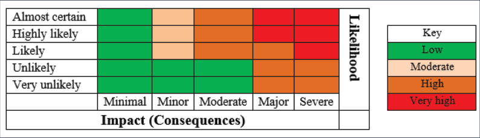

*Figure 4: The EBS risk categorization matrix*

The definitions of the categories of impact and likelihood are as follows:

##### 4.5.5.1 Likelihood

- **Almost certain:** Is expected to occur in most circumstances, with a probability of ≥95%.
- **Highly likely:** Will probably occur in most circumstances, with a probability between 70%–94%.
- **Likely:** Will occur some of the time, with a probability between 30%–69%.
- **Unlikely:** Could occur some of the time, with a probability between 5%–29%.
- **Very unlikely:** Could occur under exceptional circumstances, with a probability of <5%.

##### 4.5.5.2 Impact

1.  **Minimal**

    - Limited impact on the affected population

    - Little disruption to normal activities and services

    - Routine responses are adequate and there is no need to implement additional control measures

    - A few extra costs for authorities and stakeholders

2.  **Minor**

    - Minor impact for a small population or at-risk group

    - Limited disruption to normal activities and services

    - A small number of additional control measures will be needed and some of these require minimal resources to implement

    - Some increase in costs for authorities and stakeholders

3.  **Moderate**

    - Moderate impact on a large population or at-risk group

    - Moderate disruption to normal activities and services

    - Some additional control measures will be needed and some of these require moderate resources to implement

    - Moderate increase in costs for authorities and stakeholders

4.  **Major**

    - Major impact on a small population or at-risk group

    - Major disruption to normal activities and services

    - A large number of additional control measures will be needed and some of these require significant resources to implement

    - Significant increase in costs for authorities and stakeholders

5.  **Severe**

    - Severe impact on a small population or at-risk group

    - Severe disruption to normal activities and services

    - A large number of additional control measures will be needed and some of these require significant resources to implement.

    - Serious increases in costs for authorities and stakeholders

#### 4.5.6 Risk algorithm

The risk algorithm is a series of questions that reflect upon the hazard, exposure, and context assessments and allow for a risk determination to be made based upon the responses to these questions.

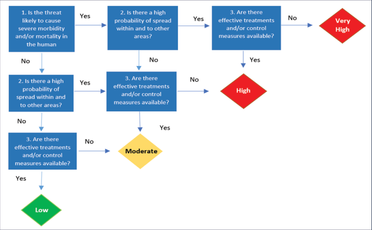

*Figure 5: The EBS risk categorization algorithm*

#### 4.5.7 Outcomes of rapid risk assessment

Broadly, the outcomes of a rapid risk assessment can be categorized into these three actions:

1.  **Investigate/Respond if…**

    - Mortality or morbidity is higher than expected.

    - The disease is novel or unexpected in the community.

    - The number of cases is increasing.

    - Severe consequences for trade, travel, or community stability are likely.

    - The event creates panic in the community.

2.  **Monitor if…**

    - Mortality/morbidity is as expected for the disease.

    - Severity of cases is low.

    - The event poses limited public health risk.

3.  **No investigation required if…**

    - No cases are detected in humans or animals.

    - The event does not constitute a public health risk.

However, following the use of the risk matrix or the risk algorithm, the actions that follow according to the categorization is as below:

| Level | Recommended action |
| --- | --- |
| Low-risk | Managed according to standard response protocols; Routine control programs and regulation (e.g., monitoring through routine surveillance systems) |
| Moderate risk | Roles and responsibilities for the response must be specified; Specific monitoring or control measures required (e.g., enhanced surveillance, additional vaccination campaign etc.) |
| High risk | Senior management attention needed; There may be a need to establish command-and-control structures; A range of additional control measures will be required some of which may have significant consequences |
| Very high risk | Immediate response required even if the event is reported out of normal working hours. Immediate senior management attention needed (e.g., the command-and-control structure should be established within hours); the implementation of control measures with serious consequences is highly likely |

_Figure 6: Recommended actions to be taken by risk category_

#### 4.5.8 Steps in the risk assessment cycle

1.  Assembling the risk assessment team – selecting disciplines based on available information.

2.  Formulating risk questions – defining scope and key issues (who is affected, how, when, and why).

3.  Undertaking the risk assessment – analyzing hazard, exposure, and context.

4.  Risk characterization – assigning a level of risk to guide response.

### 4.6 Step 5: Alerts

An alert is the formal output of the EBS process, issued after an event has been detected, triaged, verified, and risk-assessed. Alerts communicate confirmed public health events to relevant authorities and stakeholders, ensuring timely mobilization of responses. Alerts must be clear, concise, and actionable, providing the nature of the event, its location, the number of affected persons, the assigned risk level, and the recommended next steps.

In Uganda's EBS system, alerts are communicated through: Spot Reports (SpotReps) for high and very high-risk events; weekly Epi-Bulletins for moderate and ongoing events; and the Uganda Health Alert System (alerts.health.go.ug) for public-facing notifications.

## Chapter 5: Community Event-Based Surveillance

### 5.1 Introduction

The majority of potential public health threats occur within communities, with community members shouldering the primary impact. Community Event-Based Surveillance (Community EBS) constitutes a systematic approach to detecting and reporting unusual health events at the grassroots level. Community may refer to settlements where individuals reside, as well as educational institutions, factories, or workplaces. Community EBS depends on the vigilance of community members and local structures to identify signals indicative of emerging public health threats. It is particularly helpful in places with poor access to healthcare. Unlike facility-based systems, Community EBS gathers information directly from the population, thus enhancing sensitivity to early signs of outbreaks, environmental hazards, or atypical events. By empowering communities to engage in surveillance activities, Community EBS fortifies Ugandan epidemic intelligence capabilities and facilitates the detection of public health threats at their source, often before they reach health facilities.

### 5.2 Community EBS actors and roles

The success of CEBS depends on the active, coordinated engagement of multiple community actors:

1.  Community Members: First-line detectors of unusual events; report to VHTs, local leaders, or directly via SMS 8500, 6767 / toll-free hotline 0800100066.

2.  Village Health Teams (VHTs): Primary community EBS actors; conduct household visits; receive reports from community members; perform initial triage; transmit signals to the nearest facility SFP or DSFP.

3.  Community Health Extension Workers (CHEWs): Support VHT activities; liaise between community and facility levels; assist in verification and community feedback.

4.  Religious Leaders: Mobilize congregations; raise awareness of unusual events observed at places of worship or community gatherings; encourage timely reporting.

5.  Political Leaders (LCs, Sub-county Chiefs): Provide authority and legitimacy for surveillance activities; help mobilize resources and community participation; reinforce accountability.

6.  Teachers and School Health Committees: Report unusual illness clusters or absenteeism patterns that may represent early warning signals.

Together, these actors create a network of vigilance that ensures Community EBS is both participatory and sustainable.

### 5.3 Community Signal List

To facilitate detection, a predefined list of community signals is provided in Annex III. This list is intended as a non-prescriptive guide; it does not restrict the scope of signals that may be reported. Communities and VHTs are encouraged to report any unusual event they believe may represent a public health threat, regardless of whether it appears on the signal list. The signal list is reviewed and updated annually by IES&PHE.

### 5.4 Sources of Information in CEBS

Community EBS draws on multiple sources of information to capture signals of unusual events. These include direct community reports, observations by VHTs, rumors circulating in villages, announcements at religious gatherings, and alerts from local leaders. Informal sources such as social media, local radio, and word-of-mouth also play a role, especially in rural areas where formal reporting systems may be limited. By integrating diverse sources, Community EBS increases sensitivity and ensures that no potential signal is overlooked.

### 5.5 Steps of Community Event-Based Surveillance

#### 5.5.1 Detection

Given the nature of their roles, Village Health Teams (VHTs) are uniquely positioned to conduct household visits within their communities. During these visits, they identify unusual activities or occurrences. Moreover, as trusted community leaders, VHTs also receive information from other community members regarding atypical events. All such information may serve as signals or indicators suggestive of a public health threat. Although the majority of such signals are reported by VHTs, they are not the sole sources within the community. Political leaders, religious leaders, cultural leaders, teachers, employers, and community members are all potential sources of Community Event-Based Surveillance (Community EBS) signals whenever they observe strange occurrences in their respective environments. Detected signals must be promptly reported via SMS to 6767 or by telephone call to the Ministry of Health's toll-free hotline at 0800100066.

*Figure 7: Community EBS — Signal Flow and Reporting Chain*

#### 5.5.2 Triage

The VHT or community leaders to whom community members may report signals should be equipped with sufficient information to perform triage. This allows them to screen signals prior to reporting. Signals originating from the VHT or from community leaders trained in EBS will be triaged at the level where they are received, which may include the District Health Office or the Regional or National Public Health Emergency Operations Center (EOC).

#### 5.5.3 Verification

Community signals should be verified by staff members from the facility nearest to the signal. This process should preferably involve a physical visit to the site, initiated after communication with the signal reporter. If a physical visit is not feasible, a telephone call must be made to the VHT of the area where the signal was reported. Under the guidance of the facility staff, the VHT may proceed to conduct the verification.

#### 5.5.4 Risk assessment and alert

Risk assessment of events should be conducted by a team constituted at the district. Chapter 4 contains details on the risk assessment process. An alert should be reported in the event of the appropriate risk categorization.

### 5.6 Flow of Information in Community EBS

The flow of information within the Community EBS begins when community members identify unusual events and report them to Village Health Teams (VHTs) or local leaders. VHTs then conduct an initial triage and report the signal either to designated facility focal persons, or through digital platforms where their reports are received at the District Health Officer, and the Regional and National Public Health EOCs.

The coordination of the next steps is the district's primary responsibility. The National and Regional PHEOCs may provide technical support to districts as and when needed. At the district level, these signals are meticulously triaged, verified, and, if validated as credible, escalated to the Public Health Emergency Operations Centre (PHEOC). This well-structured process guarantees the efficient transfer of signals from the grassroots level to higher authorities, facilitating prompt risk assessment and response.

A strong feedback mechanism is essential for sustaining Community EBS. Communities must receive timely updates on the status of their reports, whether signals were verified, and what actions were taken. Feedback builds trust, motivates continued participation, and reinforces the value of community contributions. Feedback can be delivered through VHTs, local meetings, radio announcements, or direct communication from district health teams.

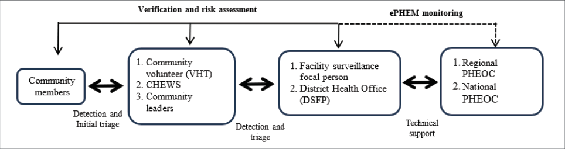

*Figure 8: Data flowchart in Community EBS*

## Chapter 6: Facility Event-Based Surveillance

### 6.1 Introduction

Facility Event-Based Surveillance (Facility EBS) is the systematic detection, documentation, and escalation of unusual health events observed within health and other facilities within the One Health approach. Unlike routine IBS, which depends on structured case definitions, Facility EBS targets anomalies and departures from the expected, enabling detection of novel events and emerging threats before case thresholds are crossed.

In alignment with Uganda's One Health strategy, the term 'facility' in the context of EBS refers to any structured setting capable of detecting and reporting unusual health incidents. This encompasses hospitals, clinics, veterinary centers, farms, markets, abattoirs, laboratories, and environmental sites. A facility fundamentally functions as a frontline node, whether human, animal, or environmental, where early indicators of potential public health threats initially manifest and are subsequently communicated across sectors for prompt response.

### 6.2 Facility Signal List

Each facility maintains a current facility signal list (Annex I), which provides a non-prescriptive reference for the types of unusual events that should trigger EBS reporting. Facility staff are trained to recognize and report any event they consider unusual or potentially significant, regardless of whether it appears on the signal list. The facility signal list is updated annually and aligned with the national priority disease and hazard list.

### 6.3 Steps of Facility EBS

#### 6.3.1 Detection and Reporting

A designated focal person for EBS should be appointed for each facility type across the human health, veterinary, and environmental sectors. These focal points must receive appropriate training and be empowered to report any unusual occurrences they detect. In essence, FEBS enhances IBS by introducing a flexible, responsive layer of vigilance that can detect unexpected events. A list of potential unusual events in facilities is provided in Annex II. All unusual occurrences should be reported to the designated focal person, who will then initiate the subsequent EBS processes.

#### 6.3.2 Triage and Verification

The triage process is only conducted when the signal has been reported by multiple healthcare professionals. It is presumed that, given the reporter's technical background, the signal likely indicates a public health event.

When operating within the facility that reported the signal, the focal person should verify without delay. Occasionally, a facility lacking a designated focal person may report to a focal person at another facility. In such instances, the focal person may collaborate with the staff of the reporting facility. Following the verification process, the signal becomes an event. Outcomes of the verification process should be reported to the district health authorities.

#### 6.3.3 Risk Assessment

A multidisciplinary Rapid Response Team (RRT), led by the District Health Officer, is constituted to conduct the risk assessment using the tools described in Chapter 4.

### 6.4 Reporting Tool

The primary reporting tool for Facility EBS is the eIDSR electronic platform, accessible via the Uganda Health Alert System (alerts.health.go.ug) and the DHIS2 interface. Where electronic platforms are unavailable, a paper-based signal register (Annex IV) must be maintained and physically submitted to the DSFP during scheduled supervisory visits or immediately for high-priority signals.

### 6.5 Flow of information in FEBS

The flow of information in FEBS begins with frontline health workers detecting unusual events and reporting them to the surveillance focal person at the facility, who documents any resultant signals. The focal person conducts the initial triage and escalates credible signals to the District Surveillance Focal Person (DSFP) at the District Health Office. The DSFP conducts the necessary verification, and risk assessment. While the Regional and National Public Health Emergency Operations Center has access to all signals reported through electronic channels (8500, 6767 messaging, alerts.go.ug, or calls to the MoH toll-free call center), signals must still be reported from the districts to the Public Health Emergency Operations Centres (PHEOC). This structured flow ensures that signals move efficiently from detection to national response while maintaining accountability and consistency. Importantly, feedback loops are built into the system so that facilities receive updates on the status of their reports, reinforcing trust and encouraging continued vigilance.

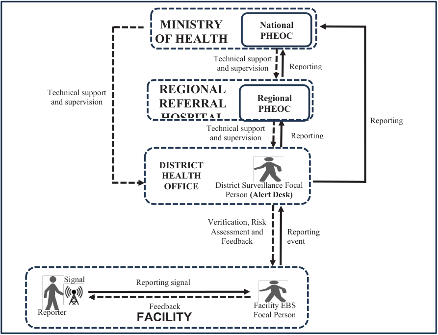

*Figure 9: The data flow of Facility EBS*

## Chapter 7: Reporting Channels Used in Event-Based Surveillance

### 7.1 Introduction

Effective event-based surveillance (EBS) relies on timely, accurate, and structured reporting of signals that may indicate public health threats. Establishing clear reporting channels ensures that information flows seamlessly from the community level to national authorities, enabling rapid verification, risk assessment, and response.

### 7.2 Reporting channels in EBS

#### 7.2.1 Phone Calls

Phone calls are the most common and reliable way to share information on the hotline EBS. Community members, health professionals, or leaders can call a specific number to report incidents like deaths, illness clusters, or outbreaks. At the district level, these calls can be handled by the alert desk established at the health office or One Health Platform offices. These calls enable immediate interaction, allowing hotline staff to ask questions, assess urgency, and provide guidance. In Uganda, the Ministry of Health's toll-free number, 0800100066, is often used to encourage reporting across the country. Phone calls also allow real-time triage, ensuring critical signals are fast-tracked.

During outbreaks, the deployment of toll-free lines has been established to enhance the scope of receipt of signals.

#### 7.2.2 Short Messaging Services

The Short Message Service (SMS) serves as an alternative reporting channel, particularly advantageous in regions with inadequate network coverage or limited access to voice communication services. SMS enables community members to transmit concise reports concerning unusual events, which can subsequently be logged and reviewed by hotline personnel. This method of reporting is cost-effective, user-friendly, and accessible to populations possessing basic mobile phones. Additionally, it generates a written record of signals, which can be stored and analyzed to identify patterns. In Uganda, the number 8500, 6767 has been popularized for submitting alerts. SMS complements voice calls by broadening reach and ensuring inclusivity. In recent years in Uganda, the use of chatbots has been explored but not popularized.

#### 7.2.3 Social Media Messaging

Social media platforms such as WhatsApp, Facebook Messenger, and X (formerly Twitter) are increasingly utilized as sources of information for hotline EBS. These platforms facilitate rapid dissemination of signals, including text, images, and videos, thereby providing more comprehensive context for verification purposes. Social media messaging proves particularly valuable among younger populations and urban communities where digital communication is prevalent. Hotline desks can monitor official accounts or designated groups to capture signals and actively encourage communities to report directly via messaging applications. Incorporating social media into hotline EBS enhances sensitivity and ensures that signals circulating online are not overlooked.

#### 7.2.4 Media scanning

Media scanning is designed to capture signals of unusual health events from traditional and digital media sources. Compared to community or facility reporting, media scanning systematically monitors newspapers, radio, television, and online platforms to identify early warnings of outbreaks, disasters, or other public health threats. To widen its sensitivity and scope, media scanning should look beyond country-specific media but also those of neighboring countries.  Media scanning is useful in detecting events that may not yet have reached formal reporting channels, such as rumors of disease clusters, environmental hazards, or sudden deaths. By integrating media scanning into EBS, the surveillance system ensures that information circulating in public spaces is harnessed for epidemic intelligence, enabling rapid verification and response.

Media scanning draws on a wide range of sources to maximize sensitivity:

1.  Official websites of government entities and local, regional, and global partners: Ministry of Health, Ministry of Agriculture, Animal Industry and Fisheries, Ministry of Water and Environment, and Uganda Wildlife Authority. Others include the websites of WHO, FAO, Africa CDC, US CDC, etc.

2.  Traditional media: Newspapers, radio broadcasts, and television reports often provide early coverage of unusual events, especially in rural areas where community reports may take longer to reach health authorities.

3.  Online news outlets: Digital platforms and news websites offer real-time updates on emerging events, making them critical for rapid detection.

4.  Social media: Platforms such as Twitter, Facebook, and WhatsApp are rich sources of signals, including rumors, photos, and videos shared by community members.

5.  Community radio and local bulletins: These are particularly valuable in remote areas, where local broadcasts may highlight unusual events before they are picked up nationally. By monitoring these diverse sources, media scanning ensures that signals are captured across both formal and informal communication channels.

### 7.3 Integrating Data, Emergency Medical Services, Alert Management, and Laboratory (IDEAL)

To enhance the efficacy of the EBS hotline in an outbreak setting, the Ministry of Health introduced a comprehensive model that integrates alert management, Emergency Medical Services (EMS), laboratory, and data management. This integrated framework includes establishing toll-free hotlines that operate continuously, 24 hours a day, every day of the week. Call operators and desk verifiers diligently gather and analyze data, generating and disseminating periodic reports. Documentation tools are used to collect data throughout various stages, including triage and verification, EMS dispatch and evacuation, and laboratory sample collection. Initially implemented during an outbreak response in 2022 and 2025, the system was found to be both effective and efficient. Consequently, it is essential to reinforce this integrated data, emergency medical services, alert management, and laboratory services (IDEAL) model to bolster the country's capacity for preparedness, early detection, and containment of any public health threats nationwide.

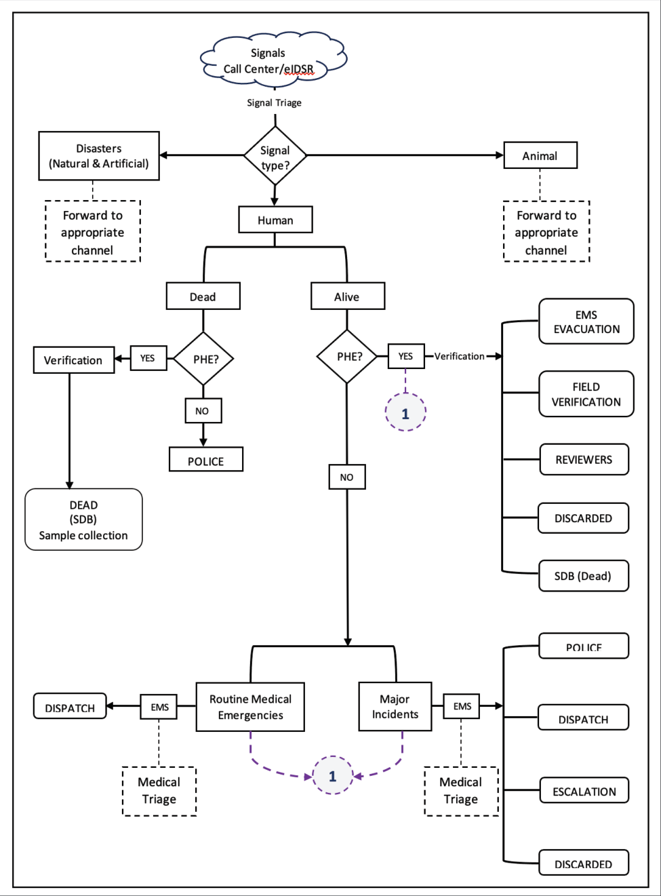

*Figure 10: A schema of the IDEAL model*

### 7.4 Flow of information during public health emergencies

The flow of information begins with community members or health workers reporting signals through phone calls to the district alert desk, SMS, or social media. Hotline or alert desk staff receive and log these signals, conduct initial triage, and escalate credible reports to District Surveillance Focal Persons (DSFPs). Verified signals are then communicated to the PHEOC for risk assessment and alert generation. This structured flow ensures that information moves efficiently from communities to national authorities while maintaining accountability and transparency.

Feedback is essential to sustaining the alert desk or hotline EBS. Communities must be informed about the status of their reports, whether signals were verified, and what actions were taken. Feedback can be provided through return calls, SMS updates, or social media announcements. By closing the loop, hotline EBS builds trust, encourages continued reporting, and reinforces the value of community participation. For example, if a community reports suspected cholera cases, and authorities confirm an outbreak, communicating this back ensures that communities understand the importance of their vigilance and are empowered to take protective measures.

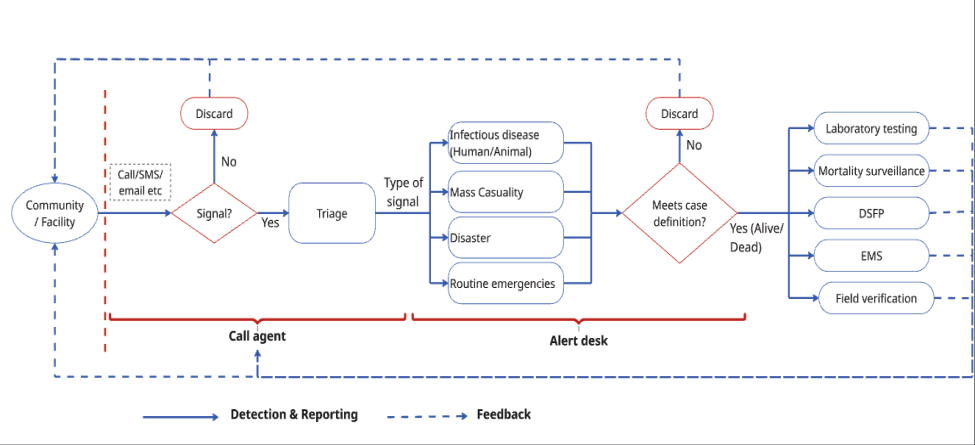

*Figure 11: Data flow using a hotline*

## Chapter 8: Cross-Border Event-Based Surveillance

### 8.1 Rationale

Uganda shares borders with six countries: the Democratic Republic of Congo (DRC), South Sudan, Kenya, Tanzania, Rwanda, and Burundi. Its geographic position at the intersection of East and Central Africa, combined with high volumes of cross-border trade, refugee and IDP movements, and shared ecological zones, creates substantial risk for transboundary transmission of priority diseases. Past cross-border transmission events involving Ebola, Marburg, cholera, mpox, and plague underscore the strategic importance of cross-border EBS.

IHR (2005) Article 44 obligates State Parties to collaborate with each other and with WHO in detecting, assessing, and responding to events that may constitute a PHEIC. Cross-border EBS operationalizes this obligation at the sub-national level, enabling prompt signal sharing and joint response coordination before events escalate.

### 8.2 Key elements of Cross-Border EBS

#### 8.2.1 Border district EBS Focal Persons

Each district bordering a neighboring country designates a cross-border EBS focal person responsible for maintaining regular communication with their counterpart in the neighboring country, sharing signals meeting the cross-border notification threshold, and participating in joint verification and risk assessment activities.

#### 8.2.2 Harmonized Case Definitions and Signal Lists

Uganda works with neighboring countries through the East African Community (EAC) Health and Africa CDC to adopt harmonized case definitions for priority cross-border diseases and a shared list of cross-border notification signals.

#### 8.2.3 Points of Entry (POE) Surveillance

Health surveillance at official points of entry including border crossings, airports, and ports is a core IHR requirement. EBS focal persons at POEs are trained to identify signals of unusual health events in travelers and immediately notify the national EBS system.

#### 8.2.4 Joint Risk Assessment and Response

When a signal is detected with potential cross-border implications, joint risk assessment teams comprising representatives from both countries are activated. Response actions are coordinated jointly and communicated to WHO and Africa CDC as appropriate.

#### 8.2.5 Information Sharing Protocols

Clear protocols govern what information is shared, at what risk threshold, through which channels, and within what timeframe. These protocols balance transparency with the confidentiality requirements of IHR and national data protection legislation.

## Chapter 9: Data Management in Event-Based Surveillance

### 9.1 Introduction

Data management in Event-Based Surveillance involves collecting, storing, processing, analyzing, and sharing information throughout the EBS cycle. High-quality data underpin sound risk assessment, evidence-based decisions, and accountability [14]. In Uganda's EBS system, data are generated at every step from signal detection to alert generation. Effective data management captures, stores, processes, and shares data accurately and securely, enabling decision-makers across the health system. With signals coming through community reports, hotlines, media, and facility alerts, standardizing data practices is vital for consistency, comparability, and efficiency.

### 9.2 Data collection

Standardized data collection tools are used at each stage of EBS. The minimum dataset for a signal includes:

1.  Date and time of detection and reporting.

2.  Geographic location (district, sub-county, village or facility name).

3.  Hazard type (infectious disease, zoonotic, chemical/CBRNe, environmental, food safety, other).

4.  Brief description of the unusual occurrence.

5.  Source of the signal (community, facility, hotline, media, cross-border).

6.  Estimated number of affected persons or animals.

7.  Name and contact of the reporter.

As signals progress through triage, verification, and risk assessment, additional data fields are completed, including the outcome of each step, the rationale for decisions made, and any response actions initiated.

Data collection tools in Uganda’s EBS system include the Signal Register at the district and PHEOC levels, the Verification Form, the Risk Assessment Worksheet, and the Alert Report Form. These tools are available in both electronic and paper formats to accommodate varying levels of digital infrastructure across the country. Electronic data collection is facilitated through the integrated EBS database hosted within the PHEOC, which allows real-time data entry, validation, and retrieval.

The current data management tools in Uganda's EBS are:

1.  Electronic Integrated Disease Surveillance and Response System (eIDSR)

2.  U-Report

3.  Call Centre Customer Relationship Management (CRM) system at the Ministry of Health

4.  Electronic Public Health Event Management System (ePHEM)

5.  Uganda Health Alert System

6.  Event Mobile Application (EMA-i) used in the animal health sector

7.  National Integrated Food & Agricultural Management Information System (NIFAMIS)

8.  Wildlife Disease Surveillance and Monitoring System (WDSMS)

9.  Water and Environment Information System (WEIS).

Uganda uses a hybrid EBS data management system that integrates guideline reporting with electronic platforms. The eIDSR (via the 6767 SMS platform), U-Report (through the 8500 SMS), the Uganda Health Alert System (accessible at alerts.health.go.ug), and the call center CRM facilitate signal logging. The EMA-i, the WDMS and WEIS perform similar functions in the animal, wildlife and water and environment sectors.

In the animal health sector, community members, such as farmers, use various communication modalities, including phone calls, SMS, and word of mouth, to report signals to subcounty-level officers. This officer may be a Veterinary Officer, Animal Husbandry Officer, or Assistant Veterinary Officer. Following the triage of the signal, the officer escalates it by entering it into the phone-based ‘Event Mobile Application- EMA-i’ system, which can be accessed by the facility-level official (farmer) at the subcounty. The information is subsequently relayed to the next level within the Veterinary Health System and can be viewed at the district and national levels.

### 9.3 Data Storage and Security

All EBS data must be stored securely to protect the confidentiality of reporters, communities, and individuals identified in signals. Electronic data are stored in password-protected databases with role-based access controls that restrict access to authorized personnel only [15]. Data are backed up regularly to prevent loss, and server infrastructure complies with national data protection and privacy standards. Paper-based records are kept in locked storage at district health offices and PHEOCs and are retained for a minimum of five years in accordance with national health records management guidelines. Personal identifiers are anonymized or pseudonymized where possible to protect the privacy of individuals while preserving the epidemiological utility of the data.

### 9.4 Data Processing and Analysis

Data processing involves the cleaning, validation, and organization of raw EBS data to prepare them for analysis. Designated data managers at district health offices and PHEOCs are responsible for reviewing incoming data for completeness, consistency, and accuracy. Duplicate records are identified and resolved, missing fields are flagged, and data are coded according to standardized classifications for event type, hazard category, geographic location, and risk level.

Analysis of EBS data is conducted on a routine basis to detect trends, identify geographical clusters of signals, evaluate the performance of the surveillance system, and generate insights for response planning [16]. Descriptive analysis is the primary approach, examining the distribution of signals by time, place, and type of hazard. Signal-to-event conversion rates, verification timeliness, and risk assessment completion rates are calculated as routine performance indicators. When appropriate, spatial analysis tools are used to map the geographic distribution of events and identify areas with concentrated signal activity. Findings from data analysis are summarized in weekly, monthly, and quarterly reports disseminated to relevant stakeholders.

### 9.5 Data flow and reporting

The flow of EBS data mirrors the flow of signals within the surveillance system. At the community level, VHTs and facility focal persons record signals in paper registers and transmit the information verbally or via SMS to district health offices or PHEOCs. At the district level, surveillance officers enter data into the EBS database and generate district-level signal summaries. At the national PHEOC, data from all districts are consolidated, analyzed, and incorporated into national situation reports and dashboards.

Routine data reporting follows a defined schedule: district health offices submit weekly EBS summaries to the National and Regional PHEOC every Monday, and the national PHEOC publishes a consolidated EBS situation report every two weeks. Emergency reports are generated as needed when high-risk or very high-risk events are detected. Data are also shared with regional and international partners—including WHO, Africa CDC, and relevant United Nations agencies—in accordance with IHR notification requirements and established data-sharing agreements.

### 9.6 Data Quality Assurance

Data quality in EBS is maintained through accuracy (training and continuous mentorship), completeness (data validation rules within collection tools), timeliness (signals triaged within 24 hours; verified within 24 hours; risk assessed within 48 hours), consistency (standardized tools and procedures across all levels), and validity (structured triaging and verification processes to filter noise). Periodic data quality audits are conducted at district, regional, and national levels.

Details of action taken to improve data quality are as follows:

#### 9.6.1 Accuracy

1.  Training of users on data to collect and how to use data management tools correctly.

2.  Continuous mentorship to reduce errors and ensure reliable data capture.

3.  Periodic spot checks, cross-validation, and supervision to maintain accuracy.

#### 9.6.2 Completeness

1.  Ensuring required data elements are collected through proper training and tool usage.

2.  Incorporate data validation rules within collection tools to prevent missing information.

3.  Routine data cleaning and vetting by district and national analysts to address gaps.

#### 9.6.3 Timeliness

1.  Signals triaged and verified within 24 hours.

2.  Risk assessments completed within 48 hours.

3.  Prompt data flow across all levels of the EBS system to enable early response.

#### 9.6.4 Consistency

1.  Standardized data collection procedures across all levels of EBS.

2.  Use of the same validated tools and rules to ensure uniformity.

3.  Regular mentorship and supervision to harmonize practices among EBS personnel.

#### 9.6.5 Validity

1.  Data collection tools embedded with validation rules to confirm authenticity of entries.

2.  Cross-checking and verification by analysts to ensure data reflects actual events.

3.  Structured triaging and verification processes to filter false signals and confirm real events

### 9.7 Analysis and Visualization

Analysts at the National and Regional PHEOCs scrutinize data for trends and patterns that could signal a potential public health threat. They will also look out for specific indicators to assess the system's performance. These indicators will be routinely collected from all reporting sectors, and automatically captured by the ePHEM system, and many include;

1.  Number of signals per syndrome or event type

2.  Signal detection to verification time,

3.  Percentage of verified signals,

4.  Risk assessment completion rates

Monitoring of IBS data from the different sectors will also be conducted to detect when thresholds have been exceeded. Collected data will be visualized on the EBS dashboard both at the national and regional levels. Analysts will use these dashboards to:

1.  Compare current data to historical baselines to identify unusual clusters of similar reports or spikes in specific syndromes.

2.  Assess geographical spread by mapping signals to identify areas with high reporting activity or unusual event clusters.

3.  Monitor performance indicators against established benchmarks (24 hours for triage and verification within 24 hours, and risk assessment within 48 hours).

### 9.8 Data Storage and Security

All EBS data are stored securely within the respective systems of One Health stakeholders, with each institution retaining responsibility for managing its own data. Electronic data are stored in password-protected databases with role-based access controls, two-factor authentication strongly recommended, end-to-end encryption, and regular backups. Paper-based records are retained for a minimum of five years at district health offices and PHEOCs. Personal identifiers are anonymized or pseudonymized in shared datasets.

All externally shared data is anonymized and encrypted to ensure confidentiality and trust. Regular backups are conducted to safeguard against data loss and ensure continuity of surveillance across human, animal, wildlife, and environmental health systems.

### 9.9 Reporting and Feedback

EBS data are disseminated through: weekly epi-bulletins (National and Regional PHEOC); Spot Reports (SpotReps) for high and very high-risk events; quarterly performance review reports; and annual IHR compliance reports (SPAR, JEE contributions). Data are shared with national, regional, and international partners including WHO, Africa CDC, and relevant UN agencies in accordance with IHR notification requirements and established data-sharing agreements.

### 9.10 Ethical considerations for data management in Uganda

Ethical management of EBS data is crucial for fostering public trust and ensuring effective surveillance. Confidentiality and privacy are preserved by safeguarding personally identifiable information (PII) through stringent security measures and anonymization protocols. Compliance with Uganda’s data protection legislation, Ministry of Health regulations, and national ethical standards is rigorously maintained. EBS upholds participant autonomy by honoring voluntary participation, with individuals retaining the right to decline or withdraw without repercussions. The responsible utilization of data is ensured by limiting data use solely to public health objectives and preventing misuse or stigmatization. Accountability and transparency are reinforced through the implementation of stringent oversight mechanisms and ethical review processes, thereby ensuring responsible data management.

## Chapter 10: Monitoring and Evaluation

### 10.1 Introduction

Monitoring and Evaluation (M&E) of the EBS system is the ongoing process of tracking progress, assessing performance, and identifying gaps to enable continuous improvement. Monitoring is the process of continuously tracking progress or delay in inputs, activities, outputs, and outcomes of the EBS [17]. A robust M&E system provides the evidence base for national EBS performance reporting, NAPHS II implementation tracking, and IHR compliance documentation.

### 10.2 Objectives of the EBS M&E

1.  Track performance of EBS activities at community, district, regional, and national levels against established benchmarks and targets.

2.  Assess the quality and timeliness of signal detection, triage, verification, risk assessment, and alert generation.

3.  Identify gaps in EBS implementation and guide corrective actions, including targeted training, supervision, and resource mobilization.

4.  Evaluate the impact of EBS on early warning and response outcomes.

5.  Contribute to JEE, SPAR, and Africa CDC Benchmarks reporting on national surveillance performance.

### 10.3 Key Performance Indicators

EBS performance is measured using ten standardized KPIs aligned with WHO IHR core capacity C2 indicators and Africa CDC EBS Framework benchmarks. Baseline values for each indicator will be established during the initial 12-month implementation period following national rollout.

_Table 4: EBS indicators, description, target and frequency_

|  No | Indicator | Description | Target | Frequency |
| ---: | --- | --- | --- | --- |
|   1 | Signal detection rate | Number of signals detected per reporting period, disaggregated by source and level. | Trend | Monthly |
|   2 | Timeliness of reporting | Proportion of signals reported to PHEOC/DHO within 24 hours of detection. | >80% | Monthly |
|   3 | Triage completion rate | Proportion of detected signals that undergo formal triage within 24 hours. | >90% | Monthly |
|   4 | Verification timeliness | Proportion of triaged signals verified within 12 hours (High) / 24 hours (Med/Low). | >80% | Monthly |
|   5 | Signal-to-event conversion rate | Proportion of verified signals classified as events requiring risk assessment. | Baseline TBD | Quarterly |
|   6 | Risk assessment completion rate | Proportion of confirmed events for which a formal risk assessment is completed. | >90% | Monthly |
|   7 | Alert timeliness | Time from risk assessment completion to alert issuance for High/Very High events. | < 6 hours | Monthly |
|   8 | EBS focal person coverage | Proportion of facilities, districts, and border posts with at least one trained, active EBS focal person. | >90% | Quarterly |
|   9 | Community reporting rate | Number of community-source signals per district per month (proxy for community engagement). | Trend / increase | Monthly |
|  10 | Feedback provision rate | Proportion of signal reporters and DHOs receiving feedback within agreed timeframe. | >80% | Monthly |

### 10.4 Evaluation Approaches

Evaluation of the EBS system is conducted at planned intervals to assess whether the system as a whole is meeting its intended objectives. Evaluation methods include assessments of system attributes, after-action reviews (AARs), and simulation exercises (SimEx) [18]. System attribute assessments evaluate EBS performance against attributes like simplicity, flexibility, data quality, acceptability, sensitivity, positive predictive value, representativeness, timeliness, and stability. Conducted every three to five years or after major changes, they guide system redesign. After-action reviews (AARs), held within 72 hours of an event, involve stakeholders reviewing what happened, what worked, what didn't, and needed actions. EBS components reviewed include signal detection timeliness, verification quality, communication effectiveness, and alert adequacy. Lessons are documented and tracked in action plans. Simulation exercises test responsiveness from signal detection to response activation, involving community to national levels. They identify gaps in procedures, communications, and capacity, informing training, procedures, and resource planning.

#### 10.4.1 Process Monitoring

Continuous tracking of EBS implementation activities using data from EBS registers, ePHEM, and district monthly reports. Monthly district performance summaries and national performance dashboards are produced by the NPHEOC.

#### 10.4.2 System Attribute Assessment

A comprehensive assessment of the EBS system against eleven system attributes: simplicity, flexibility, data quality, acceptability, sensitivity, positive predictive value, representativeness, timeliness, stability, usefulness, and cost. System attribute assessments are conducted every three to five years or following major system changes or outbreak events.

### 10.5 After-Action Reviews

AARs are structured reviews conducted within 72 hours of the conclusion of a public health event response. They involve all stakeholders who participated in the detection and response, examining: signal detection timeliness; verification quality; risk assessment accuracy; alert adequacy; communication effectiveness; and response coordination. Lessons are documented and tracked in formal action plans.

### 10.6 Simulation Exercises

Simulation Exercises (SimEx) test EBS responsiveness from signal detection through to response activation at community, district, regional, and national levels. They identify gaps in procedures, communication systems, and staff capacity, informing targeted training and system improvement. A national EBS SimEx will be conducted within 12 months of the adoption of official guidelines.

### 10.7 Supportive Supervision

District Surveillance Focal Persons conduct quarterly supervisory visits to all facilities, focusing on SFP adherence to standard operating procedures, the quality of signal documentation, the completeness of the EBS register, and the maintenance of community feedback loops. Findings are documented in structured supervision forms and submitted to the NPHEOC for national aggregation.

### 10.8 Feedback and Learning

A robust M&E system generates actionable data that feeds into EBS operations through continuous learning loops. Performance feedback is shared at all levels from the NPHEOC to DHOs, from DHOs to facility SFPs, and from SFPs to VHTs and communities via reports, WhatsApp updates, community meetings, and radio. Achievements are recognized and gaps addressed through targeted support and supervision. An annual review meeting, convened by MoH with district health officers, partners, and community representatives, provides a platform to share lessons, review performance, and set priorities for the coming year.

## References

1.  Alahmari AA, Almuzaini Y, Alamri F, Alenzi R, Khan AA. Strengthening global health security through health early warning systems: A literature review and case study. _J Infect Public Health_. 2024;17:85-95. doi:10.1016/j.jiph.2024.01.019

2.  Masiira B, Nakiire L, Kihembo C, et al. Evaluation of integrated disease surveillance and response (IDSR) core and support functions after the revitalisation of IDSR in Uganda from 2012 to 2016. _BMC Public Health_. 2019;19(1):1. doi:10.1186/s12889-018-6336-2

3.  Mugasha R, Kwiringira A, Ntono V, et al. Scaling Up and Enhancing the Functionality of the Electronic Integrated Diseases Surveillance and Response System in Uganda, 2020-2022: Description of the Journey, Challenges, and Lessons Learned. _JMIR Public Health Surveill_. 2025;11(1):e59783. doi:10.2196/59783

4.  Zavuga R, Migisha R, Kabami Z, et al. Event-Based Surveillance Reporting by Village Health Teams, Kabarole District, Uganda, July 2022  March 2023: A Cross-Sectional Stud. Preprint posted online 2024. doi:10.21203/rs.3.rs-3983926/v1

5.  World Health Organization, 2016. _International Health Regulations (2005), 3rd Ed. World Health Organization._ 3rd ed. World Health Organization; 2016. Accessed June 28, 2022. https://apps.who.int/iris/handle/10665/246107

6.  Technical Guidelines for Integrated Disease Surveillance and Response in the African Region: Third edition | WHO | Regional Office for Africa. April 21, 2026. Accessed April 21, 2026. https://www.afro.who.int/publications/technical-guidelines-integrated-disease-surveillance-andresponse-african-region-third

7.  Zaghloul A, Balajee A, Varma J, Idowu R, Merali S. Africa CDC Event-based Surveillance Framework. November 2018. Accessed April 21, 2026. https://stacks.cdc.gov

8.  _One Health Joint Plan of Action, 2022–2026_. FAO; UNEP; WHO; World Organisation for Animal Health (WOAH) (founded as OIE); 2022. doi:10.4060/cc2289en

9.  Sendai Framework for Disaster Risk Reduction 2015 - 2030.

10. Uganda launches second National Action Plan for Health Security | WHO | Regional Office for Africa. December 12, 2024. Accessed April 21, 2026. https://www.afro.who.int/countries/uganda/news/uganda-launches-second-national-action-planhealth-security

11. World Health Organization. Rapid risk assessment of acute public health events. 2012. Accessed April 21, 2026. https://iris.who.int/server/api/core/bitstreams/53e9bf3f-55f6-412bb90a-1ec37abd36e0/content

12. European Centre for Disease Prevention and Control. _Operational Tool on Rapid Risk Assessment Methodology: ECDC 2019._ Publications Office; 2019. doi:10.2900/104938

13. Food and Agriculture Organization  (WHO)., World Organization for Animal Health, World Health Organization. Joint Risk Assessment Operational Tool: A Tripartite tool for conducting joint qualitative risk assessment of zoonotic diseases. 2020. doi:ISBN: 978-92-5-132192-8

14. Choi BCK. The past, present, and future of public health surveillance. _Scientifica_. 2012;2012:875253. doi:10.6064/2012/875253

15. Gostin LO, Friedman EA. A retrospective and prospective analysis of the west African Ebola virus disease epidemic: robust national health systems at the foundation and an empowered WHO at the apex. _The Lancet_. 2015;385(9980):1902-1909. doi:10.1016/S01406736(15)60644-4

16. Thacker SB, Berkelman RL. Public health surveillance in the United States. _Epidemiol Rev_. 1988;10:164-190. doi:10.1093/oxfordjournals.epirev.a036021

17. Crawley AW, Mercy K, Shivji S, et al. An indicator framework for the monitoring and evaluation of event-based surveillance systems. _Lancet Glob Health_. Published online 2024. doi:10.1016/S2214-109X(24)00034-2

18. Timen A, Koopmans MPG, Vossen ACTM, et al. Response to imported case of Marburg hemorrhagic fever, the Netherland. Emerg Infect Dis. 2009;15(8):1171-1175. doi:10.3201/eid1508.090015

## Annexes

The following annexes support the implementation of these guidelines:

| Annex | Content |
| --- | --- |
| Annex I | Facility EBS Signal List: Priority signals for human health, veterinary, and environmental facilities. |
| Annex II | Community EBS Signal List: Non-prescriptive guide for VHTs and community reporters (English and local language versions). |
| Annex III | EBS Monitoring and Evaluation Framework: Theory of change, outputs, outcomes, and impact indicators. |
| Annex IV | EBS Signals Reporting Forms: Standard formats for signal reporting |

### For Technical Enquiries

- Department of Integrated Epidemiology, Surveillance and Public Health Emergencies (IES&PHE)

- Ministry of Health, Plot 6 Lourdel Road, Nakasero, Kampala, Uganda

- Email: alerts@health.go.ug | Tel: +256 414 340 872

- Uganda Health Alert System: alerts.health.go.ug

- Emergency Hotline: 0800100066 (Toll-free) | SMS: 8500, or 6767

### Annex I: Facility EBS Signal List

#### Human Health

| Code | Signal |
| --- | --- |
| FH1 | Occurrence of one or more cases or deaths of a strange, unusual or unexplained disease, based on the clinician’s professional judgement |
| FH2 | One or more health care worker(s) with severe illness after attending to patients with similar symptoms |
| FH3 | Unexpectedly large increase of cases of similar symptoms based on the clinician’s professional judgement |
| FH4 | Two or more cases of infectious diseases with the same symptoms and from the same location (e.g. health facility, household, residential unit, school or factory) |
| FH5 | Occurrence of unexplained or unusual clinical manifestation of a known infectious disease or treatment response based on the clinician’s professional judgement. |
| FH6 | Unusual laboratory findings (e.g. increase in positivity rate, new strain, resistance profiles, etc.) |
| FH7 | Unexpected increase in people presenting with animal bites from the same community |
| FH8 | Two or more people with a history of recent travel, presenting with similar symptoms |

#### Animal Health

| Code | Signal |
| --- | --- |
| FA1 | A cluster of animal deaths |
| FA2 | A cluster of animals presenting with unusual signs or behaviors (e.g. aggression, bleeding, dizziness, weight loss, isolation from other animals, diarrhea, body swellings, limpness, loss of hair, coughing, excessive drooling, blindness) |
| FA3 | A cluster of animals exhibiting production losses (e.g. milk, eggs, abortions) |

**Note:** For endangered species, only one animal needs to be affected for this to be considered a signal.

#### Environment

| Code | Signal |
| --- | --- |
| FE1 | Unusual change in physical water quality parameters of drinking water sources (e.g. color, taste, odor, suspended solids, turbidity) |
| FE2 | Sudden increase in average atmospheric temperature noticed for two consecutive days |

### Annex II: Community EBS Signal List

#### Human Health

| Code | Signal |
| --- | --- |
| CH1 | Unexplained bleeding from any part of the body in a person of any age. |
| CH2 | A child below the age of 15 years with sudden onset of weakness in any one of the limbs. |
| CH3 | Anyone with fever and rash. |
| CH4 | Any occurrence of unusual signs, symptoms or deaths. |
| CH5 | Two or more persons with similar signs and symptoms in the same location (i.e. school, village, workplace, prison, country, region, etc.). |
| CH6 | Sudden death in an apparently healthy individual. |
| CH7 | Anyone with three or more watery stools in 24 hours. |
| CH8 | Respiratory symptoms with fever in any person who has recently traveled abroad in the last 14 days. |
| CH9 | Anyone who gets severe symptoms following vaccination. |
| CH10 | Unusual numbers of children absent from the same school or class due to the same illness. |
| CH11 | Unusually high number of people from the same location buying drugs for the same illness from a drug shop. |

#### Animal Health

| Code | Signal |
| --- | --- |
| CA1 | Sudden death of an animal. |
| CA2 | Any animal presenting with unusual signs or behavior (e.g. aggression, bleeding, dizziness, weight loss, isolation from other animals, diarrhea, body swellings, limpness, loss of hair, coughing, excessive drooling, blindness). |
| CA3 | Any animal with a loss in production (e.g. milk, eggs, abortions). |

#### Environment

| Code | Signal |
| --- | --- |
| CE1 | Massive growth of algal bloom (green growth) or water weeds in water bodies, e.g. lakes, rivers or streams. |
| CE2 | Improper waste disposal, leakage or spillage on land, in air or water bodies. |
| CE3 | Unusual change in physical water quality parameters of drinking water sources (e.g. color, taste, odor, suspended solids, turbidity). |
| CE4 | Occurrence of an environmental hazard, e.g. flood, landslide, earthquake, frequent and more intense earth vibrations, release of gasses, cracks on the ground. |
| CE5 | Unexplained death of aquatic animals (e.g. fish, hippos, etc.). |
| CE6 | Reported outbreak of water-related diseases in a health facility. |
| CE7 | Sudden increase in average atmospheric temperature noticed for two days. |

### Annex III: Monitoring and Evaluation Plan

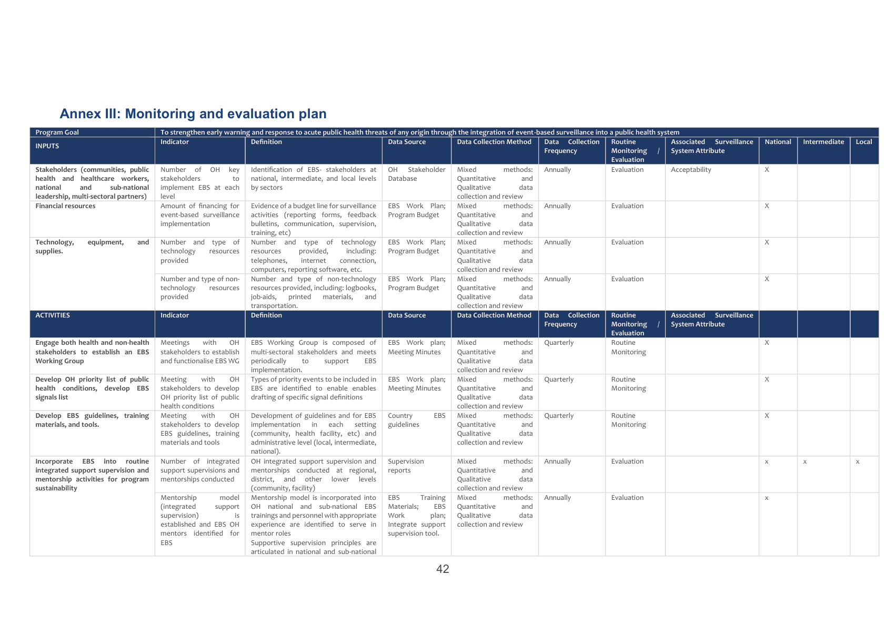

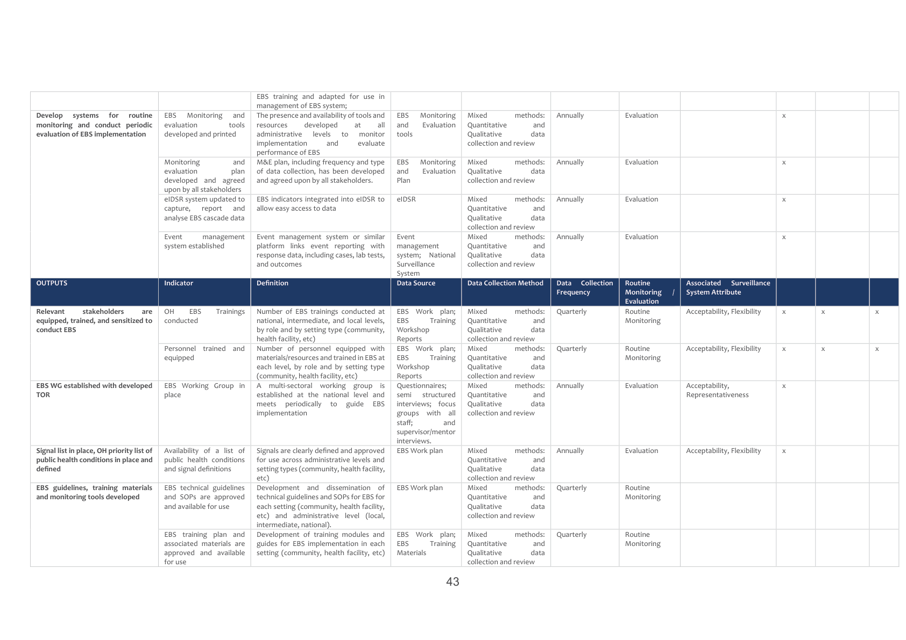

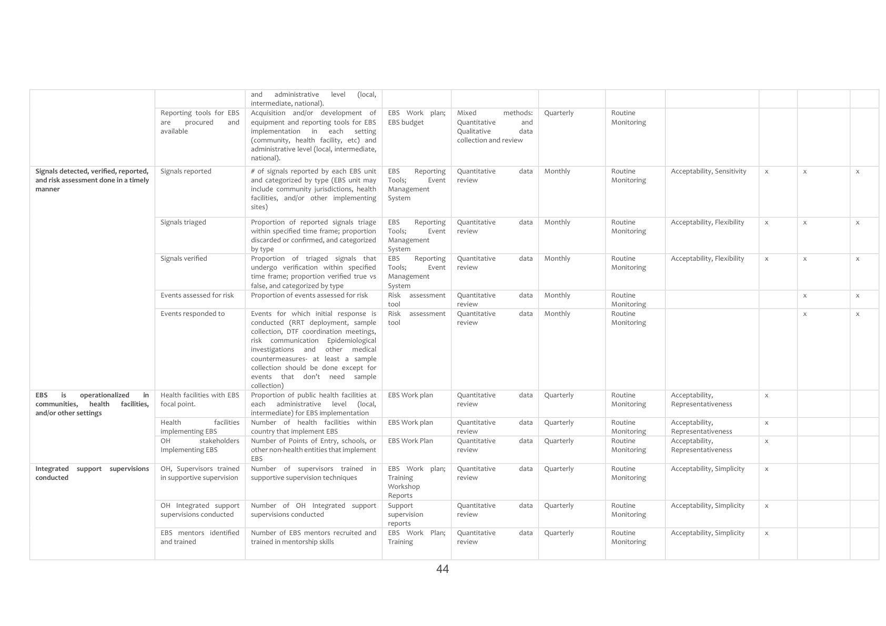

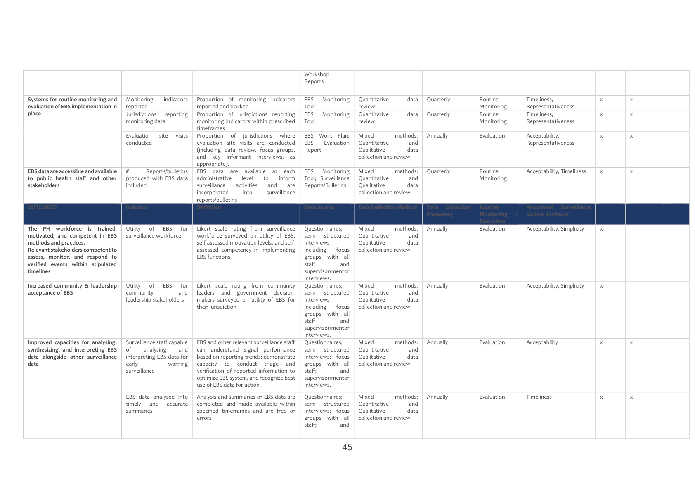

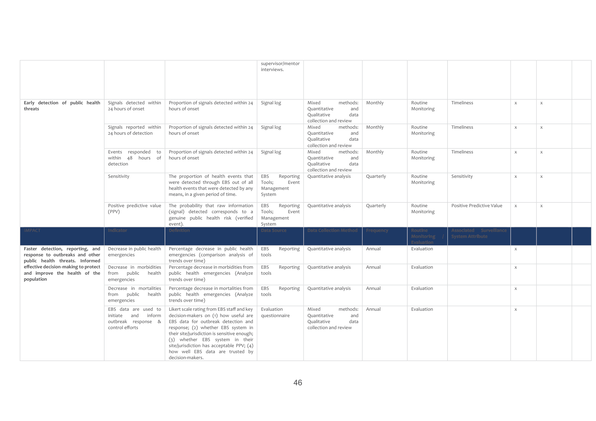

### Annex IV: Signal Reporting Tool

#### Signal Reporting Form

##### General Information

| Field | Entry |
| --- | --- |
| Name of reporter |  |
| Telephone |  |
| Name of CHV Supervisor |  |
| Telephone |  |

**Instructions:** When you detect one or more signals in your community, please report immediately to your local-level supervisor. Use this notebook to record the following information and communicate to the local-level supervisor.

| Field | Entry |
| --- | --- |
| Date the signal began |  |
| Date the signal was detected |  |
| Description of the signal, including number of people / animals affected |  |
| Location of the signal |  |

##### Actions

| Field | Entry |
| --- | --- |
| Signal reported to supervisor |  |
| Date reported to supervisor |  |
| Logged on system or Sent 6767, 8500, sms |  |

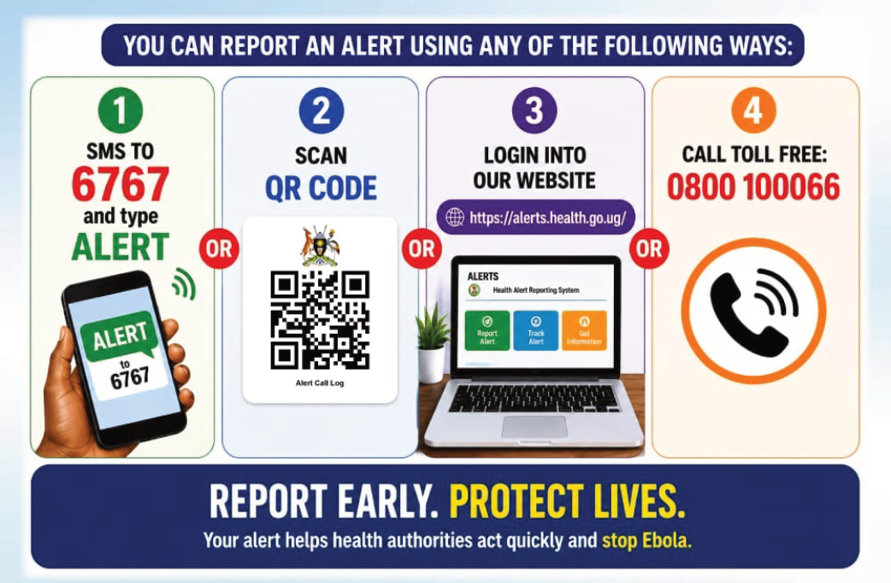
